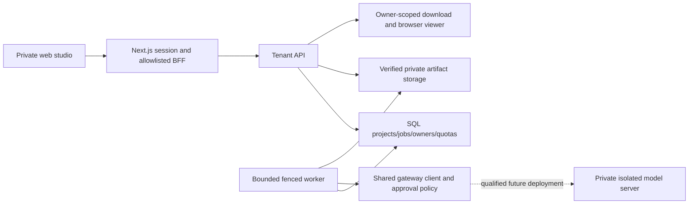

# Build 3D AI — Project Status, File Guide and Implementation Tasks

**Owner handoff · 17 November 2026 · source baseline: `8d09e3b6268d01bf7b3d2aa468ac537a7d80ae35`.** This is the practical starting point for the next implementation tool and its reviewers. It consolidates current source, existing project plans and the latest local validation; it does not restart the project or turn research into shipped features. Re-fetch `main`, inspect open PRs and check the actual source before choosing a task. The containing documentation commit can be identified through Git history.

The [adopted main project goal](docs/project/BUILD_3D_AI_PROJECT_IDEA.txt) remains the product direction. This file explains what exists, what remains, how to continue and what each repository file/folder does. The [structure guide](PROJECT_STRUCTURE.md), [feature ownership map](docs/project/FEATURE_MAP.md), [56 responsibility cards](AnalyseFuture/repository-inventory/FEATURE_REGISTRY.json) and [continuity handbook](docs/continuity/PROJECT_MEMORY_MASTER.md) supply supporting detail. The 56 cards are workstreams, not 56 shipped features.

## Contents

1. [Main goal and first milestone](#main-goal-and-first-milestone)
2. [Implemented features and their limits](#implemented-features-and-their-limits)
3. [Missing features and technical limits](#missing-features-and-technical-limits)
4. [How the components work together](#how-the-components-work-together)
5. [Task dispatch and dependencies](#task-dispatch-and-dependencies)
6. [Backend and model-qualification tasks](#backend-and-model-qualification-tasks)
7. [Web studio tasks](#web-studio-tasks)
8. [Platform, release and review tasks](#platform-release-and-review-tasks)
9. [Later product capabilities](#later-product-capabilities)
10. [Validation and safe development commands](#validation-and-safe-development-commands)
11. [Pull request workflow and monitoring](#pull-request-workflow-and-monitoring)
12. [Copyable assignment for the next tool](#copyable-assignment-for-the-next-tool)
13. [Every-folder guide](#every-folder-guide)
14. [Every-file guide](#every-file-guide)

## Main goal and first milestone

Build an independently controlled commercial AI 3D creation studio: permitted image/text inputs become reusable, editable, textured assets with private projects, reliable jobs, artist controls and validated exports. Compete through measured quality, useful control and accepted-asset cost. The longer-term differentiator is consistent stylized adult characters and reusable environments for real Blender animation, including body and facial performance.

Keep the existing API, durable worker, identity foundation, storage, approval policy, GLB validation and studio. Reuse reviewed libraries behind these boundaries. The owner controls first-party product code, brand and operations; third-party code, weights and data retain their own rights and notices.

**The next product milestone is one genuine, narrowly supported image → textured GLB → private product download → browser viewer → Blender import workflow.** Record the exact model/runtime/weights, supported inputs, failures, hardware, latency, VRAM, quality from several views and total cost. A working form, synthetic triangle GLB, static image or model-serving interface does not complete this milestone. Text generation is a separate acceptance path; if implemented as text → image → 3D, label it that way.

The immediate milestone may remain private. Public signup, payments, service reliability and account/data lifecycle are separate release requirements. No production model is currently approved; the default approved-model list is intentionally empty. This handoff authorizes no paid compute, training, large weight download or public deployment.

## Implemented features and their limits

“Implemented” below means code exists in the current product. “Locally verified” means a bounded software contract passed in the [17 November validation](AnalyseFuture/validation/2026-11-17/REPORT.md). Neither means deployed, legally cleared for every use, nor proven with a real generated asset.

| Feature | Current implementation | Evidence and practical limit |
|---|---|---|
| Private users and API keys | [API store](apps/api/src/build3d_api/store.py), [operator CLI](apps/api/src/build3d_api/cli.py): provision users, store key digests, revoke keys, enforce active ownership/rate windows | API ownership/authentication fixtures passed. Current browser login requires an operator-issued user key; public signup/reset is absent. |
| Private projects and persisted history | [API routes](apps/api/src/build3d_api/main.py), SQL-backed [store](apps/api/src/build3d_api/store.py), [studio](apps/web/src/features/studio/components/studio.tsx) | Backend bounded pagination exists. The UI currently requests the first 100 projects/jobs. |
| Text/image job admission | [routes](apps/api/src/build3d_api/main.py), [image normalization](apps/api/src/build3d_api/images.py), [store](apps/api/src/build3d_api/store.py) | Idempotency/conflict, owner, concurrency and active-job limit tests passed. Admission is not model inference. |
| Bounded upload handling | API [ASGI body limit](apps/api/src/build3d_api/body_limit.py), Pillow normalization, shared web [stream reader](apps/web/src/lib/server/request-body.ts) | Web login/product limits are 8 KiB/12 MiB, including unknown-length streams. The separate operator gateway needs its own preparse improvement. |
| Durable fenced execution | [worker](apps/api/src/build3d_api/worker.py), transactional claims/transitions in [store](apps/api/src/build3d_api/store.py) | Leases, fencing, recovery, safe polling retries and uncertain-submit quarantine are tested with synthetic upstreams. No real GPU job is established. |
| Conservative reconciliation | [CLI](apps/api/src/build3d_api/cli.py) and [worker](apps/api/src/build3d_api/worker.py) | Ambiguous non-idempotent submissions require reconciliation, rather than blind POST retries. End-to-end upstream cancellation is not implemented. |
| Versioned database schema | [database layer](apps/api/src/build3d_api/db.py), four [Alembic versions](apps/api/src/build3d_api/migrations/versions/) | SQLite and isolated PostgreSQL suites, repeat migration and wheel-content checks passed. Billing/asset versions/team schemas are future work. |
| Exact model-approval policy | [policy](apps/gateway/src/build3d_gateway/model_policy.py), [empty defaults](apps/gateway/src/build3d_gateway/model-approvals.json) | Unknown/unapproved models fail closed. Metadata is operator attestation, not independent legal clearance. |
| Private upstream gateway | [operator app](apps/gateway/src/build3d_gateway/main.py), shared [upstream client](apps/gateway/src/build3d_gateway/upstream.py) | Authenticated catalog/status/upload/generation/download contracts tested against fixtures. This is not a bundled, running AI model server. |
| Bounded GLB preflight | [validator](apps/gateway/src/build3d_gateway/glb_validation.py), [downloader](apps/gateway/src/build3d_gateway/download.py) | Structural/chunk/resource/checksum contracts passed. Decoded-resource/extension policy and real downstream artist acceptance remain incomplete. |
| Private artifact storage | [filesystem/S3 abstraction](apps/api/src/build3d_api/storage.py) and owner-scoped API downloads | Filesystem checks and synthetic S3-client tests passed. No real bucket qualification or public asset URL is implied. |
| Persistent storage quota | [store](apps/api/src/build3d_api/store.py), [quota migration](apps/api/src/build3d_api/migrations/versions/0003_storage_quota.py), [studio](apps/web/src/features/studio/components/studio.tsx) | Atomic byte enforcement, used/remaining display and near/over-limit guidance exist. Storage limits do not impose a dollar GPU spending cap. |
| Read-only consistency inventory | [maintenance](apps/api/src/build3d_api/maintenance.py), [storage](apps/api/src/build3d_api/storage.py), [CLI](apps/api/src/build3d_api/cli.py) | Orphan/missing/inconsistent classification exists. Filesystem candidate discovery can grow before the report limit; it is not a full content audit. |
| Copy-only storage migration | [migration](apps/api/src/build3d_api/migration.py) | Dry-run/default, checksum/GLB verification and repeat-safe copies are tested. It does not delete source files or automatically switch storage configuration. |
| External identity foundation | Immutable issuer/subject mapping in [store](apps/api/src/build3d_api/store.py), [JWT/JWKS verifier](apps/api/src/build3d_api/trusted_identity.py), [provider example](config/identity/providers.example.json) | Asymmetric trusted-provider validation and rate limits are tested; optional external authentication remains disabled by default. Browser provider lifecycle is not delivered. |
| Private browser session/BFF | [session route](apps/web/src/app/api/session/route.ts), [allowlisted proxy](apps/web/src/app/api/product/%5B...segments%5D/route.ts), [server helper](apps/web/src/lib/server/product-api.ts) | HttpOnly SameSite user-key cookie, method/path/query restriction, configured backend, private response handling and bounded request bodies exist. This is not complete public identity. |
| Studio workspace | [Studio](apps/web/src/features/studio/components/studio.tsx), [client](apps/web/src/lib/client/api.ts), [status presentation](apps/web/src/features/jobs/status.ts) | Login, create/open project, model state, text/image submission, persisted status/errors, quota and selection exist. Slow-poll cancellation and >100 history need repair. |
| Real browser GLB loading path | [viewer](apps/web/src/features/assets/components/model-viewer.tsx) | Owner-scoped product download, orbit/zoom/fit/reset, wireframe and mesh/triangle statistics exist. Browser acceptance uses a synthetic GLB; no real AI output/Blender quality claim. |
| Embedded-texture GLB packager | [textured_glb.py](apps/gateway/src/build3d_gateway/textured_glb.py) | Strict OBJ+baked-PNG conversion and generated-file contracts are tested. A filename is not a format conversion, and real bake orientation/material quality remains unverified. |
| Qualification source preparation | [prepare_runtime.py](services/generation/triposr_candidate/prepare_runtime.py), [manifest](services/generation/triposr_candidate/runtime_manifest.json) | Exact-source guards, local reviewed config/checkpoint path and dependency patching exist; fresh pinned source preparation/compilation passed. Candidate image, checkpoint execution and legal/data decision are still gates. |
| Dependency metadata auditor | [audit_pip_report.py](services/generation/triposr_candidate/audit_pip_report.py) | Nine synthetic auditor tests passed. Resolver-reported hashes/source-archive blockers are metadata, not independently verified wheel bytes or a release lock. |
| Explicit-spend smoke interface | [smoke.py](apps/gateway/src/build3d_gateway/smoke.py), [GPU runbook](docs/operations/FIRST_REAL_GPU_RUNBOOK.md) | CLI/protocol fixtures and help entrypoint passed. No actual paid/GPU smoke run was performed. |
| CPU packaging and local development | [cloud helpers](scripts/cloud/), [Compose](infrastructure/compose/), two app Dockerfiles and [wheel verifier](scripts/packaging/check_api_wheel.py) | Both CPU images built/started nonroot, migrations and local API/studio flow passed. Managed CA build-secret adaptation retained TLS verification; this is not a production deployment. |
| Automated software checks | Four [.github/workflows](.github/workflows/), Python/JS/browser suites | 253 local test executions passed after fixing the Vitest alias. Local Python 3.12/Node 24 results do not establish every hosted Python/Node matrix result. |
| Preservation and provenance | [AnalyseFuture](AnalyseFuture/), [original-version records](AnalyseFuture/repository-inventory/PRESERVATION_RECORDS.json), [path mapping](AnalyseFuture/repository-inventory/FUNCTIONAL_PATH_MAPPING.json) | All 801 recorded originals were retained. Reference code is inactive and includes known limitations; preservation is neither malware classification nor integration approval. |

## Missing features and technical limits

| Area | What remains | Current status |
|---|---|---|
| Genuine generated assets | Qualified exact runtime/weights/data decision; actual inference, baked textured GLB, private download and downstream import proof | Release gate; not completed by the software tests |
| Text and multi-view generation | Real text pathway/provenance; genuine multi-image conditioning and benchmarks | Text admission exists; end-to-end generation and multi-view capability unverified/not implemented |
| Public accounts | Provider integration, browser trust path, verification, recovery, session rotation/logout, deletion and abuse handling | Private auth and API identity primitives exist; public lifecycle remains open |
| Creator UI completeness | Polling correctness, complete paginated history, wider accessibility/device and error-path coverage | Concrete implementation tasks below |
| Production operations | Staging rollout, secrets/TLS, real storage/restore, monitoring, incident response, load and failure drills | Local packaging exists; hosted acceptance not established |
| Billing and GPU economics | Auditable ledger, reservation/settlement/refund, payment webhooks, model-specific cost caps and reconciliation | Not implemented; rate/job/storage quotas are not payment or cash controls |
| Professional asset tools | Qualified PBR/UV/cleanup, retopology, local edits, format-specific export acceptance | Some packaging/research primitives exist; professional workflows need implementation/evidence |
| Rigging and facial performance | Body/skin/retarget, independent eyes/lids/brows/jaw/mouth, visemes and corrective deformation | Future work; inactive references are not an integrated rigging product |
| Asset versions, teams and scenes | Versions/lineage, memberships, collaborative ownership, semantic parts and editable scene graph | Project/job history and one-asset viewer are the foundation, not these features |
| Specialized models/training | Licensed dataset lineage, held-out evaluation, reproducible adaptation and measured improvement | No training or model-quality improvement is demonstrated |

Some expectations are intrinsically uncertain: one photo cannot uniquely reveal hidden geometry; arbitrary generated topology cannot guarantee production-ready facial deformation; a Gaussian splat is not an editable polygon scene; more polygons do not guarantee better topology; a one-/two-year AI roadmap cannot guarantee a research breakthrough. Use supported input envelopes, measured acceptance and human artist review. The [main idea](docs/project/BUILD_3D_AI_PROJECT_IDEA.txt) explains these limits and conditional future roles in detail.

## How the components work together



The product API owns tenant state and transactions. The gateway package owns reusable upstream/model-policy/GLB behavior; its separate operator HTTP app is not the browser's tenant API. The worker reuses the gateway client and same database/storage/policy. Python CPU packages, Next.js, and any future CUDA model runtime remain separate dependency environments. `AnalyseFuture/third_party/` is reference material, not an automatic runtime dependency. Do not replace the SQL queue or duplicate authentication/storage merely because an old upstream reference has similar features.

## Task dispatch and dependencies

All new cards start **open**, unless explicitly marked blocked. Existing code is credited above. Pick one bounded card per PR and identify it in the title/description. A card may need several PRs; close it only when its acceptance evidence is recorded.

Priority meanings: **P0** blocks its dependent release milestone; **P1** closes a concrete correctness/security/release gap; **P2** improves a supported product workflow; **P3** is conditional product research. Priority is not permission to spend or expose a service. “Ready on CPU” means implementation/fixture work can start without model execution. “Gated” means a named external decision/resource is needed before the dependent step.

**Recommended first assignment: `WEB-01`, the slow-poll cancellation/stale-result fix.** It is narrow, protects an existing workflow and needs no GPU. `WEB-02` pagination and the CPU-only prepared-source boundary task can proceed independently if they touch separate files and PRs. Do not have two tools rewrite Studio simultaneously; coordinate or rebase the second PR.

Two tracks can progress in parallel:

- **Software hardening:** polling → pagination → browser/BFF acceptance; storage/gateway/GLB resource bounds; reproducible release/deployment evidence.
- **Real asset proof:** closed prepared context → exact artifact/rights review → isolated runtime qualification → explicit bounded resource approval → real generation/packaging/private view/Blender evidence → measured pilot.

Public accounts, destructive data lifecycle and payments each need their own reviewed acceptance path before public/paid use. Advanced creator/model research follows a useful measured baseline, rather than blocking immediate CPU fixes.

### Work queue

These are proposed task IDs, not GitHub issue/PR numbers. None is marked accepted or merged by this document.

| Task | Current state | First bounded outcome | Dependency / limit |
|---|---|---|---|
| [WEB-01](#web-01) | Open · CPU ready | Polling abort and stale-state correctness | First recommended PR |
| [WEB-02](#web-02) | Open · coordinate Studio edits | Complete project/job pagination | WEB-01 lifecycle guards |
| [BE-01](#be-01) | Open · CPU ready | Closed reviewed source-copy context | No GPU needed |
| [BE-05](#be-05) | Open · CPU ready | Gateway preparse byte limits | Keep gateway private |
| [BE-06](#be-06) | Open · CPU ready | Bounded filesystem discovery | Preserve read-only scan semantics |
| [WEB-03](#web-03) | Open · CPU ready | BFF/client trust-boundary acceptance | Coordinate WEB-01 abort contract |
| [WEB-05](#web-05) | Open · CPU ready | Truthful private logout/expiry | Reuse current private session |
| [BE-07](#be-07) | Open · policy/CPU slice | GLB decoded-resource envelope | Coordinate WEB-06 |
| [WEB-06](#web-06) | Open · shared policy | Bounded viewer resource behavior | BE-07 supported GLB policy |
| [BE-12](#be-12) | Open · CPU contract slice | Explicit API response contract | Coordinate current TS parsers |
| [WEB-04](#web-04) | Open · isolated test setup | Real-API browser acceptance | No actual model needed |
| [WEB-07](#web-07) | Open · CPU ready | Queued cancel controls | WEB-01; existing API cancel contract |
| [WEB-08](#web-08) | Open · CPU/browser ready | Accessible supported workflows | Coordinate overlapping UI PRs |
| [OPS-01](#ops-01) | Open · CPU release work | Locks/artifacts/notices and matrix | Large artifact operations separately gated |
| [BE-02](#be-02) | Open · evidence review | Candidate artifact/rights record | BE-01; bounded artifact resources |
| [BE-03](#be-03) | Gated · exact artifacts/resources | Candidate image/headless readiness | BE-01/02; isolated environment |
| [BE-04](#be-04) | Gated · legal and GPU budget | One genuine end-to-end asset | BE-03; explicit run envelope |
| [OPS-03](#ops-03) | Open harness · real runs gated | Quality/cost evidence harness | BE-04 for model observations |
| [BE-08](#be-08) | Gated · provider/trust design | Browser identity-to-owner bridge | Reviewed provider and session contract |
| [BE-09](#be-09) | Open policy/design | Disable/revocation/job semantics | Coordinate BE-08 lifecycle |
| [BE-10](#be-10) | Open read-only plan | Retention/deletion contract | Product policy; no destructive action |
| [BE-13](#be-13) | Gated · lifecycle acceptance | Public account lifecycle | BE-08/09/10; provider review |
| [OPS-02](#ops-02) | Open design · rollout gated | Staging/S3/restore/operations | Approved account/resources; identity for public use |
| [OPS-04](#ops-04) | Owner/admin action | Repository/account/rules evidence | Authorized settings interface |
| [OPS-06](#ops-06) | Open design · live use gated | GPU admission/spending controls | Qualified model; costs; budget authority |
| [BE-11](#be-11) | Gated · economics/policy | Persistent usage/credit ledger | Real cost and lifecycle decisions |
| [BE-14](#be-14) | Gated · sandbox/provider policy | One payment lifecycle | BE-11; identity; owner/provider decision |
| [OPS-05](#ops-05) | Optional · integration needed | Persistent PR visibility/review automation | Authorized integration/settings; no watcher yet |

## Backend and model-qualification tasks

Keep the established owner, idempotency, fencing, uncertain-submit, quota, copy-only migration and private-download invariants. A lost commit acknowledgement must not delete a possibly referenced artifact; an expired worker cannot complete under a newer lease. The following cards are open work, not spend approval.

<a id="be-01"></a>

### BE-01 — Close the candidate source-copy boundary

**Priority:** P0 before treating a prepared model context as controlled.
**Ready now:** Yes, CPU-only development with local harmless fixtures.

**Confirmed gap:** `assert_clean_source()` uses ordinary `git status
--porcelain`, which omits ignored files, while `prepare()` copies the working
folder using `shutil.copytree(..., ignore=.git)`. An extra ignored file can enter
the prepared build context without being covered by the six modified-blob
checks. This is a source-identified boundary gap, not a demonstrated exploit.

**Scope/files:** `services/generation/triposr_candidate/prepare_runtime.py`,
`test_prepare_runtime.py`, candidate `README.md`; update the preparation section
of `docs/operations/FIRST_REAL_GPU_RUNBOOK.md`. Use only reviewed tracked input
content or explicitly reject unreviewed ignored additions; define treatment of
symlinks, file modes and the destination path. Do not change the approved source
SHA, six known blob guards, checkpoint hash or model approval list.

**Acceptance:** A harmless ignored file cannot silently appear in output; a
symlink escaping the reviewed tree is rejected or safely excluded; a wrong
commit/blob still fails before transformation; a valid exact checkout prepares
successfully and retains required licenses/configuration. Preparation must not
execute a planted file, import a model or contact a weight endpoint.

**Meaningful tests:** Add regression fixtures in `test_prepare_runtime.py`;
run that suite, the nine `test_audit_pip_report.py` cases, and a fresh pinned-source
preparation/bytecode check when a reviewed source checkout is available. Keep
artifact inventory evidence for the exact prepared context. No GPU or paid
infrastructure is required.

<a id="be-02"></a>

### BE-02 — Complete one candidate dependency/artifact and rights record

**Priority:** P0 for model qualification. **Prerequisites:** BE-01; coordinate
with OPS-01 for shared release-integrity mechanisms.

**Scope/files:** Candidate `requirements-build3d.txt`, `runtime_manifest.json`,
`audit_pip_report.py`, `test_audit_pip_report.py`;
`docs/research/LICENSE_MATRIX.md`, `docs/research/REUSE_AUDIT.md`, and
`docs/operations/FIRST_REAL_GPU_RUNBOOK.md`. Produce one exact candidate-runtime
record, not a universal package manager. Keep recovered source provenance and
its strict `--require-wheels` gate.

**Work:** Record the resolved Python artifacts, independent byte hashes,
build inputs for source distributions, notices, preinstalled PyTorch/CUDA/system
libraries and immutable image identity. Explicitly resolve the
`antlr4-python3-runtime==4.9.3` source-distribution blocker by a reviewed,
reproducible build or justified compatible alternative. Do not merely change a
metadata status string or expected hash to pass a check.

**Acceptance:** The review distinguishes index-provided metadata from actual
artifact bytes, identifies every unresolved native/OS/source/weight/data right,
and can reproduce the approved set or fail closed on drift. Owner/legal release
judgment remains explicit; a green provenance collector is not approval.

**Meaningful tests/gates:** Preserve all nine auditor fixtures; add cases only
for changed contracts, inspect actual bounded artifacts, and exercise strict
release mode. New large downloads/builds need an approved storage/compute and
transfer budget. Do not install noncommercial bundled wheels from
`AnalyseFuture` or disable package/TLS verification.

<a id="be-03"></a>

### BE-03 — Qualify the exact prepared runtime before a GPU experiment

**Priority:** P0 for the first real run. **Prerequisites:** BE-01/BE-02 and
explicit approval for large image/artifact operations; OPS-02 supplies the
isolated execution and trust environment.

**Scope/files:** Candidate `Dockerfile.candidate`, `runtime_manifest.json`, local
`model_config.yaml`/`dino_config.json`, preparation output and a new dated
qualification evidence record. The container build context is the prepared
source tree, not the raw first-party candidate directory by itself.

**Work:** Build and inspect one immutable candidate image. Verify interpreter,
PyTorch/CUDA/native inventory, offline controls and safe local file boundaries.
Exercise headless ModernGL/xatlas baking with a small synthetic geometry fixture.
Stage/load only the exact reviewed checkpoint when separately authorized; loading
must use its size/SHA256 guards and `weights_only=True`. Do not accept arbitrary
user PyTorch files or make a source change that re-enables hidden downloads.

**Acceptance:** Required libraries load and the bake works in the stated
headless environment; unexpected Hub/rembg/model requests fail; artifact/image
identities and all failures are recorded. A checkpoint can be reported as
unrun without claiming runtime readiness when access/rights/resources are still
missing. No real inference claim follows from a synthetic texture fixture.

**Meaningful tests/gates:** Existing two marching-cubes contracts, three source
preparation cases, strict dependency evidence and controlled isolated runtime
probes. Do not start paid GPU compute under this task. Model-data/runtime rights,
large-download approval and the environment's resource constraints are real
prerequisites, not satisfied by silence or an adopted roadmap.

<a id="be-04"></a>

### BE-04 — Execute one genuine image-to-textured-GLB qualification

**Priority:** P0 product proof. **Blocked until:** BE-03 succeeds, exact
source/weights/runtime/data decisions are approved, and the owner grants a
provider/region/GPU/time/spend envelope with termination/cleanup instructions.

**Scope/files:** `docs/operations/FIRST_REAL_GPU_RUNBOOK.md`;
`services/generation/triposr_candidate/runtime_manifest.json`; existing gateway
`smoke.py`, `textured_glb.py`, policy file; API worker/storage routes; a new dated
experiment record. Reuse the existing implementation. Change active model policy
only through its explicit reviewed release decision, not merely to run tests.

**Acceptance:** One permitted, hashed input produces actual geometry and baked
texture through the pinned private runtime; the first-party packager/validator
accepts the resulting GLB; the real product stores and privately downloads it;
the actual viewer and Blender import it; a reviewer inspects multiple angles
and UV/material orientation. Record actual failures, model/container/input/output
hashes, VRAM, startup/inference/bake/total time and total provider cost. Confirm
resource termination. Structural validity alone is not quality acceptance.

**Meaningful validation:** Existing software suites remain green; add real
artifact evidence rather than replacing fixtures or fabricating success. A
failed/blocked run should preserve diagnosis and cost/cleanup evidence. One good
asset does not establish a broad supported-category or 95% success claim.

<a id="be-05"></a>

### BE-05 — Add request bounds before private-gateway multipart spooling

**Priority:** P1; keep the gateway private while this remains open.
**Ready now:** CPU-only development.

**Confirmed gap:** `apps/gateway/src/build3d_gateway/main.py` reads at most
10 MiB plus one byte *after* FastAPI/Starlette has parsed/spooled multipart input.
The tenant API already has earlier ASGI body limits; web streaming-body fixes do
not protect this separate endpoint.

**Scope/files:** Gateway `main.py`, gateway `test_gateway.py`, and a narrowly
owned ASGI bound component if needed. Review
`apps/api/src/build3d_api/body_limit.py` for behavior, but do not make gateway
import the API package or create a circular dependency just for reuse.

**Acceptance:** Declared and unknown-length oversized requests are rejected
before unbounded spooling/allocation; malformed/negative lengths have a defined
response; valid PNG/JPEG/WEBP uploads still use the approved upstream file-ID
contract and accepted filename extension. Missing/wrong control keys and
unapproved models fail closed without generation. Bound multipart overhead
explicitly rather than rejecting every valid image exactly at the intended cap.

**Meaningful tests:** Add streamed/chunked and deceptive-length request fixtures
that fail on the current preparse gap, and assert no upstream call on rejection.
Run the gateway suite and API body-limit regressions. Do not expose the gateway
publicly or merge weaker legacy image/authentication code.

<a id="be-06"></a>

### BE-06 — Bound filesystem inventory discovery, not just its output

**Priority:** P1 for meaningful scale. **Ready now:** CPU/filesystem fixtures.

**Confirmed gap:** `FileSystemArtifactStorage.inventory()` builds and sorts a
complete candidate list with `rglob()`/`glob()` before enforcing `limit`.
`maintenance.py` correctly rejects truncated scans, but candidate discovery can
allocate far beyond the advertised reporting bound.

**Scope/files:** `apps/api/src/build3d_api/storage.py`, `maintenance.py` only if
needed, and `apps/api/tests/test_storage.py`; document behavior in
`docs/operations/OBJECT_STORAGE.md`. Retain current and legacy path recognition,
symlink handling, owner checks and no-deletion guarantees.

**Acceptance:** Discovery and returned data have explicit resource bounds;
complete/truncated results remain honest; exceeding a caller's cap never yields
false missing/orphan classifications from a partial scan. Define ordering and
how determinism is achieved without silently loading the entire tree. A complete
small scan retains current behavior. Inventory remains a metadata-consistency
operation unless a separate content-verification mode is deliberately designed.

**Meaningful tests:** Large controlled directory fixtures instrument traversal
and verify early stopping/resource bounds, recognizable/malformed/legacy keys,
symlinks, limit/limit+1, complete scans, scanner failure on truncation and
copy-migration reruns. Existing quota and storage tests remain unchanged unless
the documented contract deliberately changes. No real S3 credentials are needed.

<a id="be-07"></a>

### BE-07 — Define and enforce the supported GLB decoding/resource policy

**Priority:** P1 before accepting broader untrusted 3D content.
**Prerequisite:** A documented supported output envelope; coordinate graphics
review with the frontend owner.

**Scope/files:** Shared `apps/gateway/src/build3d_gateway/glb_validation.py`,
`test_glb_validation.py`, `download.py`/API consumers only as necessary;
`docs/operations/GPU_SMOKE_AND_ARTIFACTS.md`. The existing validator is a bounded
structural/checksum preflight, not a comprehensive renderer-security certificate.

**Work:** Specify accepted required/optional glTF extensions, external/embedded
resource policy, accessor/buffer-view/index bounds and practical decoded
geometry/texture budgets. Keep the first PR to an explicit useful subset; do
not implement an entire renderer, topology engine or universal format importer.

**Acceptance:** Supported real and synthetic outputs retain compatibility;
unsupported required extensions, out-of-range accessors and declared resource
excess fail clearly before trusted delivery. Compression/decoder requests and
viewer behavior follow the declared policy. Technical validity is not relabeled
as visual correctness or animation readiness.

**Meaningful tests:** Adversarial synthetic GLBs, boundary fixtures and existing
packager/API/download regressions; downstream isolated parser/render checks for
the supported subset. No execution of arbitrary scripts, hostile real models,
or `AnalyseFuture` converters is needed to test the basic policy.

<a id="be-08"></a>

### BE-08 — Connect one reviewed browser identity session to the product owner

**Priority:** P0 *before public accounts*, not a blocker for the private
operator-provisioned generation pilot.

**Prerequisites:** Choose/review a mature identity provider/library and its
terms; use an isolated development account/session database. The dated identity
research's provider/version preference is a candidate, not current package or
license evidence.

**Scope/files:** `apps/api/src/build3d_api/trusted_identity.py`, `store.py`,
`main.py` and existing tests as needed; `config/identity/providers.example.json`;
`apps/web/src/app/api/session/route.ts` and server helpers; the existing
`docs/architecture/IDENTITY_AND_ACCOUNT_LIFECYCLE.md`. Backend and frontend owners
should agree on one short-lived internal assertion contract before coding.

**Acceptance:** A validated provider session resolves through immutable
issuer/subject linkage to one existing product owner; an unmapped, disabled,
wrong-audience or expired identity fails; cross-owner objects remain invisible.
Browser JavaScript receives neither durable product keys nor upstream/control
credentials. Existing developer API keys remain independently issuable/revocable.
Default public/external enablement remains off until the separate rollout gate.

**Meaningful tests:** Existing JWT/mapping/key tests, short-lived assertion
fixtures and an isolated real-backend browser login/ownership contract. Scope
this PR to the trust bridge; full signup/mail recovery/session administration
and public launch remain separate work. No paid email/provider deployment or
account migration is inferred from this task.

<a id="be-09"></a>

### BE-09 — Implement explicit account-disable and credential-revocation semantics

**Priority:** P1 prerequisite for a safe public account lifecycle.
**Ready for design/tests now; implementation follows an approved lifecycle policy.**

**Existing basis/gap:** `users.active` and authentication rejection already
exist; tests disable users directly through SQL. There is no complete operator
or customer account-disable workflow coordinating issued credentials, queued
work, uncertain/running work and public sessions. In particular, the worker's
claim path does not join `users.active`, so account policy must explicitly decide
what happens to jobs admitted before disablement rather than assuming access
rejection stops compute.

**Scope/files:** API `store.py`, `worker.py`, `cli.py`, `db.py`/a new frozen
migration only if necessary; `test_product_api.py`, `test_durable_worker.py`,
`test_trusted_identity.py`; identity/backbone documentation. Coordinate session
revocation with BE-08 rather than adding another identity authority.

**Acceptance:** Disabled identities cannot authenticate or admit new work;
key/session revocation is explicit; queued jobs follow the chosen safe policy
with slots released exactly once. Uncertain/running remote jobs are never
misrepresented as canceled or blindly resubmitted. Re-enable/recovery behavior,
operator authorization and race outcomes are documented. This task does not
delete customer objects or promise provider computation stopped.

**Meaningful tests:** Disable-versus-admission/claim races, multiple credentials,
JWT plus API-key paths, repeated disablement, queued slot accounting and existing
lost-lease/lost-COMMIT invariants. Use synthetic upstream operations only.

<a id="be-10"></a>

### BE-10 — Specify artifact retention and add a read-only deletion plan

**Priority:** P2; required before destructive erasure/public account deletion.
**Prerequisites:** Product/legal retention decisions; OPS-02 owns provider
backups/restoration and isolated staging, which this task must not duplicate.

**Scope/files:** `storage.py`, `maintenance.py`, `migration.py`, `cli.py`,
`store.py`, `test_storage.py`; `docs/operations/OBJECT_STORAGE.md` and the identity
lifecycle decision. First PR should provide the contract and a bounded read-only
plan/report, not immediate garbage collection or irreversible account erasure.

**Acceptance:** A plan identifies owned DB references, persisted inputs,
current/legacy objects, shared/derived references if later introduced, and
retention/backup consequences without deleting anything. It distinguishes
missing/corrupt objects from deletable orphans and fails on incomplete scans.
Current scanner remains non-destructive; copy-only migration is not repurposed
as deletion. A later destructive implementation needs separate reviewed
confirmation, audit and restore acceptance.

**Meaningful tests:** Owned versus foreign objects, incomplete inventories,
legacy duplicates, protected references, repeated planning and zero mutations.
Use filesystem/fake S3 fixtures first. Real buckets or retention policy changes
require the separate OPS-02/provider/owner approval path.

<a id="be-11"></a>

### BE-11 — Establish a minimal metering/credit ledger contract before charging

**Priority:** P2; conditional on a real qualified workflow and demand.
**Prerequisites:** Measured accepted-asset cost, product charging policy and the
identity/job lifecycle decisions. Existing storage/job quotas are not a ledger.

**Scope/files:** A proposed narrowly owned billing/metering module within
`apps/api/src/build3d_api/`, a frozen migration if an internal ledger is adopted,
`store.py`/`worker.py` integration points and focused tests;
`docs/operations/PRODUCT_BACKBONE.md` plus a new scoped design note. The module
and ledger do **not** exist today. Do not bundle public checkout, subscriptions,
all payment providers and fiscal compliance into this first PR.

**Acceptance:** Define immutable/idempotent usage identity, reservation,
settlement, release/refund and uncertain-provider-outcome states. A retry cannot
double-charge or fabricate a refund while remote work remains uncertain;
reconciliation preserves traceability. Amount/unit/rounding policy is explicit,
and authorization/quota accounting stays separate. No real money or provider
webhook secret is used in development fixtures.

**Meaningful tests:** Duplicate/out-of-order events, lost acknowledgements,
failed jobs, uncertain submissions, concurrent settlement and owner isolation.
An initial design-only PR must clearly say no billing is implemented; an
implementation PR must prove persistent ledger behavior. Public payment-provider
integration and hard cloud spending enforcement require later scoped work.

<a id="be-12"></a>

### BE-12 — Make the API's supported response contracts explicit and regression-tested

**Priority:** P2 maintainability and cross-tool continuation.
**Ready now:** CPU-only; coordinate with frontend contract ownership.

**Existing basis/gap:** Request validation and stable response dictionaries
exist, with many useful behavior tests. Job/project/storage response shapes and
status unions are also manually expressed in TypeScript and fixtures. Shared
responsibility should not become silently diverging contracts or a new generic
cross-runtime feature directory.

**Scope/files:** API `main.py` and `store.py` public projections; a small API
response-schema module if justified; existing API tests; current web contracts
at `apps/web/src/lib/contracts.ts` and API parser tests at
`apps/web/src/lib/client/api.test.ts`; `docs/project/FEATURE_MAP.md`.
Start with one supported endpoint family (for example storage usage plus the
stable public job projection) rather than replace every schema in one PR.

**Acceptance:** The API documents and tests the supported successful/error
shapes and status values, strips no currently supported public field without a
migration decision, and never includes input bytes, lease tokens or credentials.
Frontend parsers/fixtures agree on the chosen contract. Schema generation must
not automatically expose internal SQL tables or replace object authorization.

**Meaningful tests:** Real isolated API responses versus the chosen schema,
malformed response/parser rejection, complete job-status union, private-field
absence and owner boundaries. Preserve existing public status codes and
idempotent replay semantics. Do not add a large code generator or runtime
package dependency unless a measured need justifies it.

<a id="be-13"></a>

### BE-13 — Complete one public browser account lifecycle before enabling it (P0 for public launch; gated)

- **Owner:** backend/frontend identity engineers. **Dependencies:** BE-08 trust bridge, BE-09 disable/revocation policy, BE-10 retention plan and a reviewed provider/account decision. The existing optional API JWT verifier is only one part of this workflow.
- **Scope:** Implement one supported provider's signup/login, verification, recovery, session rotation/expiry, logout-all, CSRF/origin protections and abuse controls using its reviewed primitives. Reuse immutable product owner mapping. Specify public account deletion and asset-retention behavior; keep irreversible execution disabled until the separate deletion/restore acceptance gate. Update `docs/architecture/IDENTITY_AND_ACCOUNT_LIFECYCLE.md`, web session/server routes and relevant API settings/tests. Do not build a new password system when a mature reviewed solution fits.
- **Acceptance:** A new verified customer can access only their own projects; recovery and session/key revocation cannot transfer ownership by changing email claims. Expired/replayed/wrong-audience assertions, blocked users, cross-origin state changes and abuse attempts fail. Login/logout/recovery messages and session state are truthful. Account erasure is unavailable or explicitly gated until retention/backups have an accepted implementation.
- **Tests/evidence:** Isolated provider integration and real-backend browser cases for verification/recovery/rotation/logout/revocation/tenant isolation, controlled expiry/clock skew and abuse bounds. No paid email/provider or public rollout is inferred from passing local tests. Keep private provider credentials outside source and client bundles.
- **Rollback:** Feature flag/public enablement off, compatible owner mapping and a documented session rollback. Disabling the new provider must not corrupt existing private users or API keys.

<a id="be-14"></a>

### BE-14 — Integrate one payment-provider lifecycle after ledger proof (P1 before accepting money; gated)

- **Owner:** billing/backend engineer and product owner. **Dependencies:** BE-11 persistent ledger, real measured costs, charging/refund policy, public account acceptance and owner-approved payment-provider/account/terms. No payment integration exists today.
- **Scope:** Begin with one product/price and test/sandbox checkout, signed webhooks, idempotent event processing, subscription/payment state, settlement/refunds and reconciliation. Propose a bounded billing module and frozen migration only where needed; document webhook secrets, retention, support and relevant fiscal/accounting responsibilities. Credits, currency and provider dollars must be distinct units.
- **Acceptance:** Duplicate/replayed/out-of-order webhooks cannot double-credit or charge; failed/uncertain jobs settle according to the declared policy; provider failures cannot silently grant service or lose ledger events. Refunds and charge reversals remain traceable; tenant/customer mapping is immutable and authorization checked. The UI presents accurate balances and payment states.
- **Tests/evidence:** Signed sandbox events, malformed/wrong-signature/retry cases, concurrent reservation/settlement and a reconciliation report against the provider test account. No live charges, production keys or automatic financial deployment are authorized by this card.
- **Rollback:** Disable new checkout, retain ledger/event evidence and reconcile outstanding transactions. Reverting software does not itself reverse a real external payment.


## Web studio tasks

The current fast browser suite is deliberately synthetic. These cards improve actual supported behavior without substituting a new app or claiming an AI backend exists.

<a id="web-01"></a>

### WEB-01 — Make polling and async project updates safe (P1; start here)

- **Problem/evidence:** The studio interval aborts and replaces a mutable `controller`, while an older call's catch reads the replacement signal. `requestJson` converts fetch aborts into a generic 503. `refreshJobs` sets state after asynchronous work without a final request/project validity guard. Submission handlers also call refresh after awaiting a request and can finish after navigation.
- **Scope:** `apps/web/src/features/studio/components/studio.tsx`, `apps/web/src/lib/client/api.ts`; the job-status helper only if its actual use is made consistent. Capture a controller/signal per run; ensure state commits belong to the still-current project/session/request generation. Preserve intentional cancellation rather than presenting it as a service outage. Audit initial workspace loads and submission completion for the same lifecycle issue without rewriting the app.
- **Prerequisites:** None requiring GPU, a provider account or new public auth. Establish the exact expected behavior before coding.
- **Acceptance:** A request delayed beyond five seconds can be aborted by the next poll without a false 503 alert; a genuine replacement-request failure still appears. Switch from project A to B and resolve A last: A must not overwrite B's jobs/selection or a logged-out workspace. Unmount/logout must not commit stale state. New valid updates still display promptly.
- **Tests:** Add delayed/out-of-order response tests exercising the real studio loop (Playwright interception or a focused component harness with controlled timers). Include project switch, logout/unmount, successful next poll and genuine network failure. Existing `status.test.ts` alone cannot close this task. Run web typecheck, units, production build and browser contracts.
- **Review/rollback:** No change to uncertain job reconciliation semantics, automatic resubmission, database state or GPU spending. Keep the fix independently revertible.

<a id="web-02"></a>

### WEB-02 — Expose all persisted projects and jobs through paging (P1)

- **Problem/evidence:** `listProjects()` and `listJobs()` hardcode `limit=100&offset=0`; there are no UI page/load-more controls. The API already provides bounded `limit`/`offset` and stable ordering in `apps/api/src/build3d_api/{main.py,store.py}`.
- **Scope:** `apps/web/src/lib/client/api.ts`, `apps/web/src/lib/contracts.ts`, studio UI and its styles/tests. Reuse the API contract; design separate project/job paging state, loading/end-of-results behavior and selection handling. A cursor API would be a separately justified backend change, not a prerequisite for the initial bounded UI fix.
- **Prerequisites:** Coordinate with WEB-01 so paging requests are protected from stale project/session updates.
- **Acceptance:** With more than 100 projects and more than 100 jobs in a project, every supported page is reachable. No owner mixing, stale-page overwrite or duplicate records in a static fixture. Creation and polling do not silently discard the current selection or all previously loaded pages. Define and document behavior when newly inserted rows shift offset-based pages; do not promise snapshot consistency without implementing it.
- **Tests:** Multi-page/end-page/empty-page fixtures, project changes during a page request, new project/job insertion and API-rejected paging values. Retain backend ownership and maximum-limit behavior. Run the web checks and any API tests if its paging contract changes.
- **Review/rollback:** Avoid unbounded fetch-all loops and do not label first-page display as complete history.

<a id="web-03"></a>

### WEB-03 — Add direct BFF and client trust-boundary acceptance tests (P1)

- **Problem/evidence:** The shared body reader has ten cases, but current client tests exercise error presentation rather than response parsers, and six browser contracts do not fully cover route/query/cookie/transport behavior.
- **Scope:** Session and product route files, `apps/web/src/lib/server/{product-api,request-body}.ts`, `apps/web/src/lib/client/api.ts`; add focused tests in the owning functional collection or the existing browser suite. Extract a pure helper only where it helps test the actual boundary rather than duplicating it.
- **Prerequisites:** None; use an isolated controlled backend, not public services or real inference. Specify supported response/time-limit behavior before changing it.
- **Acceptance:** Unsupported method/path/ID/query combinations fail without an upstream call; missing/rejected keys do not expose tenant data; authentication failures clear the cookie where required; upstream credentials and arbitrary proxy hosts cannot be selected by browser input. Declared and streamed body overflows return 413 while valid boundary-size requests work. Malformed JSON/model/job/project/storage responses produce controlled errors. Relevant retry/checksum/content headers survive, cacheable private responses do not.
- **Tests:** Route-level exact-limit/overflow including no Content-Length, malformed data, allowed query bounds, encoded IDs, server origin validation, private-cookie flags, 401/429/5xx and manual redirect behavior. Add a bounded timeout policy/test if the service contract requires it; current `productFetch` has no explicit request deadline. Any canceled request must retain WEB-01's semantics.
- **Review/rollback:** Do not expand the allowlist or turn a failure into success merely to pass tests; preserve owner authorization in the API.

<a id="web-04"></a>

### WEB-04 — Add a repeatable browser acceptance suite against the real product API (P2; useful in parallel with qualification)

- **Problem/evidence:** Existing Playwright uses `tests/mock-backend.mjs` and a synthetic triangle GLB. A real API-to-studio HTTP flow was checked during validation, but this is not a committed full real-API browser suite.
- **Scope:** `apps/web/tests/`, `apps/web/playwright.config.ts`, appropriate API test fixture helpers and CI configuration. Keep synthetic contracts fast; add a separately named real-API configuration/job using isolated database/storage and temporary provisioned users.
- **Prerequisites:** Reviewed fixture design, deterministic cleanup and supported test dependency setup; no paid resources or real model approval needed for login/project/storage/ownership checks.
- **Acceptance:** A clean environment starts real API and web processes, logs in, creates/reopens a persistent project, checks history and quota responses, then verifies logout and cross-owner denial. For a download/viewer case, publish an explicitly labeled controlled test artifact through a supported test seam; do not claim it was AI generated. No fixture/auth bypass is enabled in a production route.
- **Tests/evidence:** The browser suite must fail when the real BFF/API contract or ownership check breaks. Retain command logs, cleanup proof and supported-version results; no secrets or private fixture database in Git.
- **Review/rollback:** This task establishes software integration. Real generation and Blender acceptance remain separate gated tasks.

<a id="web-05"></a>

### WEB-05 — Make the current private-session logout and expiry truthful (P1 before wider exposure)

- **Problem/evidence:** The cookie holds a provisioned user API key for eight hours. `handleLogout` catches a failed DELETE and clears UI state, although a failed network request cannot establish that the server cookie was deleted; a reload may restore that session. Public signup, verification, recovery and account deletion are not available.
- **Scope:** Make the existing private lifecycle explicit in studio/client/session routes and docs. Coordinate session semantics with `docs/architecture/IDENTITY_AND_ACCOUNT_LIFECYCLE.md` and backend owner. Public provider/lifecycle work belongs to the backend identity task; this card does not duplicate it or create a parallel auth database in Next.js.
- **Prerequisites:** Private failure/expiry behavior can be fixed now. Coordinate any token/session contract change with the backend task; this handoff does not select or purchase a provider.
- **Acceptance:** Successful logout demonstrably removes the server cookie; network failure does not falsely promise durable logout, and controls allow a safe retry. Revoked/expired credentials return to a truthful unauthenticated state. Operator keys and API keys do not move into browser storage to simplify the fix; the future public lifecycle stays explicitly unimplemented.
- **Tests:** Cookie presence after successful DELETE, failure/reload behavior, revoked key on GET and product-route 401, auth restoration during an older in-flight request, production cookie flags and cross-owner API requests. Relevant web/API tests must pass.
- **Review/rollback:** No provider secrets in a public Markdown file or client bundle; do not label the private API-key flow as production-ready public accounts.

<a id="web-06"></a>

### WEB-06 — Enforce and communicate the supported GLB viewer resource envelope (P1; shared graphics/backend task)

- **Problem/evidence:** `ModelViewer` loads artifacts using `useGLTF`; mesh/triangle statistics are computed after loading. Byte-bounded GLB structural preflight alone does not cap decoded textures, compression expansion or all extensions.
- **Scope:** Coordinate backend GLB validation policy with `apps/web/src/features/assets/components/model-viewer.tsx`, error/loading states and downstream parser acceptance. Reuse mature validators/decoders only after exact dependency/rights review. Specify supported extensions, decoded geometry/texture budgets and lifecycle/disposal/cache behavior before adding decoders.
- **Prerequisites:** Shared supported-format/resource policy agreed with gateway/API owner; meaningful representative and adversarial fixtures. Actual generated-asset checks depend on separately qualified output.
- **Acceptance:** Unsupported/over-budget artifacts fail clearly before uncontrolled browser work under the declared policy. Supported examples rotate/render/download; switching jobs after a failed load recovers; repeated views stay within a measured resource envelope. Structural integrity and viewer success are not described as artist-quality approval.
- **Tests:** Controlled oversized/unsupported/corrupt GLBs, job switching, failure recovery and repeated load/unload tests in a bounded environment. Include real approved examples later; no arbitrary Blender script or upstream installer execution.
- **Review/rollback:** Backend enforcement is required where a browser-only limit can be bypassed. State hardware/browser limits and retain the private owner-scoped download boundary.

<a id="web-07"></a>

### WEB-07 — Add a truthful queued-job cancel action (P2 product completeness)

- **Problem/evidence:** The API and product BFF expose cancellation, and status rendering handles `canceled`, but the current client/studio has no cancel function/button. Existing backend semantics cancel only before upstream submission; local UI cancellation does not stop remote compute.
- **Scope:** `apps/web/src/lib/client/api.ts`, studio job controls and tests; reuse `POST /v1/jobs/{id}/cancel` through the existing allowlist. Do not create a second cancellation state machine.
- **Prerequisites:** WEB-01 guards and review of the current API cancellation contract and response statuses.
- **Acceptance:** An eligible queued job can be canceled, history refreshes, and completed/running/uncertain states are not falsely presented as stoppable. A racing claim or conflict shows accurate feedback; no automatic resubmit or upstream generation replay is introduced.
- **Tests:** Queued success, claim/cancel race, cross-owner denial, repeated action behavior according to the API contract, network failure and a project switch while cancel completes. Run relevant API and all web contracts.
- **Review/rollback:** This is pre-submission cancel only; stronger remote cancellation needs a separately specified adapter/provider contract and cost reconciliation.

<a id="web-08"></a>

### WEB-08 — Qualify keyboard, assistive and narrow-screen studio use (P2; CPU/browser work ready)

- **Owner:** frontend/QA engineer. **Files:** `apps/web/src/features/studio/components/studio.tsx`, viewer/status components, `apps/web/src/app/globals.css`, `apps/web/tests/e2e/studio.spec.ts` and focused new accessibility tests where meaningful.
- **Scope:** Audit and fix one defined workflow from private login through project/job/quota and download using keyboard/focus, form labels/errors, status announcements, contrast and narrow screens. Provide usable loading/error/fallback states for the 3D canvas. State tested browser/device and assistive configurations; do not claim universal accessibility from responsive CSS.
- **Dependencies:** Coordinate changing Studio controls with WEB-01/02/07 so concurrent PRs do not overwrite fixes. No GPU/model/provider account is needed for controlled browser fixtures.
- **Acceptance:** Logical focus order and visible focus; named controls; understandable validation/async errors and job updates; dialogs/menus do not trap focus unintentionally; essential controls and private download remain usable at declared widths and zoom. Viewer-only information has an appropriate supported alternative.
- **Tests/evidence:** Keyboard-driven browser cases and automated accessibility checks for critical rules, plus documented manual screen-reader/zoom checks where automation is insufficient. Include a loading/failure state and >100-history controls after pagination is added.
- **Rollback:** Keep existing private routes, ownership and viewer download behavior; change the affected UI slice without a wholesale redesign.


## Platform, release and review tasks

<a id="ops-01"></a>

### OPS-01 — Make release inputs reproducible and verify the supported CI matrix (P1; CPU work ready)

- **Owner:** release/platform engineer with package owners. **Current foundation:** root `requirements.lock`, app `pyproject.toml`, `apps/web/package.json`, four CI workflows, both CPU Dockerfiles, candidate manifest and packaging checks already exist.
- **Scope:** Add a reviewed npm lockfile and align installer/CI with deterministic installation; record exact Python/transitive wheel artifacts and notices, base-image/action revisions and update procedure. Keep CPU and candidate CUDA environments separate. Reuse candidate provenance work rather than equating pip metadata with inspected artifacts. Split lockfile, release inventory and CI changes into narrow PRs if needed.
- **Dependencies:** Backend candidate artifact work for its own environment; no new model license decision is implied. Existing normal package installation must retain certificate/artifact verification.
- **Acceptance:** Fresh supported installs use the reviewed dependency graph and fail on altered hashes where the release policy requires them; notices/SBOM include selected binary/system libraries. Wheel verification still includes all four migrations. Hosted Python 3.11/3.12 API/gateway, Python 3.10 qualification and Node 22 web jobs have recorded results for the exact PR revision; investigate incompatibilities rather than silently changing the supported matrix. Update path triggers for any new shared configuration.
- **Tests/evidence:** Clean package installation, `pip check`, relevant API/gateway/qualification suites, web type/unit/build/browser, fresh wheels and Compose checks. Audit a lockfile diff and intended update workflow. Local Python 3.12/Node 24 results remain separately labeled.
- **Rollback:** Revert the affected dependency/workflow change as one slice; preserve older manifests in Git. Do not remove notices or weaken TLS to reproduce an install.

<a id="ops-02"></a>

### OPS-02 — Qualify one isolated deployment, real object storage and recovery (P0 before public operation; deployment gated)

- **Owner:** platform/storage/security engineers. **Files:** `infrastructure/compose/`, both CPU Dockerfiles, API settings/storage/maintenance/migration, `docs/operations/{OBJECT_STORAGE,PRODUCT_BACKBONE,OPERATIONS_SECURITY}.md` and the cloud setup guide.
- **Scope:** First write a supported staging design: private service boundaries, database/storage/identity configuration, runtime TLS trust, secret delivery, bounded logs/metrics, readiness, migrations and rollback. Then, under approved account/resources, qualify an isolated real S3-compatible bucket, database backup/restore, storage recovery and failure paths. Separate the deployment design, observability and provider drill PRs; do not combine them with model integration.
- **Dependencies:** Owner-selected account/region/service permissions and any spend cap before creating paid infrastructure; applicable identity and data-lifecycle tasks before public exposure. A build-only CA mount does not establish the runtime's trust to upstream/JWKS/S3 services.
- **Acceptance:** Intended services are reachable only through declared boundaries; liveness does not claim a GPU is ready. Real provider upload/list/read/checksum/owner-isolation and quota behavior pass; injected corruption, timeout and denied permissions fail safely. Restore a known database/artifact set and compare ownership/checksums. Demonstrate worker crash/lease reconciliation without duplicate paid submissions. Capture bounded non-secret request/job/error/latency/storage telemetry and a usable alert/incident runbook.
- **Tests/evidence:** Container/nonroot/config tests plus recorded isolated provider and restore drills, failure logs, restore point/time and exact deployment versions. Synthetic S3 tests stay in CI and are labeled; they cannot close the real-provider gate. No public customer data or private backup is committed.
- **Rollback:** Versioned deployment rollback, database migration compatibility plan and explicit restore path. Retain copy-only storage migration; a successful copy does not authorize deleting or switching the source.

<a id="ops-03"></a>

### OPS-03 — Build the quality and accepted-asset cost evaluation harness (P1; harness ready, inference gated)

- **Owner:** QA/ML engineer and technical artist. **Files:** `docs/project/BENCHMARKS.md`, `docs/project/BUILD_3D_AI_PROJECT_IDEA.txt`, existing smoke/GLB/packaging tools; any new evaluation directory must be proposed explicitly.
- **Scope:** Define a versioned result schema and licensed, held-out input manifest before large runs. Track model/runtime/checkpoint hashes, parameters, hardware, failures, all attempts, output hashes, several view renders, import result, artist correction time, latency, peak VRAM, GPU/storage/retry cost and total accepted-asset cost. Start with a small permitted representative set; keep the proposed 100-item release evaluation distinct from an already-executed benchmark.
- **Dependencies:** Exact rights/qualified runtime and bounded resource approval before real model runs. API/software fixture metrics are a different evidence class.
- **Acceptance:** Repeated runs produce comparable immutable result records; failures remain in the denominator. Human rubric assesses geometry/materials/hidden-view consistency and downstream usability, with no cherry-picked front view. No score or target is presented as observed until measured. A benchmark report can reproduce its inputs/revisions and state uncertainty.
- **Tests/evidence:** CPU tests for schema validation, aggregation and missing/failed sample handling; later approved real runs with artifacts, Blender import and cost logs. Any competing-service benchmark needs permitted inputs, current terms and separate account/spend permission.
- **Rollback:** Keep the raw results immutable; version the protocol when measures change instead of rewriting past outcomes.

<a id="ops-04"></a>

### OPS-04 — Resolve repository/account access evidence with the owner (P0 for incident closure; owner action)

- **Owner:** repository/account owner or authorized organization administrator. **Context:** The owner reported disruption; source/history preservation did not establish account compromise or account recovery. The API is not currently accessible from this environment for authoritative PR/check/rules metadata; native Git main access works.
- **Scope:** Through the owner's approved GitHub access, account for sessions, tokens/SSH/deploy keys, installed apps, collaborators, Actions permissions and branch rules. Revoke unauthorized access and rotate actually exposed secrets; record a non-secret outcome and operating policy privately/as appropriate. The next implementation tool must check existing PRs before duplicating a task.
- **Acceptance:** An authorized owner can explain active access, intended branch/review rules and response to the reported incident. Required checks/reviewers are consistent with the future PR workflow. No force push, rule bypass or proxy/platform credential extraction is used.
- **Evidence:** Owner-confirmed non-secret checklist or platform settings review, not a claim that moving folders fixed the account. Do not publish tokens, security logs or personal account details in this public document.
- **Rollback/limit:** Permission revocation and credential rotation are deliberate owner operations. This card is not an automated repository-cleanup script.

<a id="ops-05"></a>

### OPS-05 — Optionally automate PR check visibility and review assignment (P2; proposal, no watcher installed)

- **Owner:** maintainer/platform engineer. **Current workflow:** The implementation tool opens a focused PR; the owner shares its URL/number with Codex for an interactive review. Creating this Markdown file does not schedule background monitoring, send notifications, run periodic jobs or grant automatic merge authority.
- **Scope:** If persistent monitoring is wanted, submit a separate PR designing GitHub-native required checks/review assignment/status reporting. Define events, repository scope, notification destination/permission, failure behavior, minimal permissions and who receives reports. Reuse the current workflows and project permissions; do not add a bot token just to read public status.
- **Dependencies:** An available authorized automation integration and owner agreement on delivery/settings. Configuring branch rules or sending messages is a distinct authorized action, not implicit in this documentation task.
- **Acceptance:** A new PR and an added commit produce visible check/review status for the exact head SHA; stale approval is identified after changes; failures do not auto-merge. Forked/untrusted PR code never receives secrets or privileged write context. If the API/integration is unavailable, show an explicit unknown status rather than green.
- **Tests/evidence:** Controlled sample PR/status transitions, least-privilege workflow review and documented disable/rollback path. No continuous monitor or remote check success is claimed until the automation actually exists and is verified.

<a id="ops-06"></a>

### OPS-06 — Enforce model-specific admission and spending controls before paid scale (P1; design ready, live resources gated)

- **Owner:** platform/worker/billing engineer. **Files:** API settings/store/worker/CLI, shared model policy, `docs/operations/{PRODUCT_BACKBONE,FIRST_REAL_GPU_RUNBOOK,OPERATIONS_SECURITY}.md`; proposed resource-accounting schema only after a design review.
- **Scope:** Reuse the durable SQL queue. Define per-model GPU/VRAM/concurrency admission, maximum run/time/attempt envelope, budget reservations, reconciliation and operator pause/drain behavior. Start with a bounded single-provider dispatch/control slice; multi-region autoscaling and a new broker are later decisions justified by measured demand. Coordinate usage identity with BE-11; avoid duplicate ledgers or double-dispatch authorities.
- **Dependencies:** Qualified exact model, benchmarked latency/cost and owner-selected provider/region/quota/hard cap/termination authority before live GPU jobs. Public paid use also depends on identity and financial acceptance.
- **Acceptance:** Concurrent jobs cannot exceed the declared local admission/reservation envelope; unverified models are rejected; retries retain non-idempotent submission uncertainty. Provider budget/termination controls and delayed-billing limits are explicit. Local cancel/timeout is never presented as proof that remote GPU cost stopped. Operators can halt new admissions and reconcile in-flight/unknown outcomes without replaying paid work.
- **Tests/evidence:** CPU/synthetic tests for cap races, exhausted budgets, lost submit responses, stale leases, provider outage and operator drain; later a separately approved bounded provider drill with actual cost/termination evidence. Do not promise a perfect dollar ceiling if provider metering/shutdown latency cannot guarantee it.
- **Rollback:** Stop new admissions, reconcile existing reservations/jobs, retain immutable usage evidence and release resources using the approved provider procedure.

## Later product capabilities

These are open workstreams, not existing GitHub issue IDs or promised dates. Scope each into small design/implementation PRs after its prerequisite. “One year,” “two years” and longer horizons in the [main goal](docs/project/BUILD_3D_AI_PROJECT_IDEA.txt) are conditional planning from November 2026, not a forecast that another company or researcher will deliver a feature for us.

| ID / intended owner | Required work and prerequisite | Acceptance before calling it implemented |
|---|---|---|
| FUT-01 — ML/product: real text pipeline | After one qualified image pathway, select permitted native text-to-3D or explicitly labeled text→image→3D. Preserve prompt, intermediate input, versions, parameters, safety/rights and costs. | Real permitted prompts produce validated private artifacts; intermediate pipeline is disclosed; failures/costs and multi-view output quality are measured. Text job admission alone does not close this. |
| FUT-02 — graphics/technical artist: mesh/PBR tools | On genuine supported assets, integrate reviewed UV, cleanup, texture-bake, material inspection and optional decimation tools. Distinguish decimation from deformation-aware retopology. | UV/material maps, seams, normals, triangle budgets and downstream renders/imports pass representative artist-reviewed cases; outputs and parameters are versioned. |
| FUT-03 — graphics/platform: exports | After GLB baseline, qualify OBJ/FBX/BLEND individually with exact converter/license/process isolation and supported texture/axis/unit/animation policy. | Real files import in the stated downstream versions with materials, scale and rig data as promised; wrong format with a renamed extension is rejected. |
| FUT-04 — product/backend: asset versions and lineage | Extend existing project/job/artifact ownership into immutable asset versions, inputs/operations, parameters, parent lineage and safe revert/download. Define schema/quotas before team features. | Regeneration/edit/export create navigable versions without losing previous work; owner permissions and byte accounting hold under concurrent writes. |
| FUT-05 — backend/product: team collaboration | After version/permission design, define workspaces, membership/invites, role changes, sharing/revocation and ownership transfer. Reuse one tenant authority. | Tests cover membership/role changes and cross-workspace leakage; revoked access stops downloads/jobs; no public artifact exposure by default. |
| FUT-06 — ML/QA: genuine multi-view input | Review a legally usable model that actually conditions on multiple images; define camera/view expectations and baseline comparison. | Held-out multi-view cases show measured consistency/geometry improvements and stated failure limits; silently selecting one input is not multi-view support. |
| FUT-07 — ML/artist: stable adult-character identity and local edits | Evaluate template/control/segmentation or model-specific approaches on licensed characters. Version semantic parts and preserve unaffected regions where supported. | Multi-angle and repeated-edit tests measure proportions, face/clothing identity and unintended changes; human review states where automatic consistency fails. |
| FUT-08 — technical artist/animation engineer: body rigs and motions | Qualify separately licensed rig/weights and retargeting tools; define skeleton/unit/skin conventions and adult-proportion inputs. | Blender deformation tests cover shoulders/elbows/hands/hips/knees, walk/gesture/sit and export/reimport; a skeleton file alone is insufficient. |
| FUT-09 — facial-rig/animation specialists: expressions and speech | After a supported character topology/template, create independent eyes/lids/brows/jaw/mouth interior, corrective shapes, expressions, visemes and audio alignment. | Look/blink/smile/frown/jaw/speech tests pass in Blender with natural deformation and documented limitations. Generic body auto-rigging is not facial animation. |
| FUT-10 — graphics/product: editable environments | Build a scene graph with individually selectable/versioned props, placement, transforms, materials, cameras and export; define resource limits and scene ownership. | A room/street/set remains independently editable after save/reload/export; assets retain lineage; rendering and memory costs are measured. |
| FUT-11 — research/graphics: splat/world mode | Evaluate licensed neural/splat representations separately from polygon tools; define viewer, storage, edit and conversion limits. | Supported representations render/export correctly and are clearly labeled. Do not promise splat→production-mesh conversion without measured evidence. |
| FUT-12 — ML/data/release: licensed model adaptation | Only after a measured baseline, curate rights/consent/lineage, asset-disjoint train/validation/test splits, versioned training config and explicit spend cap. | Reproducible adaptation improves a declared held-out metric without hiding regressions; checkpoint/dataset rights, notices, provenance and full training cost are recorded. No training is authorized by this table. |
| FUT-13 — full-stack/product: assistant, developer API and integrations | Begin with reviewed read-only explanations/workflow suggestions; later versioned API/webhooks/Blender tooling need scoped credentials, retries, signatures and user-visible action control. | Requests preserve tenant/asset rights and produce auditable bounded actions; suggestions are not presented as completed geometry edits. API/export compatibility has meaningful integration tests. |
| FUT-14 — storage/security/product: customer erasure | After BE-10 planning and accepted restore/retention policy, implement a separately reviewed, audited owner-authorized deletion workflow with legal holds/backups/derived-version consequences defined. This is customer data lifecycle, not permission to remove repository/history material. | Dry-run and authorization are explicit; approved test objects are removed exactly once with quota/reference integrity; protected/foreign objects remain; backup expiry/recovery limits are truthful. No irreversible production deletion occurs under this handoff. |

## Validation and safe development commands

The latest full local software validation applies to the `8d09e3b` code state, including the Vitest alias correction. It recorded **253 test executions**: 136 API/gateway on SQLite, 83 API on PostgreSQL, 12 preparation/auditor, two CPU marching-cubes, 14 web units and six browser contracts. The PostgreSQL/API overlap is intentional; these are not 253 distinct product features. TypeScript, production build/startup, packaging/migrations, dependency checks, Compose, nonroot CPU images, actual API/studio HTTP flows and fresh pinned source preparation also passed.

Read the [full record and commands](AnalyseFuture/TEST_AND_VALIDATION_REPORT.txt) and [dated evidence](AnalyseFuture/validation/2026-11-17/REPORT.md). A docs-only handoff does not rerun those suites or establish a new model result. Future implementation PRs run the checks relevant to their real behavior. Hosted CI/check status must be read for the exact PR head; it remains unknown when the API/status interface is unavailable.

From the repository root, using the documented CPU environment:

```bash
bash scripts/cloud/install.sh
.venv/bin/python -m pip check
.venv/bin/python -m pytest -q apps/api/tests apps/gateway/tests
.venv/bin/python -m pytest -q services/generation/triposr_candidate/test_prepare_runtime.py services/generation/triposr_candidate/test_audit_pip_report.py
python scripts/cloud/run_web.py npm run typecheck
python scripts/cloud/run_web.py npm test
python scripts/cloud/run_web.py npm run build
python scripts/cloud/run_web.py npm run test:e2e -- --config ../../scripts/cloud/playwright.config.cjs
```

The marching-cubes suite needs its separate documented CPU numpy/scikit-image environment. PostgreSQL tests need an isolated test database; fixtures manage test schemas, so a production/shared database is inappropriate. Ordinary CI uses the canonical Playwright configuration; the cloud selector uses managed Chromium. See [cloud development](docs/development/CLOUD_DEVELOPMENT_ENVIRONMENT.md), [backend operation](docs/operations/PRODUCT_BACKBONE.md), [qualification notes](services/generation/triposr_candidate/README.md) and `.github/workflows/` for exact versions/environments.

Do not run raw `AnalyseFuture` installers/tests, the GPU worker, model/checkpoint loader, full candidate build, Blender automation, training or paid services as a generic “run everything” step. They have separate reviewed tasks/inputs/resource gates. No private credentials, fixture keys, live databases, model weights, dependency caches or generated assets belong in public Git.

## Pull request workflow and monitoring

The owner's next implementation tool is to **use a focused branch and pull request**. The prior direct-main recovery/testing deliveries do not instruct that tool to bypass this new PR workflow. This handoff documentation itself follows the owner's existing direct-main publishing instruction. Preserve Git history, do not force-push and do not overwrite another tool's work.

1. **Before starting:** Read `AGENTS.md`, this file, the adopted goal and the relevant source/tests. Fetch current `main`, inspect existing PRs/issues and confirm that no one is already implementing the card. Record the base SHA, task ID, scope and prerequisites. If PR metadata is unavailable, label that unknown and obtain it through an authorized interface instead of assuming there are no PRs.
2. **Implementation tool:** Pick one card, define the acceptance test, change the existing owner modules, preserve historical/reference material, run relevant checks and update this file's status plus canonical docs. State any blocked step. Use a scoped branch such as `implementation/web-01-polling`; open a PR into `main` and share its URL, head SHA and evidence with the owner.
3. **Codex review:** When the owner supplies the PR URL/number or an authorized automation invokes review, inspect the current diff, base/head, source relationships, tests and actual CI status. Compare against the card and preserved later fixes; check tenant/resource/trust boundaries, rights, cost impact and rollback. Review each added revision before treating earlier approval as current. A local review report can be delivered in this conversation; publishing a GitHub review/comment uses an authorized posting path.
4. **Decision:** Report blocking findings separately from follow-up suggestions. Passing CI alone does not clear model rights or spend approval. No blanket automatic approval or merge is granted by this document. Merge/publish/deploy only under the owner's applicable authorization and repository rules; preserve the real result and any remaining blockers.
5. **After acceptance:** Record the merged PR/commit, tests actually run, fixture-vs-real distinction and acceptance evidence. Update relevant feature cards, continuity notes and path/inventory documents when files or responsibilities change. Keep dated validation/preservation reports historical rather than rewriting them as though they covered the new implementation.

**Monitoring boundary:** No continuous background watcher or notification delivery is installed by this file. Codex can review PRs when they are shared in an active session; persistent monitoring requires the separately implemented and verified `OPS-05` automation. No current open-PR count, branch-rule state or hosted CI success is inferred from native Git access. At this handoff the GitHub API queries were unavailable, while `main` was verified through native Git.

### Required PR description and reviewer checklist

```text
Task ID / title:
Base SHA / tested head SHA:
Problem and before/after user behavior:
Existing implementation reused / touched paths:
Prerequisites and blockers:
Acceptance criteria (each with evidence):
Actual test commands, environments and results:
Fixtures vs real provider/model/artifact evidence:
Security, tenant/resource boundaries and rights/notices:
Dependency, compute and cost impact (authorization if required):
Rollback / migration compatibility:
Docs and task statuses updated:
Remaining limitations / follow-up tasks:
```

A reviewer should require meaningful delayed/out-of-order tests for polling, >100-record cases for pagination, adversarial boundary tests for limits/GLB, both database paths for transaction changes, packaged migration checks for schema/distribution changes and real downstream artifacts for claims about AI/artist output. Do not add tests that merely restate implementation or replace meaningful failures with skipped assertions.

## Copyable assignment for the next tool

```text
Continue kawakaze430/build-3d-ai from current main. Read AGENTS.md and
PROJECT_STATUS_AND_TASKS.md, then inspect the exact current source, tests,
open PRs and task dependencies. Preserve existing product work and all
inactive/reference/history files. Do not redesign the repository from scratch.

Start with WEB-01 unless an existing PR already owns it. Fix polling abort
classification and stale project/session completions with focused meaningful
delayed/out-of-order tests. Keep the uncertain-submission/owner/quota/download
contracts unchanged. Run relevant web checks, record exact commands/results
and the base/tested-head SHAs, and update the task/handoff documentation.

Use a focused branch and open a pull request into main for review. Do not
merge or force-push. Return the PR URL/head SHA and any blockers to the owner.
No paid GPU, training, large weight downloads, public identity/deployment,
new external service or automatic model approval is authorized by this task.
Do not describe fixtures or a skeleton as real AI generation.
```

## Every-folder guide

The following map covers every ancestor directory containing a tracked repository file at the stated snapshot, including deeply nested reference/history folders. Framework/package folders retain their functional boundaries. Git internals, empty/untracked directories, private databases/configuration, installed `.venv`/`node_modules` and generated `.next`/cache directories are local state, not missing product source; recreate them using the development guide and keep private state out of public evidence.

**Coverage: 167 repository directories, including the root.** Counts describe tracked source/evidence folders; runtime caches are excluded.

| Folder | Responsibility | Status / maintenance owner |
|---|---|---|
| [Repository root](.) | Repository entrypoints, policy, active applications/tools/infrastructure, curated documentation and excluded preservation evidence. | active project collection; Project maintainer |
| [.github](.github) | Active first-party GitHub Actions definitions; nested archived .github trees are not installed workflows. | active project collection; Platform/CI engineer |
| [.github/workflows](.github/workflows) | Gateway, product API, web studio and qualification CI jobs; hosted results require separately observed runs. | active project collection; Platform/CI engineer |
| [AnalyseFuture](AnalyseFuture) | Current audit/validation evidence plus inactive upstream/sample/historical preservation; excluded from default product build/test traversal, not a sandbox. | mixed current evidence and inactive preservation; Repository maintainer/evidence curator |
| [AnalyseFuture/assets](AnalyseFuture/assets) | Supplied reference assets; not tenant storage or generated product output. | inactive / preserved; no automatic execution; Supplied asset rights holders; project maintainer curates unverified reference |
| [AnalyseFuture/assets/reference](AnalyseFuture/assets/reference) | Rights/provenance notes and example model/demo bundle, retained inactive. | inactive / preserved; no automatic execution; Supplied asset rights holders; project maintainer curates unverified reference |
| [AnalyseFuture/assets/reference/autorig](AnalyseFuture/assets/reference/autorig) | Original supplied model/skeleton/demo/prompt/diagram bundle; absent license evidence and no animation-readiness proof. | inactive / preserved; no automatic execution; Supplied asset rights holders; project maintainer curates unverified reference |
| [AnalyseFuture/assets/reference/autorig/example_autorig](AnalyseFuture/assets/reference/autorig/example_autorig) | Four supplied textured GLBs with no skins/animations in their JSON; FBX skeleton references live separately. | inactive / preserved; no automatic execution; Supplied asset rights holders; project maintainer curates unverified reference |
| [AnalyseFuture/assets/reference/autorig/example_autorig/skeleton](AnalyseFuture/assets/reference/autorig/example_autorig/skeleton) | Four supplied FBX skeleton examples; actual import/deformation/animation quality not evaluated. | inactive / preserved; no automatic execution; Supplied asset rights holders; project maintainer curates unverified reference |
| [AnalyseFuture/experiments](AnalyseFuture/experiments) | Generated/uncertain artifacts explicitly separated from active source. | inactive / preserved; no automatic execution; Repository maintainer/evidence curator |
| [AnalyseFuture/experiments/generated-nextjs](AnalyseFuture/experiments/generated-nextjs) | Prior Next-generated notes retained as text, not active framework configuration. | inactive / preserved; no automatic execution; Repository maintainer/evidence curator |
| [AnalyseFuture/historical-implementations](AnalyseFuture/historical-implementations) | Exact prior code/config/document copies for non-destructive recovery; never competing active applications. | inactive / preserved; no automatic execution; Repository maintainer/evidence curator |
| [AnalyseFuture/historical-implementations/before-functional-restructure](AnalyseFuture/historical-implementations/before-functional-restructure) | Exact pre-functional versions of originally authored files; this nested folder preserves original relative layout, not active ownership. | inactive / preserved; no automatic execution; Repository maintainer/evidence curator |
| [AnalyseFuture/historical-implementations/before-functional-restructure/.github](AnalyseFuture/historical-implementations/before-functional-restructure/.github) | Exact pre-functional versions of originally authored files; this nested folder preserves original relative layout, not active ownership. | inactive / preserved; no automatic execution; Repository maintainer/evidence curator |
| [AnalyseFuture/historical-implementations/before-functional-restructure/.github/workflows](AnalyseFuture/historical-implementations/before-functional-restructure/.github/workflows) | Exact pre-functional versions of originally authored files; this nested folder preserves original relative layout, not active ownership. | inactive / preserved; no automatic execution; Repository maintainer/evidence curator |
| [AnalyseFuture/historical-implementations/before-functional-restructure/AnalyseFuture](AnalyseFuture/historical-implementations/before-functional-restructure/AnalyseFuture) | Exact pre-functional versions of originally authored files; this nested folder preserves original relative layout, not active ownership. | inactive / preserved; no automatic execution; Repository maintainer/evidence curator |
| [AnalyseFuture/historical-implementations/before-functional-restructure/AnalyseFuture/assets](AnalyseFuture/historical-implementations/before-functional-restructure/AnalyseFuture/assets) | Exact pre-functional versions of originally authored files; this nested folder preserves original relative layout, not active ownership. | inactive / preserved; no automatic execution; Repository maintainer/evidence curator |
| [AnalyseFuture/historical-implementations/before-functional-restructure/AnalyseFuture/assets/reference](AnalyseFuture/historical-implementations/before-functional-restructure/AnalyseFuture/assets/reference) | Exact pre-functional versions of originally authored files; this nested folder preserves original relative layout, not active ownership. | inactive / preserved; no automatic execution; Repository maintainer/evidence curator |
| [AnalyseFuture/historical-implementations/before-functional-restructure/AnalyseFuture/repository-inventory](AnalyseFuture/historical-implementations/before-functional-restructure/AnalyseFuture/repository-inventory) | Exact pre-functional versions of originally authored files; this nested folder preserves original relative layout, not active ownership. | inactive / preserved; no automatic execution; Repository maintainer/evidence curator |
| [AnalyseFuture/historical-implementations/before-functional-restructure/AnalyseFuture/third_party](AnalyseFuture/historical-implementations/before-functional-restructure/AnalyseFuture/third_party) | Exact pre-functional versions of originally authored files; this nested folder preserves original relative layout, not active ownership. | inactive / preserved; no automatic execution; Repository maintainer/evidence curator |
| [AnalyseFuture/historical-implementations/before-functional-restructure/apps](AnalyseFuture/historical-implementations/before-functional-restructure/apps) | Exact pre-functional versions of originally authored files; this nested folder preserves original relative layout, not active ownership. | inactive / preserved; no automatic execution; Repository maintainer/evidence curator |
| [AnalyseFuture/historical-implementations/before-functional-restructure/apps/web](AnalyseFuture/historical-implementations/before-functional-restructure/apps/web) | Exact pre-functional versions of originally authored files; this nested folder preserves original relative layout, not active ownership. | inactive / preserved; no automatic execution; Repository maintainer/evidence curator |
| [AnalyseFuture/historical-implementations/before-functional-restructure/apps/web/src](AnalyseFuture/historical-implementations/before-functional-restructure/apps/web/src) | Exact pre-functional versions of originally authored files; this nested folder preserves original relative layout, not active ownership. | inactive / preserved; no automatic execution; Repository maintainer/evidence curator |
| [AnalyseFuture/historical-implementations/before-functional-restructure/apps/web/src/app](AnalyseFuture/historical-implementations/before-functional-restructure/apps/web/src/app) | Exact pre-functional versions of originally authored files; this nested folder preserves original relative layout, not active ownership. | inactive / preserved; no automatic execution; Repository maintainer/evidence curator |
| [AnalyseFuture/historical-implementations/before-functional-restructure/apps/web/src/app/api](AnalyseFuture/historical-implementations/before-functional-restructure/apps/web/src/app/api) | Exact pre-functional versions of originally authored files; this nested folder preserves original relative layout, not active ownership. | inactive / preserved; no automatic execution; Repository maintainer/evidence curator |
| [AnalyseFuture/historical-implementations/before-functional-restructure/apps/web/src/app/api/product](AnalyseFuture/historical-implementations/before-functional-restructure/apps/web/src/app/api/product) | Exact pre-functional versions of originally authored files; this nested folder preserves original relative layout, not active ownership. | inactive / preserved; no automatic execution; Repository maintainer/evidence curator |
| [AnalyseFuture/historical-implementations/before-functional-restructure/apps/web/src/app/api/product/[...segments]](AnalyseFuture/historical-implementations/before-functional-restructure/apps/web/src/app/api/product/%5B...segments%5D) | Exact pre-functional versions of originally authored files; this nested folder preserves original relative layout, not active ownership. | inactive / preserved; no automatic execution; Repository maintainer/evidence curator |
| [AnalyseFuture/historical-implementations/before-functional-restructure/apps/web/src/app/api/session](AnalyseFuture/historical-implementations/before-functional-restructure/apps/web/src/app/api/session) | Exact pre-functional versions of originally authored files; this nested folder preserves original relative layout, not active ownership. | inactive / preserved; no automatic execution; Repository maintainer/evidence curator |
| [AnalyseFuture/historical-implementations/before-functional-restructure/apps/web/src/components](AnalyseFuture/historical-implementations/before-functional-restructure/apps/web/src/components) | Exact pre-functional versions of originally authored files; this nested folder preserves original relative layout, not active ownership. | inactive / preserved; no automatic execution; Repository maintainer/evidence curator |
| [AnalyseFuture/historical-implementations/before-functional-restructure/apps/web/src/lib](AnalyseFuture/historical-implementations/before-functional-restructure/apps/web/src/lib) | Exact pre-functional versions of originally authored files; this nested folder preserves original relative layout, not active ownership. | inactive / preserved; no automatic execution; Repository maintainer/evidence curator |
| [AnalyseFuture/historical-implementations/before-functional-restructure/docs](AnalyseFuture/historical-implementations/before-functional-restructure/docs) | Exact pre-functional versions of originally authored files; this nested folder preserves original relative layout, not active ownership. | inactive / preserved; no automatic execution; Repository maintainer/evidence curator |
| [AnalyseFuture/historical-implementations/before-functional-restructure/services](AnalyseFuture/historical-implementations/before-functional-restructure/services) | Exact pre-functional versions of originally authored files; this nested folder preserves original relative layout, not active ownership. | inactive / preserved; no automatic execution; Repository maintainer/evidence curator |
| [AnalyseFuture/historical-implementations/before-functional-restructure/services/generation](AnalyseFuture/historical-implementations/before-functional-restructure/services/generation) | Exact pre-functional versions of originally authored files; this nested folder preserves original relative layout, not active ownership. | inactive / preserved; no automatic execution; Repository maintainer/evidence curator |
| [AnalyseFuture/historical-implementations/before-functional-restructure/services/generation/triposr_candidate](AnalyseFuture/historical-implementations/before-functional-restructure/services/generation/triposr_candidate) | Exact pre-functional versions of originally authored files; this nested folder preserves original relative layout, not active ownership. | inactive / preserved; no automatic execution; Repository maintainer/evidence curator |
| [AnalyseFuture/historical-implementations/configuration-before-universal](AnalyseFuture/historical-implementations/configuration-before-universal) | Earlier exclusion/workflow/browser configuration; this nested folder preserves original relative layout, not active ownership. | inactive / preserved; no automatic execution; Repository maintainer/evidence curator |
| [AnalyseFuture/historical-implementations/configuration-before-universal/.github](AnalyseFuture/historical-implementations/configuration-before-universal/.github) | Earlier exclusion/workflow/browser configuration; this nested folder preserves original relative layout, not active ownership. | inactive / preserved; no automatic execution; Repository maintainer/evidence curator |
| [AnalyseFuture/historical-implementations/configuration-before-universal/.github/workflows](AnalyseFuture/historical-implementations/configuration-before-universal/.github/workflows) | Earlier exclusion/workflow/browser configuration; this nested folder preserves original relative layout, not active ownership. | inactive / preserved; no automatic execution; Repository maintainer/evidence curator |
| [AnalyseFuture/historical-implementations/configuration-before-universal/apps](AnalyseFuture/historical-implementations/configuration-before-universal/apps) | Earlier exclusion/workflow/browser configuration; this nested folder preserves original relative layout, not active ownership. | inactive / preserved; no automatic execution; Repository maintainer/evidence curator |
| [AnalyseFuture/historical-implementations/configuration-before-universal/apps/web](AnalyseFuture/historical-implementations/configuration-before-universal/apps/web) | Earlier exclusion/workflow/browser configuration; this nested folder preserves original relative layout, not active ownership. | inactive / preserved; no automatic execution; Repository maintainer/evidence curator |
| [AnalyseFuture/historical-implementations/configuration-before-universal/scripts](AnalyseFuture/historical-implementations/configuration-before-universal/scripts) | Earlier exclusion/workflow/browser configuration; this nested folder preserves original relative layout, not active ownership. | inactive / preserved; no automatic execution; Repository maintainer/evidence curator |
| [AnalyseFuture/historical-implementations/configuration-before-universal/scripts/cloud](AnalyseFuture/historical-implementations/configuration-before-universal/scripts/cloud) | Earlier exclusion/workflow/browser configuration; this nested folder preserves original relative layout, not active ownership. | inactive / preserved; no automatic execution; Repository maintainer/evidence curator |
| [AnalyseFuture/historical-implementations/documentation-before-universal](AnalyseFuture/historical-implementations/documentation-before-universal) | Earlier root/docs statements before current reconciliation; this nested folder preserves original relative layout, not active ownership. | inactive / preserved; no automatic execution; Repository maintainer/evidence curator |
| [AnalyseFuture/historical-implementations/documentation-before-universal/docs](AnalyseFuture/historical-implementations/documentation-before-universal/docs) | Earlier root/docs statements before current reconciliation; this nested folder preserves original relative layout, not active ownership. | inactive / preserved; no automatic execution; Repository maintainer/evidence curator |
| [AnalyseFuture/historical-implementations/gateway-packaging](AnalyseFuture/historical-implementations/gateway-packaging) | Earlier gateway Docker/Compose setup; this nested folder preserves original relative layout, not active ownership. | inactive / preserved; no automatic execution; Repository maintainer/evidence curator |
| [AnalyseFuture/historical-implementations/gateway-packaging/apps](AnalyseFuture/historical-implementations/gateway-packaging/apps) | Earlier gateway Docker/Compose setup; this nested folder preserves original relative layout, not active ownership. | inactive / preserved; no automatic execution; Repository maintainer/evidence curator |
| [AnalyseFuture/historical-implementations/gateway-packaging/apps/gateway](AnalyseFuture/historical-implementations/gateway-packaging/apps/gateway) | Earlier gateway Docker/Compose setup; this nested folder preserves original relative layout, not active ownership. | inactive / preserved; no automatic execution; Repository maintainer/evidence curator |
| [AnalyseFuture/historical-implementations/qualification-before-universal](AnalyseFuture/historical-implementations/qualification-before-universal) | Earlier model-candidate qualification notes; this nested folder preserves original relative layout, not active ownership. | inactive / preserved; no automatic execution; Repository maintainer/evidence curator |
| [AnalyseFuture/historical-implementations/qualification-before-universal/services](AnalyseFuture/historical-implementations/qualification-before-universal/services) | Earlier model-candidate qualification notes; this nested folder preserves original relative layout, not active ownership. | inactive / preserved; no automatic execution; Repository maintainer/evidence curator |
| [AnalyseFuture/historical-implementations/qualification-before-universal/services/generation](AnalyseFuture/historical-implementations/qualification-before-universal/services/generation) | Earlier model-candidate qualification notes; this nested folder preserves original relative layout, not active ownership. | inactive / preserved; no automatic execution; Repository maintainer/evidence curator |
| [AnalyseFuture/historical-implementations/qualification-before-universal/services/generation/triposr_candidate](AnalyseFuture/historical-implementations/qualification-before-universal/services/generation/triposr_candidate) | Earlier model-candidate qualification notes; this nested folder preserves original relative layout, not active ownership. | inactive / preserved; no automatic execution; Repository maintainer/evidence curator |
| [AnalyseFuture/historical-implementations/structure-before-functional](AnalyseFuture/historical-implementations/structure-before-functional) | Previous repository-structure description; this nested folder preserves original relative layout, not active ownership. | inactive / preserved; no automatic execution; Repository maintainer/evidence curator |
| [AnalyseFuture/historical-implementations/triposr-provenance-research](AnalyseFuture/historical-implementations/triposr-provenance-research) | Dated branch audit/plan/decision documents; this nested folder preserves original relative layout, not active ownership. | inactive / preserved; no automatic execution; Repository maintainer/evidence curator |
| [AnalyseFuture/historical-implementations/triposr-provenance-research/docs](AnalyseFuture/historical-implementations/triposr-provenance-research/docs) | Dated branch audit/plan/decision documents; this nested folder preserves original relative layout, not active ownership. | inactive / preserved; no automatic execution; Repository maintainer/evidence curator |
| [AnalyseFuture/historical-implementations/validation-fixes](AnalyseFuture/historical-implementations/validation-fixes) | Original configuration retained before the validated alias correction; this nested folder preserves original relative layout, not active ownership. | inactive / preserved; no automatic execution; Repository maintainer/evidence curator |
| [AnalyseFuture/historical-implementations/validation-fixes/apps](AnalyseFuture/historical-implementations/validation-fixes/apps) | Original configuration retained before the validated alias correction; this nested folder preserves original relative layout, not active ownership. | inactive / preserved; no automatic execution; Repository maintainer/evidence curator |
| [AnalyseFuture/historical-implementations/validation-fixes/apps/web](AnalyseFuture/historical-implementations/validation-fixes/apps/web) | Original configuration retained before the validated alias correction; this nested folder preserves original relative layout, not active ownership. | inactive / preserved; no automatic execution; Repository maintainer/evidence curator |
| [AnalyseFuture/historical-implementations/web-request-bodies](AnalyseFuture/historical-implementations/web-request-bodies) | Original routes/studio retained before body/URL consolidation; this nested folder preserves original relative layout, not active ownership. | inactive / preserved; no automatic execution; Repository maintainer/evidence curator |
| [AnalyseFuture/historical-implementations/web-request-bodies/apps](AnalyseFuture/historical-implementations/web-request-bodies/apps) | Original routes/studio retained before body/URL consolidation; this nested folder preserves original relative layout, not active ownership. | inactive / preserved; no automatic execution; Repository maintainer/evidence curator |
| [AnalyseFuture/historical-implementations/web-request-bodies/apps/web](AnalyseFuture/historical-implementations/web-request-bodies/apps/web) | Original routes/studio retained before body/URL consolidation; this nested folder preserves original relative layout, not active ownership. | inactive / preserved; no automatic execution; Repository maintainer/evidence curator |
| [AnalyseFuture/historical-implementations/web-request-bodies/apps/web/src](AnalyseFuture/historical-implementations/web-request-bodies/apps/web/src) | Original routes/studio retained before body/URL consolidation; this nested folder preserves original relative layout, not active ownership. | inactive / preserved; no automatic execution; Repository maintainer/evidence curator |
| [AnalyseFuture/historical-implementations/web-request-bodies/apps/web/src/app](AnalyseFuture/historical-implementations/web-request-bodies/apps/web/src/app) | Original routes/studio retained before body/URL consolidation; this nested folder preserves original relative layout, not active ownership. | inactive / preserved; no automatic execution; Repository maintainer/evidence curator |
| [AnalyseFuture/historical-implementations/web-request-bodies/apps/web/src/app/api](AnalyseFuture/historical-implementations/web-request-bodies/apps/web/src/app/api) | Original routes/studio retained before body/URL consolidation; this nested folder preserves original relative layout, not active ownership. | inactive / preserved; no automatic execution; Repository maintainer/evidence curator |
| [AnalyseFuture/historical-implementations/web-request-bodies/apps/web/src/app/api/product](AnalyseFuture/historical-implementations/web-request-bodies/apps/web/src/app/api/product) | Original routes/studio retained before body/URL consolidation; this nested folder preserves original relative layout, not active ownership. | inactive / preserved; no automatic execution; Repository maintainer/evidence curator |
| [AnalyseFuture/historical-implementations/web-request-bodies/apps/web/src/app/api/product/[...segments]](AnalyseFuture/historical-implementations/web-request-bodies/apps/web/src/app/api/product/%5B...segments%5D) | Original routes/studio retained before body/URL consolidation; this nested folder preserves original relative layout, not active ownership. | inactive / preserved; no automatic execution; Repository maintainer/evidence curator |
| [AnalyseFuture/historical-implementations/web-request-bodies/apps/web/src/app/api/session](AnalyseFuture/historical-implementations/web-request-bodies/apps/web/src/app/api/session) | Original routes/studio retained before body/URL consolidation; this nested folder preserves original relative layout, not active ownership. | inactive / preserved; no automatic execution; Repository maintainer/evidence curator |
| [AnalyseFuture/historical-implementations/web-request-bodies/apps/web/src/components](AnalyseFuture/historical-implementations/web-request-bodies/apps/web/src/components) | Original routes/studio retained before body/URL consolidation; this nested folder preserves original relative layout, not active ownership. | inactive / preserved; no automatic execution; Repository maintainer/evidence curator |
| [AnalyseFuture/history](AnalyseFuture/history) | Exact prior notes and validation-phase metadata snapshots retaining old context. | inactive / preserved; no automatic execution; Repository maintainer/evidence curator |
| [AnalyseFuture/history/assets](AnalyseFuture/history/assets) | Byte-identical earlier assets notes/metadata, retaining original phase context rather than current instructions. | inactive / preserved; no automatic execution; Repository maintainer/evidence curator |
| [AnalyseFuture/history/assets/reference](AnalyseFuture/history/assets/reference) | Byte-identical earlier reference notes/metadata, retaining original phase context rather than current instructions. | inactive / preserved; no automatic execution; Repository maintainer/evidence curator |
| [AnalyseFuture/history/third_party](AnalyseFuture/history/third_party) | Byte-identical earlier third_party notes/metadata, retaining original phase context rather than current instructions. | inactive / preserved; no automatic execution; Repository maintainer/evidence curator |
| [AnalyseFuture/history/validation-before-authorization](AnalyseFuture/history/validation-before-authorization) | Byte-identical earlier validation-before-authorization notes/metadata, retaining original phase context rather than current instructions. | inactive / preserved; no automatic execution; Repository maintainer/evidence curator |
| [AnalyseFuture/history/validation-before-authorization/metadata](AnalyseFuture/history/validation-before-authorization/metadata) | Byte-identical earlier metadata notes/metadata, retaining original phase context rather than current instructions. | inactive / preserved; no automatic execution; Repository maintainer/evidence curator |
| [AnalyseFuture/recovery-notes](AnalyseFuture/recovery-notes) | Owner requests, older audits and optional diagnostic context; not automatically executed. | inactive / preserved; no automatic execution; Repository maintainer/evidence curator |
| [AnalyseFuture/recovery-notes/managed-build](AnalyseFuture/recovery-notes/managed-build) | Optional API/gateway Docker diagnostic recipes using an externally supplied BuildKit CA secret; no CA bytes stored. | inactive / preserved; no automatic execution; Repository maintainer/evidence curator |
| [AnalyseFuture/repository-inventory](AnalyseFuture/repository-inventory) | Machine-readable current and historical inventories, feature/source/security reviews, path/hash preservation and earlier delivery evidence. | evidence / excluded from product execution; Repository maintainer/evidence curator |
| [AnalyseFuture/third_party](AnalyseFuture/third_party) | Inactive supplied upstream source snapshots and their original notices; not enabled product dependencies. | inactive / preserved; no automatic execution; Upstream authors retain rights; project maintainer curates inactive reference |
| [AnalyseFuture/third_party/3daigc-api](AnalyseFuture/third_party/3daigc-api) | Inactive upstream FastAPI/GPU scheduler/model adapters, tools, docs and sample assets; missing11submodules and unapproved runtime. | inactive / preserved; no automatic execution; Upstream authors retain rights; project maintainer curates inactive reference |
| [AnalyseFuture/third_party/3daigc-api/adapters](AnalyseFuture/third_party/3daigc-api/adapters) | Concrete upstream model adapters for generation, painting, segmentation, rigging, UV, topology and local editing; adapters retains upstream-relative paths. | inactive / preserved; no automatic execution; Upstream authors retain rights; project maintainer curates inactive reference |
| [AnalyseFuture/third_party/3daigc-api/api](AnalyseFuture/third_party/3daigc-api/api) | Upstream HTTP dependencies/entrypoints/routers; weaker legacy identity/file controls remain inactive; api retains upstream-relative paths. | inactive / preserved; no automatic execution; Upstream authors retain rights; project maintainer curates inactive reference |
| [AnalyseFuture/third_party/3daigc-api/api/routers](AnalyseFuture/third_party/3daigc-api/api/routers) | Upstream HTTP dependencies/entrypoints/routers; weaker legacy identity/file controls remain inactive; api/routers retains upstream-relative paths. | inactive / preserved; no automatic execution; Upstream authors retain rights; project maintainer curates inactive reference |
| [AnalyseFuture/third_party/3daigc-api/assets](AnalyseFuture/third_party/3daigc-api/assets) | Upstream sample meshes/images/materials/native wheels; metadata evidence only and separately licensed; assets retains upstream-relative paths. | inactive / preserved; no automatic execution; Upstream authors retain rights; project maintainer curates inactive reference |
| [AnalyseFuture/third_party/3daigc-api/assets/example_image](AnalyseFuture/third_party/3daigc-api/assets/example_image) | Upstream sample meshes/images/materials/native wheels; metadata evidence only and separately licensed; assets/example_image retains upstream-relative paths. | inactive / preserved; no automatic execution; Upstream authors retain rights; project maintainer curates inactive reference |
| [AnalyseFuture/third_party/3daigc-api/assets/example_mesh](AnalyseFuture/third_party/3daigc-api/assets/example_mesh) | Upstream sample meshes/images/materials/native wheels; metadata evidence only and separately licensed; assets/example_mesh retains upstream-relative paths. | inactive / preserved; no automatic execution; Upstream authors retain rights; project maintainer curates inactive reference |
| [AnalyseFuture/third_party/3daigc-api/assets/example_mesh/typical_creature_dragon](AnalyseFuture/third_party/3daigc-api/assets/example_mesh/typical_creature_dragon) | Upstream sample meshes/images/materials/native wheels; metadata evidence only and separately licensed; assets/example_mesh/typical_creature_dragon retains upstream-relative paths. | inactive / preserved; no automatic execution; Upstream authors retain rights; project maintainer curates inactive reference |
| [AnalyseFuture/third_party/3daigc-api/assets/example_mesh/typical_creature_elephant](AnalyseFuture/third_party/3daigc-api/assets/example_mesh/typical_creature_elephant) | Upstream sample meshes/images/materials/native wheels; metadata evidence only and separately licensed; assets/example_mesh/typical_creature_elephant retains upstream-relative paths. | inactive / preserved; no automatic execution; Upstream authors retain rights; project maintainer curates inactive reference |
| [AnalyseFuture/third_party/3daigc-api/assets/example_mesh/typical_creature_rock_monster](AnalyseFuture/third_party/3daigc-api/assets/example_mesh/typical_creature_rock_monster) | Upstream sample meshes/images/materials/native wheels; metadata evidence only and separately licensed; assets/example_mesh/typical_creature_rock_monster retains upstream-relative paths. | inactive / preserved; no automatic execution; Upstream authors retain rights; project maintainer curates inactive reference |
| [AnalyseFuture/third_party/3daigc-api/assets/example_mesh/typical_humanoid_dragonborn](AnalyseFuture/third_party/3daigc-api/assets/example_mesh/typical_humanoid_dragonborn) | Upstream sample meshes/images/materials/native wheels; metadata evidence only and separately licensed; assets/example_mesh/typical_humanoid_dragonborn retains upstream-relative paths. | inactive / preserved; no automatic execution; Upstream authors retain rights; project maintainer curates inactive reference |
| [AnalyseFuture/third_party/3daigc-api/assets/example_meshedit](AnalyseFuture/third_party/3daigc-api/assets/example_meshedit) | Upstream sample meshes/images/materials/native wheels; metadata evidence only and separately licensed; assets/example_meshedit retains upstream-relative paths. | inactive / preserved; no automatic execution; Upstream authors retain rights; project maintainer curates inactive reference |
| [AnalyseFuture/third_party/3daigc-api/assets/example_meshedit/images](AnalyseFuture/third_party/3daigc-api/assets/example_meshedit/images) | Upstream sample meshes/images/materials/native wheels; metadata evidence only and separately licensed; assets/example_meshedit/images retains upstream-relative paths. | inactive / preserved; no automatic execution; Upstream authors retain rights; project maintainer curates inactive reference |
| [AnalyseFuture/third_party/3daigc-api/assets/example_meshseg](AnalyseFuture/third_party/3daigc-api/assets/example_meshseg) | Upstream sample meshes/images/materials/native wheels; metadata evidence only and separately licensed; assets/example_meshseg retains upstream-relative paths. | inactive / preserved; no automatic execution; Upstream authors retain rights; project maintainer curates inactive reference |
| [AnalyseFuture/third_party/3daigc-api/assets/example_partpacker](AnalyseFuture/third_party/3daigc-api/assets/example_partpacker) | Upstream sample meshes/images/materials/native wheels; metadata evidence only and separately licensed; assets/example_partpacker retains upstream-relative paths. | inactive / preserved; no automatic execution; Upstream authors retain rights; project maintainer curates inactive reference |
| [AnalyseFuture/third_party/3daigc-api/assets/example_retopo](AnalyseFuture/third_party/3daigc-api/assets/example_retopo) | Upstream sample meshes/images/materials/native wheels; metadata evidence only and separately licensed; assets/example_retopo retains upstream-relative paths. | inactive / preserved; no automatic execution; Upstream authors retain rights; project maintainer curates inactive reference |
| [AnalyseFuture/third_party/3daigc-api/assets/example_uv](AnalyseFuture/third_party/3daigc-api/assets/example_uv) | Upstream sample meshes/images/materials/native wheels; metadata evidence only and separately licensed; assets/example_uv retains upstream-relative paths. | inactive / preserved; no automatic execution; Upstream authors retain rights; project maintainer curates inactive reference |
| [AnalyseFuture/third_party/3daigc-api/assets/wheels](AnalyseFuture/third_party/3daigc-api/assets/wheels) | Upstream sample meshes/images/materials/native wheels; metadata evidence only and separately licensed; assets/wheels retains upstream-relative paths. | inactive / preserved; no automatic execution; Upstream authors retain rights; project maintainer curates inactive reference |
| [AnalyseFuture/third_party/3daigc-api/config](AnalyseFuture/third_party/3daigc-api/config) | Upstream YAML model/system/log settings, inactive and not safe public defaults; config retains upstream-relative paths. | inactive / preserved; no automatic execution; Upstream authors retain rights; project maintainer curates inactive reference |
| [AnalyseFuture/third_party/3daigc-api/core](AnalyseFuture/third_party/3daigc-api/core) | Upstream model contracts, optional auth/file persistence, scheduler and common processing utilities; core retains upstream-relative paths. | inactive / preserved; no automatic execution; Upstream authors retain rights; project maintainer curates inactive reference |
| [AnalyseFuture/third_party/3daigc-api/core/auth](AnalyseFuture/third_party/3daigc-api/core/auth) | Upstream model contracts, optional auth/file persistence, scheduler and common processing utilities; core/auth retains upstream-relative paths. | inactive / preserved; no automatic execution; Upstream authors retain rights; project maintainer curates inactive reference |
| [AnalyseFuture/third_party/3daigc-api/core/models](AnalyseFuture/third_party/3daigc-api/core/models) | Upstream model contracts, optional auth/file persistence, scheduler and common processing utilities; core/models retains upstream-relative paths. | inactive / preserved; no automatic execution; Upstream authors retain rights; project maintainer curates inactive reference |
| [AnalyseFuture/third_party/3daigc-api/core/scheduler](AnalyseFuture/third_party/3daigc-api/core/scheduler) | Upstream model contracts, optional auth/file persistence, scheduler and common processing utilities; core/scheduler retains upstream-relative paths. | inactive / preserved; no automatic execution; Upstream authors retain rights; project maintainer curates inactive reference |
| [AnalyseFuture/third_party/3daigc-api/core/utils](AnalyseFuture/third_party/3daigc-api/core/utils) | Upstream model contracts, optional auth/file persistence, scheduler and common processing utilities; core/utils retains upstream-relative paths. | inactive / preserved; no automatic execution; Upstream authors retain rights; project maintainer curates inactive reference |
| [AnalyseFuture/third_party/3daigc-api/docs](AnalyseFuture/third_party/3daigc-api/docs) | Upstream architecture/API/generated notes and task prompts; historical source claims are not product evidence; docs retains upstream-relative paths. | inactive / preserved; no automatic execution; Upstream authors retain rights; project maintainer curates inactive reference |
| [AnalyseFuture/third_party/3daigc-api/docs/vibe_coding](AnalyseFuture/third_party/3daigc-api/docs/vibe_coding) | Upstream architecture/API/generated notes and task prompts; historical source claims are not product evidence; docs/vibe_coding retains upstream-relative paths. | inactive / preserved; no automatic execution; Upstream authors retain rights; project maintainer curates inactive reference |
| [AnalyseFuture/third_party/3daigc-api/docs/vibe_coding/cursor_created](AnalyseFuture/third_party/3daigc-api/docs/vibe_coding/cursor_created) | Upstream architecture/API/generated notes and task prompts; historical source claims are not product evidence; docs/vibe_coding/cursor_created retains upstream-relative paths. | inactive / preserved; no automatic execution; Upstream authors retain rights; project maintainer curates inactive reference |
| [AnalyseFuture/third_party/3daigc-api/docs/vibe_coding/prompts](AnalyseFuture/third_party/3daigc-api/docs/vibe_coding/prompts) | Upstream architecture/API/generated notes and task prompts; historical source claims are not product evidence; docs/vibe_coding/prompts retains upstream-relative paths. | inactive / preserved; no automatic execution; Upstream authors retain rights; project maintainer curates inactive reference |
| [AnalyseFuture/third_party/3daigc-api/docs/vibe_coding/prompts/v1.0](AnalyseFuture/third_party/3daigc-api/docs/vibe_coding/prompts/v1.0) | Upstream architecture/API/generated notes and task prompts; historical source claims are not product evidence; docs/vibe_coding/prompts/v1.0 retains upstream-relative paths. | inactive / preserved; no automatic execution; Upstream authors retain rights; project maintainer curates inactive reference |
| [AnalyseFuture/third_party/3daigc-api/docs/vibe_coding/prompts/v2.0](AnalyseFuture/third_party/3daigc-api/docs/vibe_coding/prompts/v2.0) | Upstream architecture/API/generated notes and task prompts; historical source claims are not product evidence; docs/vibe_coding/prompts/v2.0 retains upstream-relative paths. | inactive / preserved; no automatic execution; Upstream authors retain rights; project maintainer curates inactive reference |
| [AnalyseFuture/third_party/3daigc-api/scripts](AnalyseFuture/third_party/3daigc-api/scripts) | Upstream install/download/launch/operator scripts, preserved but not executed; scripts retains upstream-relative paths. | inactive / preserved; no automatic execution; Upstream authors retain rights; project maintainer curates inactive reference |
| [AnalyseFuture/third_party/3daigc-api/tests](AnalyseFuture/third_party/3daigc-api/tests) | Upstream mocked and potentially live GPU adapter tests, not part of first-party test runs; tests retains upstream-relative paths. | inactive / preserved; no automatic execution; Upstream authors retain rights; project maintainer curates inactive reference |
| [AnalyseFuture/third_party/3daigc-api/tests/curl](AnalyseFuture/third_party/3daigc-api/tests/curl) | Upstream mocked and potentially live GPU adapter tests, not part of first-party test runs; tests/curl retains upstream-relative paths. | inactive / preserved; no automatic execution; Upstream authors retain rights; project maintainer curates inactive reference |
| [AnalyseFuture/third_party/3daigc-api/tests/test_adapters](AnalyseFuture/third_party/3daigc-api/tests/test_adapters) | Upstream mocked and potentially live GPU adapter tests, not part of first-party test runs; tests/test_adapters retains upstream-relative paths. | inactive / preserved; no automatic execution; Upstream authors retain rights; project maintainer curates inactive reference |
| [AnalyseFuture/third_party/3daigc-api/utils](AnalyseFuture/third_party/3daigc-api/utils) | Upstream model-specific inference/preprocessing helpers requiring missing source/weights/native GPU dependencies; utils retains upstream-relative paths. | inactive / preserved; no automatic execution; Upstream authors retain rights; project maintainer curates inactive reference |
| [AnalyseFuture/third_party/triposr](AnalyseFuture/third_party/triposr) | Inactive raw TripoSR source/demo/config/media; first-party guarded qualification preparation remains separate. | inactive / preserved; no automatic execution; Upstream authors retain rights; project maintainer curates inactive reference |
| [AnalyseFuture/third_party/triposr/examples](AnalyseFuture/third_party/triposr/examples) | Inactive example input images; not this project's benchmark results. | inactive / preserved; no automatic execution; Upstream authors retain rights; project maintainer curates inactive reference |
| [AnalyseFuture/third_party/triposr/figures](AnalyseFuture/third_party/triposr/figures) | Upstream media/comparison illustrations; no local model-quality proof. | inactive / preserved; no automatic execution; Upstream authors retain rights; project maintainer curates inactive reference |
| [AnalyseFuture/third_party/triposr/tsr](AnalyseFuture/third_party/triposr/tsr) | Raw reconstruction/model/rendering/baking Python source; guarded active candidate preparation is separate. | inactive / preserved; no automatic execution; Upstream authors retain rights; project maintainer curates inactive reference |
| [AnalyseFuture/third_party/triposr/tsr/models](AnalyseFuture/third_party/triposr/tsr/models) | Raw model geometry/tokenizer/transformer/rendering components. | inactive / preserved; no automatic execution; Upstream authors retain rights; project maintainer curates inactive reference |
| [AnalyseFuture/third_party/triposr/tsr/models/tokenizers](AnalyseFuture/third_party/triposr/tsr/models/tokenizers) | Image and triplane tokenization components in raw model source. | inactive / preserved; no automatic execution; Upstream authors retain rights; project maintainer curates inactive reference |
| [AnalyseFuture/third_party/triposr/tsr/models/transformer](AnalyseFuture/third_party/triposr/tsr/models/transformer) | Upstream transformer/attention blocks retaining Apache notices with MIT changes. | inactive / preserved; no automatic execution; Upstream authors retain rights; project maintainer curates inactive reference |
| [AnalyseFuture/validation](AnalyseFuture/validation) | Executed validation evidence grouped by dated run. | evidence / excluded from product execution; Repository maintainer/evidence curator |
| [AnalyseFuture/validation/2026-11-17](AnalyseFuture/validation/2026-11-17) | 253-case software validation, backend results and independently scoped structural review for that date. | evidence / excluded from product execution; Repository maintainer/evidence curator |
| [apps](apps) | First-party deployable product applications with stable Python packaging and Next.js routing boundaries. | active project collection; Project maintainer |
| [apps/api](apps/api) | Private tenant API, transactional state, migrations, operator commands, artifact storage and durable worker. | active project collection; Backend/API engineer |
| [apps/api/src](apps/api/src) | Installable product API Python source root. | active project collection; Backend/API engineer |
| [apps/api/src/build3d_api](apps/api/src/build3d_api) | Tenant authorization/admission/state/storage/worker implementation; owner boundary is canonical here. | active project collection; Backend/API engineer |
| [apps/api/src/build3d_api/migrations](apps/api/src/build3d_api/migrations) | Alembic migration environment and frozen versioned schema changes. | active project collection; Backend/API engineer |
| [apps/api/src/build3d_api/migrations/versions](apps/api/src/build3d_api/migrations/versions) | Four ordered schema revisions for projects/jobs, external identity, storage quota and credential rate limits. | active project collection; Backend/API engineer |
| [apps/api/tests](apps/api/tests) | Isolated SQLite/PostgreSQL API, worker, storage and trusted-identity regression contracts. | active project collection; Backend/API engineer |
| [apps/gateway](apps/gateway) | Private operator gateway, approved-model policy, upstream adapter and GLB integrity/packaging tools. | active project collection; Gateway and asset-integrity engineer |
| [apps/gateway/src](apps/gateway/src) | Installable gateway Python source root. | active project collection; Gateway and asset-integrity engineer |
| [apps/gateway/src/build3d_gateway](apps/gateway/src/build3d_gateway) | Operator/control API and shared upstream/policy/download/GLB/smoke/package implementations. | active project collection; Gateway and asset-integrity engineer |
| [apps/gateway/tests](apps/gateway/tests) | Synthetic HTTP/image/GLB contract tests for gateway, smoke protocol and texture packaging. | active project collection; Gateway and asset-integrity engineer |
| [apps/web](apps/web) | First-party Next.js studio, browser/server libraries and unit/browser contract configuration. | active project collection; Frontend/3D engineer |
| [apps/web/src](apps/web/src) | Active browser and server TypeScript/CSS source; preserved source stays outside this compile tree. | active project collection; Frontend/3D engineer |
| [apps/web/src/app](apps/web/src/app) | Framework-conventional pages/layout/styles and server route entrypoints. | active project collection; Frontend/3D engineer |
| [apps/web/src/app/api](apps/web/src/app/api) | Server-side BFF routes holding tenant credentials outside browser persistence. | active project collection; Frontend/3D engineer |
| [apps/web/src/app/api/product](apps/web/src/app/api/product) | Strict tenant product proxy filesystem route namespace. | active project collection; Frontend/3D engineer |
| [apps/web/src/app/api/product/[...segments]](apps/web/src/app/api/product/%5B...segments%5D) | Catch-all product proxy route with explicit method/path/query and bounded-body controls. | active project collection; Frontend/3D engineer |
| [apps/web/src/app/api/session](apps/web/src/app/api/session) | Private API-key login/session/logout route, not public self-service accounts. | active project collection; Frontend/3D engineer |
| [apps/web/src/features](apps/web/src/features) | Feature ownership for studio workspace, GLB assets and job-state presentation. | active project collection; Frontend/3D engineer |
| [apps/web/src/features/assets](apps/web/src/features/assets) | Browser artifact inspection and GLB viewer feature. | active project collection; Frontend/3D engineer |
| [apps/web/src/features/assets/components](apps/web/src/features/assets/components) | React Three.js model-viewer component. | active project collection; Frontend/3D engineer |
| [apps/web/src/features/jobs](apps/web/src/features/jobs) | Job-state labels/attention/pollability helpers and their unit contracts. | active project collection; Frontend/3D engineer |
| [apps/web/src/features/studio](apps/web/src/features/studio) | Private project/generation/history/quota workspace feature. | active project collection; Frontend/3D engineer |
| [apps/web/src/features/studio/components](apps/web/src/features/studio/components) | Studio orchestration/forms/polling component; no GPU worker executes in browser. | active project collection; Frontend/3D engineer |
| [apps/web/src/lib](apps/web/src/lib) | Shared typed contracts and deliberately separated browser-client/server-only utilities. | active project collection; Frontend/3D engineer |
| [apps/web/src/lib/client](apps/web/src/lib/client) | Browser tenant API requests/parsers/error handling/download helper and unit tests. | active project collection; Frontend/3D engineer |
| [apps/web/src/lib/server](apps/web/src/lib/server) | Server-only product credential fetch/cookie boundary and streamed-body reader/tests. | active project collection; Frontend/3D engineer |
| [apps/web/tests](apps/web/tests) | Browser contract fixtures and Playwright acceptance tests. | active project collection; Frontend/3D engineer |
| [apps/web/tests/e2e](apps/web/tests/e2e) | Six synthetic backend/browser/viewer/ownership/idempotency scenarios. | active project collection; Frontend/3D engineer |
| [config](config) | Non-secret configuration examples; real values remain outside Git. | active project collection; Platform/identity engineer |
| [config/identity](config/identity) | Example issuer/audience/JWKS provider configuration for disabled-by-default trusted identity. | active project collection; Platform/identity engineer |
| [docs](docs) | Current navigation index and scoped project/architecture/development/operations/research/continuity collections. | active documentation; Project maintainer |
| [docs/architecture](docs/architecture) | Component contracts, design decisions and identity/account lifecycle design. | active documentation; Architecture/backend lead |
| [docs/architecture/adr](docs/architecture/adr) | Accepted architecture decisions; currently the first-party web foundation choice. | active documentation; Architecture/backend lead |
| [docs/continuity](docs/continuity) | Current handoff, ordered checklist and dated project memory needed to resume without losing context. | active documentation; Project maintainer and next implementer |
| [docs/development](docs/development) | Recreate CPU cloud environment and work on administrative gateway safely. | active documentation; Developer-platform engineer |
| [docs/operations](docs/operations) | Private backend/storage/model-approval/security and explicitly gated GPU smoke/runbook instructions. | active documentation; Platform/security and ML qualification leads |
| [docs/project](docs/project) | Adopted product goal, feature/backlog/benchmark definitions and conditional roadmap. | active documentation; Product owner and engineering lead |
| [docs/research](docs/research) | Reuse/license/model/data strategy,112-project catalog and dependency evidence; not blanket commercial clearance. | active documentation; ML qualification and rights/reuse reviewers |
| [infrastructure](infrastructure) | Runtime composition kept separate from application package ownership. | active project collection; Platform/CI engineer |
| [infrastructure/compose](infrastructure/compose) | Loopback gateway and private PostgreSQL/API definitions with separately explicit worker profile. | active project collection; Platform/CI engineer |
| [scripts](scripts) | Explicit developer/packaging tools, not application business logic. | active project collection; Developer-platform engineer |
| [scripts/cloud](scripts/cloud) | Repeat CPU setup, preserve Next-written files and select managed Chromium using canonical browser configuration. | active project collection; Developer-platform engineer |
| [scripts/packaging](scripts/packaging) | Check built API wheel includes its migration environment and four versions. | active project collection; Developer-platform engineer |
| [services](services) | Separately isolated model/service qualification rather than mixed GPU libraries in product runtime. | active project collection; ML/runtime qualification engineer |
| [services/generation](services/generation) | Generation-model qualification workstreams. | active project collection; ML/runtime qualification engineer |
| [services/generation/triposr_candidate](services/generation/triposr_candidate) | Exact-source patch preparation, offline provenance audit/configs/CPU contracts and unapproved candidate image template. | active project collection; ML/runtime qualification engineer |

## Every-file guide

Each tracked file has one row below, including this document itself. Purpose comes from source/import review and the preserved repository inventory, rather than its filename extension. Test files describe evidence scope, not a production feature. Historical copies explain earlier implementations and are retained intentionally. Raw upstream source has not been executed or approved for commercial integration. Binary assets/wheels receive a provenance/format role, not a claim of safe execution or model quality. Paths are clickable; use the component/task sections above for implementation decisions.

The inherited machine-readable inventory and [complete inventory](AnalyseFuture/COMPLETE_FILE_INVENTORY.txt) retain their dated review context. New files or moves require this map to be updated from actual Git paths; do not recursively inventory installed dependencies or self-hash generated reports.

**Coverage: 509 tracked/authored files in this handoff delivery: 508 existing files plus this new root document.** The 167 folder paths are unchanged. Maintenance roles are in the folder map and task cards. Paths below are relative to the named group; their links point to the actual complete paths.

Reference/history rows all inherit the inactive, rights and execution limits stated above; those limits are not repeated in every row. The [machine-readable classification](AnalyseFuture/repository-inventory/FINAL_FILE_CLASSIFICATION.json) retains per-file ownership/dependency context. A test row describes the test’s purpose, not a claim that an archived test was run.

<details>
<summary>Repository root — 10 files</summary>

| File within this collection | Purpose and relationship | State |
|---|---|---|
| [.dockerignore](.dockerignore) | Excludes Git, local state and AnalyseFuture from root Docker build context. | Configuration |
| [.env.example](.env.example) | Non-secret operator/gateway/product/storage/identity variable names and development placeholders. | Configuration |
| [.gitignore](.gitignore) | Prevents private configuration, databases, dependencies, checkpoints and generated assets from ordinary staging. | Configuration |
| [AGENTS.md](AGENTS.md) | Repository working rules, rights/spend controls and continuation order | documentation |
| [CONTRIBUTING.md](CONTRIBUTING.md) | Contributor process and rights/verification expectations | documentation |
| [PROJECT_STATUS_AND_TASKS.md](PROJECT_STATUS_AND_TASKS.md) | Homepage-linked implementation handoff: main goal, feature status,28 scoped PR tasks,14 later workstreams, evidence/review process and every tracked file/folder explained. | Documentation |
| [PROJECT_STRUCTURE.md](PROJECT_STRUCTURE.md) | Functional ownership/directory guide including this handoff; maintains coherent framework/package and private-state boundaries. | documentation |
| [README.md](README.md) | GitHub homepage linking this execution handoff, the adopted goal, existing private product, setup and documentation navigation. | documentation |
| [pytest.ini](pytest.ini) | Default first-party testpaths; excludes preserved upstream material from traversal. | Configuration |
| [requirements.lock](requirements.lock) | Release-version constraints for first-party API/gateway test installation; not independent artifact-hash lock. | Configuration |

</details>

<details>
<summary>.github/ — 4 files</summary>

| File within this collection | Purpose and relationship | State |
|---|---|---|
| [workflows/gateway-ci.yml](.github/workflows/gateway-ci.yml) | Python3.11/3.12 gateway install/compile/regression workflow constrained by root requirements.lock; remote result for the new commit remains unobserved. | Configuration |
| [workflows/product-api-ci.yml](.github/workflows/product-api-ci.yml) | Read-only-token CPU test matrix with PostgreSQL service, SQLite/gateway and PostgreSQL checks plus migration wheel packaging. | Configuration |
| [workflows/triposr-qualification-ci.yml](.github/workflows/triposr-qualification-ci.yml) | Python3.10 CPU guarded patch/preparation and marching-cubes contracts against pinned upstream source; no actual model inference. | Configuration |
| [workflows/web-ci.yml](.github/workflows/web-ci.yml) | Node22 type/unit/build and Chromium browser contracts, path-triggered for web/ADR/workflow changes. | Configuration |

</details>

<details>
<summary>AnalyseFuture — current root reports — 16 files</summary>

| File within this collection | Purpose and relationship | State |
|---|---|---|
| [AnalyseFuture/ARCHIVED_FILES_MANIFEST.txt](AnalyseFuture/ARCHIVED_FILES_MANIFEST.txt) | Locations/source hashes for retained earlier versions and inactive references, separating prior relocations from current preservation | evidence/documentation |
| [AnalyseFuture/COMPLETE_FILE_INVENTORY.txt](AnalyseFuture/COMPLETE_FILE_INVENTORY.txt) | Complete current509-file path-by-path responsibilities, owners, dependencies and validation limits | evidence/documentation |
| [AnalyseFuture/CONSOLIDATION_REPORT.txt](AnalyseFuture/CONSOLIDATION_REPORT.txt) | Four shared responsibilities across eight consumers, recovered offline auditor, compatibility and actual reuse decisions | evidence/documentation |
| [AnalyseFuture/DUPLICATE_ANALYSIS.txt](AnalyseFuture/DUPLICATE_ANALYSIS.txt) | Six exact reference duplicate groups and four active shared-responsibility consolidations with deliberate retention decisions | evidence/documentation |
| [AnalyseFuture/FEATURE_INVENTORY.txt](AnalyseFuture/FEATURE_INVENTORY.txt) | 56 implementation/research/future responsibility cards; not56 shipped features | evidence/documentation |
| [AnalyseFuture/FILE_INDEX.json](AnalyseFuture/FILE_INDEX.json) | 242 earlier reference relocation records, original/current paths, source SHA256 and retained original note-copy paths; not a new move count. | evidence/documentation |
| [AnalyseFuture/MIGRATION_SUMMARY.txt](AnalyseFuture/MIGRATION_SUMMARY.txt) | Functional moves, compatibility repairs, shared behavior and non-destructive preservation scope | evidence/documentation |
| [AnalyseFuture/NEXT_DEVELOPER_INSTRUCTIONS.txt](AnalyseFuture/NEXT_DEVELOPER_INSTRUCTIONS.txt) | Actionable continuation procedure, source ownership, tests/evidence and exact legal/resource/approval gates | evidence/documentation |
| [AnalyseFuture/ORIGINAL_TO_NEW_PATH_MAPPING.txt](AnalyseFuture/ORIGINAL_TO_NEW_PATH_MAPPING.txt) | Every starting file disposition and45 final functional moves, with retained original bytes and current path mapping | evidence/documentation |
| [AnalyseFuture/PROJECT_VISION_AND_FUTURE_ROADMAP.txt](AnalyseFuture/PROJECT_VISION_AND_FUTURE_ROADMAP.txt) | Derived product direction, current foundation, difficult/impossible guarantees, conditional horizons, responsible roles and next steps | evidence/documentation |
| [AnalyseFuture/README.md](AnalyseFuture/README.md) | Navigates current recovery/validation evidence and inactive source/asset/history collections; explains research-only classification and lack of execution sandbox. | evidence/documentation |
| [AnalyseFuture/REPOSITORY_AUDIT.txt](AnalyseFuture/REPOSITORY_AUDIT.txt) | Discovery/history/preservation/consolidation scope, observed evidence and account-compromise uncertainty | evidence/documentation |
| [AnalyseFuture/SECURITY_AUDIT.txt](AnalyseFuture/SECURITY_AUDIT.txt) | Fixed first-party boundaries, inactive reference hazards, credential/history review and unresolved external/account concerns | evidence/documentation |
| [AnalyseFuture/TECHNICAL_DEBT.txt](AnalyseFuture/TECHNICAL_DEBT.txt) | Prioritized production/product/runtime/security/research gaps and measurable acceptance conditions | evidence/documentation |
| [AnalyseFuture/TEST_AND_VALIDATION_REPORT.txt](AnalyseFuture/TEST_AND_VALIDATION_REPORT.txt) | Authorized253 passing case executions plus exact build/runtime/CLI/container/source-preparation commands, failures/corrections and unverified limits | evidence/documentation |
| [AnalyseFuture/WORK_PROGRESS.txt](AnalyseFuture/WORK_PROGRESS.txt) | Current completed recovery/validation, bounded preservation and historical versus newly verified delivery context | evidence/documentation |

</details>

<details>
<summary>AnalyseFuture/assets — 16 files</summary>

| File within this collection | Purpose and relationship | State |
|---|---|---|
| [reference/README.md](AnalyseFuture/assets/reference/README.md) | First-party provenance/navigation notes for supplied unlicensed sample bundle | inactive reference documentation/asset |
| [reference/autorig/example_autorig/bird.glb](AnalyseFuture/assets/reference/autorig/example_autorig/bird.glb) | Supplied bird GLB example: 1 meshes, 1 materials, 0 skins and 0 animations in JSON; no Blender/deformation acceptance. Headers/container metadata and hashes only; no native-code execution, full pixel/geometry/animation evaluation or Blender import. | inactive reference binary |
| [reference/autorig/example_autorig/giraffe.glb](AnalyseFuture/assets/reference/autorig/example_autorig/giraffe.glb) | Supplied giraffe GLB example: 1 meshes, 3 materials, 0 skins and 0 animations in JSON; no Blender/deformation acceptance. Headers/container metadata and hashes only; no native-code execution, full pixel/geometry/animation evaluation or Blender import. | inactive reference binary |
| [reference/autorig/example_autorig/skeleton/bird.fbx](AnalyseFuture/assets/reference/autorig/example_autorig/skeleton/bird.fbx) | Supplied FBX skeleton/rig reference Headers/container metadata and hashes only; no native-code execution, full pixel/geometry/animation evaluation or Blender import. | inactive reference binary |
| [reference/autorig/example_autorig/skeleton/giraffe.fbx](AnalyseFuture/assets/reference/autorig/example_autorig/skeleton/giraffe.fbx) | Supplied FBX skeleton/rig reference Headers/container metadata and hashes only; no native-code execution, full pixel/geometry/animation evaluation or Blender import. | inactive reference binary |
| [reference/autorig/example_autorig/skeleton/tira.fbx](AnalyseFuture/assets/reference/autorig/example_autorig/skeleton/tira.fbx) | Supplied FBX skeleton/rig reference Headers/container metadata and hashes only; no native-code execution, full pixel/geometry/animation evaluation or Blender import. | inactive reference binary |
| [reference/autorig/example_autorig/skeleton/tripo_carrot.fbx](AnalyseFuture/assets/reference/autorig/example_autorig/skeleton/tripo_carrot.fbx) | Supplied FBX skeleton/rig reference Headers/container metadata and hashes only; no native-code execution, full pixel/geometry/animation evaluation or Blender import. | inactive reference binary |
| [reference/autorig/example_autorig/tira.glb](AnalyseFuture/assets/reference/autorig/example_autorig/tira.glb) | Supplied tira GLB example: 1 meshes, 46 materials, 0 skins and 0 animations in JSON; no Blender/deformation acceptance. Headers/container metadata and hashes only; no native-code execution, full pixel/geometry/animation evaluation or Blender import. | inactive reference binary |
| [reference/autorig/example_autorig/tripo_carrot.glb](AnalyseFuture/assets/reference/autorig/example_autorig/tripo_carrot.glb) | Supplied tripo_carrot GLB example: 1 meshes, 1 materials, 0 skins and 0 animations in JSON; no Blender/deformation acceptance. Headers/container metadata and hashes only; no native-code execution, full pixel/geometry/animation evaluation or Blender import. | inactive reference binary |
| [reference/autorig/example_prompts.txt](AnalyseFuture/assets/reference/autorig/example_prompts.txt) | Supplied generation prompts | inactive reference documentation/asset |
| [reference/autorig/open3dstudio_demo.jpg](AnalyseFuture/assets/reference/autorig/open3dstudio_demo.jpg) | Reference demo/comparison image for autorig (3320x2160 header dimensions); supplied media, not a locally generated/benchmarked result. Headers/container metadata and hashes only; no native-code execution, full pixel/geometry/animation evaluation or Blender import. | inactive reference binary |
| [reference/autorig/open3dstudio_v1.0_demo_41m.gif](AnalyseFuture/assets/reference/autorig/open3dstudio_v1.0_demo_41m.gif) | Reference demo/comparison image for autorig (800x520 header dimensions); supplied media, not a locally generated/benchmarked result. Headers/container metadata and hashes only; no native-code execution, full pixel/geometry/animation evaluation or Blender import. | inactive reference binary |
| [reference/autorig/runpod_demo1.png](AnalyseFuture/assets/reference/autorig/runpod_demo1.png) | Reference demo/comparison image for autorig (2158x664 header dimensions); supplied media, not a locally generated/benchmarked result. Headers/container metadata and hashes only; no native-code execution, full pixel/geometry/animation evaluation or Blender import. | inactive reference binary |
| [reference/autorig/runpod_demo2.png](AnalyseFuture/assets/reference/autorig/runpod_demo2.png) | Reference demo/comparison image for autorig (2504x1550 header dimensions); supplied media, not a locally generated/benchmarked result. Headers/container metadata and hashes only; no native-code execution, full pixel/geometry/animation evaluation or Blender import. | inactive reference binary |
| [reference/autorig/system_arch.drawio](AnalyseFuture/assets/reference/autorig/system_arch.drawio) | Supplied architecture diagram | inactive reference documentation/asset |
| [reference/autorig/system_arch.png](AnalyseFuture/assets/reference/autorig/system_arch.png) | Reference demo/comparison image for autorig (1442x902 header dimensions); supplied media, not a locally generated/benchmarked result. Headers/container metadata and hashes only; no native-code execution, full pixel/geometry/animation evaluation or Blender import. | inactive reference binary |

</details>

<details>
<summary>AnalyseFuture/experiments — 3 files</summary>

| File within this collection | Purpose and relationship | State |
|---|---|---|
| [generated-nextjs/AGENTS.md.txt](AnalyseFuture/experiments/generated-nextjs/AGENTS.md.txt) | Earlier Next.js-generated AGENTS.md.txt text retained to distinguish generated configuration artifacts from authored product source. | inactive generated example |
| [generated-nextjs/next-env.d.ts.txt](AnalyseFuture/experiments/generated-nextjs/next-env.d.ts.txt) | Earlier Next.js-generated next-env.d.ts.txt text retained to distinguish generated configuration artifacts from authored product source. | inactive generated example |
| [generated-nextjs/tsconfig.json.txt](AnalyseFuture/experiments/generated-nextjs/tsconfig.json.txt) | Earlier Next.js-generated tsconfig.json.txt text retained to distinguish generated configuration artifacts from authored product source. | inactive generated example |

</details>

<details>
<summary>AnalyseFuture/historical-implementations — 81 files</summary>

| File within this collection | Purpose and relationship | State |
|---|---|---|
| [before-functional-restructure/.github/workflows/product-api-ci.yml](AnalyseFuture/historical-implementations/before-functional-restructure/.github/workflows/product-api-ci.yml) | Exact historical copy of .github/workflows/product-api-ci.yml: Read-only-token CPU test matrix with PostgreSQL service, SQLite/gateway and PostgreSQL checks plus migration wheel packaging. Original phase context is retained; do not substitute it for current source/instructions. Preserves exact earlier context; old paths/instructions/results may be intentionally obsolete. | inactive historical copy |
| [before-functional-restructure/.github/workflows/triposr-qualification-ci.yml](AnalyseFuture/historical-implementations/before-functional-restructure/.github/workflows/triposr-qualification-ci.yml) | Exact historical copy of .github/workflows/triposr-qualification-ci.yml: Python3.10 CPU guarded patch/preparation and marching-cubes contracts against pinned upstream source; no actual model inference. Original phase context is retained; do not substitute it for current source/instructions. Preserves exact earlier context; old paths/instructions/results may be intentionally obsolete. | inactive historical copy |
| [before-functional-restructure/.github/workflows/web-ci.yml](AnalyseFuture/historical-implementations/before-functional-restructure/.github/workflows/web-ci.yml) | Exact historical copy of .github/workflows/web-ci.yml: Node22 type/unit/build and Chromium browser contracts, path-triggered for web/ADR/workflow changes. Original phase context is retained; do not substitute it for current source/instructions. Preserves exact earlier context; old paths/instructions/results may be intentionally obsolete. | inactive historical copy |
| [before-functional-restructure/AGENTS.md](AnalyseFuture/historical-implementations/before-functional-restructure/AGENTS.md) | Exact historical copy of AGENTS.md: Repository working rules, rights/spend controls and continuation order Original phase context is retained; do not substitute it for current source/instructions. Preserves exact earlier context; old paths/instructions/results may be intentionally obsolete. | inactive historical copy |
| [before-functional-restructure/AnalyseFuture/ARCHIVED_FILES_MANIFEST.txt](AnalyseFuture/historical-implementations/before-functional-restructure/AnalyseFuture/ARCHIVED_FILES_MANIFEST.txt) | Exact historical copy of AnalyseFuture/ARCHIVED_FILES_MANIFEST.txt: Locations/source hashes for retained earlier versions and inactive references, separating prior relocations from current preservation (earlier recorded phase version) Original phase context is retained; do not substitute it for current source/instructions. Preserves exact earlier context; old paths/instructions/results may be intentionally obsolete. | inactive historical copy |
| [before-functional-restructure/AnalyseFuture/DUPLICATE_ANALYSIS.txt](AnalyseFuture/historical-implementations/before-functional-restructure/AnalyseFuture/DUPLICATE_ANALYSIS.txt) | Exact historical copy of AnalyseFuture/DUPLICATE_ANALYSIS.txt: Six exact reference duplicate groups and four active shared-responsibility consolidations with deliberate retention decisions (earlier recorded phase version) Original phase context is retained; do not substitute it for current source/instructions. Preserves exact earlier context; old paths/instructions/results may be intentionally obsolete. | inactive historical copy |
| [before-functional-restructure/AnalyseFuture/FEATURE_INVENTORY.txt](AnalyseFuture/historical-implementations/before-functional-restructure/AnalyseFuture/FEATURE_INVENTORY.txt) | Exact historical copy of AnalyseFuture/FEATURE_INVENTORY.txt: 56 implementation/research/future responsibility cards; not56 shipped features (earlier recorded phase version) Original phase context is retained; do not substitute it for current source/instructions. Preserves exact earlier context; old paths/instructions/results may be intentionally obsolete. | inactive historical copy |
| [before-functional-restructure/AnalyseFuture/ORIGINAL_TO_NEW_PATH_MAPPING.txt](AnalyseFuture/historical-implementations/before-functional-restructure/AnalyseFuture/ORIGINAL_TO_NEW_PATH_MAPPING.txt) | Exact historical copy of AnalyseFuture/ORIGINAL_TO_NEW_PATH_MAPPING.txt: Every starting file disposition and45 final functional moves, with retained original bytes and current path mapping (earlier recorded phase version) Original phase context is retained; do not substitute it for current source/instructions. Preserves exact earlier context; old paths/instructions/results may be intentionally obsolete. | inactive historical copy |
| [before-functional-restructure/AnalyseFuture/PROJECT_VISION_AND_FUTURE_ROADMAP.txt](AnalyseFuture/historical-implementations/before-functional-restructure/AnalyseFuture/PROJECT_VISION_AND_FUTURE_ROADMAP.txt) | Exact historical copy of AnalyseFuture/PROJECT_VISION_AND_FUTURE_ROADMAP.txt: Derived product direction, current foundation, difficult/impossible guarantees, conditional horizons, responsible roles and next steps (earlier recorded phase version) Original phase context is retained; do not substitute it for current source/instructions. Preserves exact earlier context; old paths/instructions/results may be intentionally obsolete. | inactive historical copy |
| [before-functional-restructure/AnalyseFuture/README.md](AnalyseFuture/historical-implementations/before-functional-restructure/AnalyseFuture/README.md) | Exact historical copy of AnalyseFuture/README.md: Review-area execution/licensing boundaries and links; not a sandbox guarantee Original phase context is retained; do not substitute it for current source/instructions. Preserves exact earlier context; old paths/instructions/results may be intentionally obsolete. | inactive historical copy |
| [before-functional-restructure/AnalyseFuture/SECURITY_AUDIT.txt](AnalyseFuture/historical-implementations/before-functional-restructure/AnalyseFuture/SECURITY_AUDIT.txt) | Exact historical copy of AnalyseFuture/SECURITY_AUDIT.txt: Fixed first-party boundaries, inactive reference hazards, credential/history review and unresolved external/account concerns (earlier recorded phase version) Original phase context is retained; do not substitute it for current source/instructions. Preserves exact earlier context; old paths/instructions/results may be intentionally obsolete. | inactive historical copy |
| [before-functional-restructure/AnalyseFuture/TECHNICAL_DEBT.txt](AnalyseFuture/historical-implementations/before-functional-restructure/AnalyseFuture/TECHNICAL_DEBT.txt) | Exact historical copy of AnalyseFuture/TECHNICAL_DEBT.txt: Prioritized production/product/runtime/security/research gaps and measurable acceptance conditions (earlier recorded phase version) Original phase context is retained; do not substitute it for current source/instructions. Preserves exact earlier context; old paths/instructions/results may be intentionally obsolete. | inactive historical copy |
| [before-functional-restructure/AnalyseFuture/WORK_PROGRESS.txt](AnalyseFuture/historical-implementations/before-functional-restructure/AnalyseFuture/WORK_PROGRESS.txt) | Exact historical copy of AnalyseFuture/WORK_PROGRESS.txt: Current completed recovery/validation, bounded preservation and historical versus newly verified delivery context (earlier recorded phase version) Original phase context is retained; do not substitute it for current source/instructions. Preserves exact earlier context; old paths/instructions/results may be intentionally obsolete. | inactive historical copy |
| [before-functional-restructure/AnalyseFuture/assets/reference/README.md](AnalyseFuture/historical-implementations/before-functional-restructure/AnalyseFuture/assets/reference/README.md) | Exact historical copy of AnalyseFuture/assets/reference/README.md: First-party provenance/navigation notes for supplied unlicensed sample bundle Original phase context is retained; do not substitute it for current source/instructions. Preserves exact earlier context; old paths/instructions/results may be intentionally obsolete. | inactive historical copy |
| [before-functional-restructure/AnalyseFuture/repository-inventory/FEATURE_REGISTRY.json](AnalyseFuture/historical-implementations/before-functional-restructure/AnalyseFuture/repository-inventory/FEATURE_REGISTRY.json) | Exact historical copy of AnalyseFuture/repository-inventory/FEATURE_REGISTRY.json: Earlier feature registry records and their original phase context; current metadata remains separately owned at AnalyseFuture/repository-inventory/FEATURE_REGISTRY.json Original phase context is retained; do not substitute it for current source/instructions. Preserves exact earlier context; old paths/instructions/results may be intentionally obsolete. | inactive historical copy |
| [before-functional-restructure/AnalyseFuture/third_party/README.md](AnalyseFuture/historical-implementations/before-functional-restructure/AnalyseFuture/third_party/README.md) | Exact historical copy of AnalyseFuture/third_party/README.md: First-party provenance/license/navigation notes for imported source snapshots Original phase context is retained; do not substitute it for current source/instructions. Preserves exact earlier context; old paths/instructions/results may be intentionally obsolete. | inactive historical copy |
| [before-functional-restructure/CONTRIBUTING.md](AnalyseFuture/historical-implementations/before-functional-restructure/CONTRIBUTING.md) | Exact historical copy of CONTRIBUTING.md: Contributor process and rights/verification expectations Original phase context is retained; do not substitute it for current source/instructions. Preserves exact earlier context; old paths/instructions/results may be intentionally obsolete. | inactive historical copy |
| [before-functional-restructure/README.md](AnalyseFuture/historical-implementations/before-functional-restructure/README.md) | Exact historical copy of README.md: Product entry point, adopted goal, implemented private slices and navigation Original phase context is retained; do not substitute it for current source/instructions. Preserves exact earlier context; old paths/instructions/results may be intentionally obsolete. | inactive historical copy |
| [before-functional-restructure/apps/web/src/app/api/product/[...segments]/route.ts](AnalyseFuture/historical-implementations/before-functional-restructure/apps/web/src/app/api/product/%5B...segments%5D/route.ts) | Exact historical copy of apps/web/src/app/api/product/[...segments]/route.ts: Tenant BFF proxy allowlists methods, paths and queries, caps streamed request bodies, forwards the server-side user credential and filters response headers. Original phase context is retained; do not substitute it for current source/instructions. Preserves exact earlier context; old paths/instructions/results may be intentionally obsolete. | inactive historical copy |
| [before-functional-restructure/apps/web/src/app/api/session/route.ts](AnalyseFuture/historical-implementations/before-functional-restructure/apps/web/src/app/api/session/route.ts) | Exact historical copy of apps/web/src/app/api/session/route.ts: Private key login validates /v1/me, stores an HttpOnly SameSite cookie, reads session status and logs out; bounded-body handling does not add public signup. Original phase context is retained; do not substitute it for current source/instructions. Preserves exact earlier context; old paths/instructions/results may be intentionally obsolete. | inactive historical copy |
| [before-functional-restructure/apps/web/src/app/page.tsx](AnalyseFuture/historical-implementations/before-functional-restructure/apps/web/src/app/page.tsx) | Exact historical copy of apps/web/src/app/page.tsx: Framework-conventional root page renders the studio inside Suspense; feature implementation resides in src/features/studio/. Original phase context is retained; do not substitute it for current source/instructions. Preserves exact earlier context; old paths/instructions/results may be intentionally obsolete. | inactive historical copy |
| [before-functional-restructure/apps/web/src/components/model-viewer.tsx](AnalyseFuture/historical-implementations/before-functional-restructure/apps/web/src/components/model-viewer.tsx) | Exact historical copy of apps/web/src/components/model-viewer.tsx: Loads a private artifact into Three.js/R3F, fits/resets orbit camera, toggles wireframe, counts meshes/triangles and displays parse/load errors. Original phase context is retained; do not substitute it for current source/instructions. Preserves exact earlier context; old paths/instructions/results may be intentionally obsolete. | inactive historical copy |
| [before-functional-restructure/apps/web/src/components/studio.tsx](AnalyseFuture/historical-implementations/before-functional-restructure/apps/web/src/components/studio.tsx) | Exact historical copy of apps/web/src/components/studio.tsx: Private studio workspace combines login, project creation/selection, approved-model-gated text/image submission, job/history polling, quotas and asset inspection. Original phase context is retained; do not substitute it for current source/instructions. Preserves exact earlier context; old paths/instructions/results may be intentionally obsolete. | inactive historical copy |
| [before-functional-restructure/apps/web/src/lib/api.ts](AnalyseFuture/historical-implementations/before-functional-restructure/apps/web/src/lib/api.ts) | Exact historical copy of apps/web/src/lib/api.ts: Browser API/error/response parsing, session/model/project/job/storage requests, idempotency headers and canonical owner-scoped artifact-download URL. Original phase context is retained; do not substitute it for current source/instructions. Preserves exact earlier context; old paths/instructions/results may be intentionally obsolete. | inactive historical copy |
| [before-functional-restructure/apps/web/src/lib/status.ts](AnalyseFuture/historical-implementations/before-functional-restructure/apps/web/src/lib/status.ts) | Exact historical copy of apps/web/src/lib/status.ts: Known job-state labels, descriptions, attention/tone and pollability helpers; isPollable is not currently wired into the studio polling effect. Original phase context is retained; do not substitute it for current source/instructions. Preserves exact earlier context; old paths/instructions/results may be intentionally obsolete. | inactive historical copy |
| [before-functional-restructure/compose.gateway.yml](AnalyseFuture/historical-implementations/before-functional-restructure/compose.gateway.yml) | Exact historical copy of compose.gateway.yml: Loopback private gateway Compose service with explicit upstream destination and read-only runtime. Original phase context is retained; do not substitute it for current source/instructions. Preserves exact earlier context; old paths/instructions/results may be intentionally obsolete. | inactive historical copy |
| [before-functional-restructure/compose.product.yml](AnalyseFuture/historical-implementations/before-functional-restructure/compose.product.yml) | Exact historical copy of compose.product.yml: PostgreSQL/API and separately selected GPU worker profile; default worker help command avoids automatic inference. Original phase context is retained; do not substitute it for current source/instructions. Preserves exact earlier context; old paths/instructions/results may be intentionally obsolete. | inactive historical copy |
| [before-functional-restructure/docs/AI_MODELS_AND_DATA.md](AnalyseFuture/historical-implementations/before-functional-restructure/docs/AI_MODELS_AND_DATA.md) | Exact historical copy of docs/AI_MODELS_AND_DATA.md: Inference-first model strategy, asset-disjoint data evaluation and model-specific adaptation Original phase context is retained; do not substitute it for current source/instructions. Preserves exact earlier context; old paths/instructions/results may be intentionally obsolete. | inactive historical copy |
| [before-functional-restructure/docs/ARCHITECTURE.md](AnalyseFuture/historical-implementations/before-functional-restructure/docs/ARCHITECTURE.md) | Exact historical copy of docs/ARCHITECTURE.md: Historical target architecture and component/data responsibilities Original phase context is retained; do not substitute it for current source/instructions. Preserves exact earlier context; old paths/instructions/results may be intentionally obsolete. | inactive historical copy |
| [before-functional-restructure/docs/BACKLOG.md](AnalyseFuture/historical-implementations/before-functional-restructure/docs/BACKLOG.md) | Exact historical copy of docs/BACKLOG.md: Initial ordered engineering tasks and acceptance template Original phase context is retained; do not substitute it for current source/instructions. Preserves exact earlier context; old paths/instructions/results may be intentionally obsolete. | inactive historical copy |
| [before-functional-restructure/docs/BUILD_3D_AI_PROJECT_IDEA.txt](AnalyseFuture/historical-implementations/before-functional-restructure/docs/BUILD_3D_AI_PROJECT_IDEA.txt) | Exact historical copy of docs/BUILD_3D_AI_PROJECT_IDEA.txt: Owner-adopted primary product direction including implemented foundation, narrow first release, expansive character/scene ambition, conditional roadmap and roles. Original phase context is retained; do not substitute it for current source/instructions. Preserves exact earlier context; old paths/instructions/results may be intentionally obsolete. | inactive historical copy |
| [before-functional-restructure/docs/CLOUD_DEVELOPMENT_ENVIRONMENT.md](AnalyseFuture/historical-implementations/before-functional-restructure/docs/CLOUD_DEVELOPMENT_ENVIRONMENT.md) | Exact historical copy of docs/CLOUD_DEVELOPMENT_ENVIRONMENT.md: Recreation of tested managed CPU/API/studio/browser workflow and evidence limits Original phase context is retained; do not substitute it for current source/instructions. Preserves exact earlier context; old paths/instructions/results may be intentionally obsolete. | inactive historical copy |
| [before-functional-restructure/docs/CODEX_HANDOFF.md](AnalyseFuture/historical-implementations/before-functional-restructure/docs/CODEX_HANDOFF.md) | Exact historical copy of docs/CODEX_HANDOFF.md: Current developer continuation mixed with dated milestones and preservation history Original phase context is retained; do not substitute it for current source/instructions. Preserves exact earlier context; old paths/instructions/results may be intentionally obsolete. | inactive historical copy |
| [before-functional-restructure/docs/DECISIONS.md](AnalyseFuture/historical-implementations/before-functional-restructure/docs/DECISIONS.md) | Exact historical copy of docs/DECISIONS.md: Decision table, unresolved product questions and ADR policy Original phase context is retained; do not substitute it for current source/instructions. Preserves exact earlier context; old paths/instructions/results may be intentionally obsolete. | inactive historical copy |
| [before-functional-restructure/docs/FEATURE_MAP.md](AnalyseFuture/historical-implementations/before-functional-restructure/docs/FEATURE_MAP.md) | Exact historical copy of docs/FEATURE_MAP.md: Cross-layer feature ownership map connects studio/API/worker/policy/storage/viewer/operator/qualification implementations, their tests, dependencies and known UI gaps. Original phase context is retained; do not substitute it for current source/instructions. Preserves exact earlier context; old paths/instructions/results may be intentionally obsolete. | inactive historical copy |
| [before-functional-restructure/docs/FEATURE_MATRIX.md](AnalyseFuture/historical-implementations/before-functional-restructure/docs/FEATURE_MATRIX.md) | Exact historical copy of docs/FEATURE_MATRIX.md: Product-goal taxonomy GEN/GEO/MAT/RIG/ENV/EXP/APP/OPS/ML and acceptance requirements. Original phase context is retained; do not substitute it for current source/instructions. Preserves exact earlier context; old paths/instructions/results may be intentionally obsolete. | inactive historical copy |
| [before-functional-restructure/docs/FIRST_REAL_GPU_RUNBOOK.md](AnalyseFuture/historical-implementations/before-functional-restructure/docs/FIRST_REAL_GPU_RUNBOOK.md) | Exact historical copy of docs/FIRST_REAL_GPU_RUNBOOK.md: Exact candidate artifacts, qualification steps, spend proposal and stop conditions Original phase context is retained; do not substitute it for current source/instructions. Preserves exact earlier context; old paths/instructions/results may be intentionally obsolete. | inactive historical copy |
| [before-functional-restructure/docs/GPU_SMOKE_AND_ARTIFACTS.md](AnalyseFuture/historical-implementations/before-functional-restructure/docs/GPU_SMOKE_AND_ARTIFACTS.md) | Exact historical copy of docs/GPU_SMOKE_AND_ARTIFACTS.md: Operator smoke CLI and structural artifact proof, historical PR prerequisites Original phase context is retained; do not substitute it for current source/instructions. Preserves exact earlier context; old paths/instructions/results may be intentionally obsolete. | inactive historical copy |
| [before-functional-restructure/docs/IDENTITY_AND_ACCOUNT_LIFECYCLE.md](AnalyseFuture/historical-implementations/before-functional-restructure/docs/IDENTITY_AND_ACCOUNT_LIFECYCLE.md) | Exact historical copy of docs/IDENTITY_AND_ACCOUNT_LIFECYCLE.md: Provider comparison, implemented immutable mapping/JWT boundary and pending browser lifecycle Original phase context is retained; do not substitute it for current source/instructions. Preserves exact earlier context; old paths/instructions/results may be intentionally obsolete. | inactive historical copy |
| [before-functional-restructure/docs/IMPLEMENTATION_CHECKLIST.md](AnalyseFuture/historical-implementations/before-functional-restructure/docs/IMPLEMENTATION_CHECKLIST.md) | Exact historical copy of docs/IMPLEMENTATION_CHECKLIST.md: Comprehensive task IDs with completed private slices and broad open requirements Original phase context is retained; do not substitute it for current source/instructions. Preserves exact earlier context; old paths/instructions/results may be intentionally obsolete. | inactive historical copy |
| [before-functional-restructure/docs/LICENSE_MATRIX.md](AnalyseFuture/historical-implementations/before-functional-restructure/docs/LICENSE_MATRIX.md) | Exact historical copy of docs/LICENSE_MATRIX.md: Dated exact-source/package/model risk inventory and release gates Original phase context is retained; do not substitute it for current source/instructions. Preserves exact earlier context; old paths/instructions/results may be intentionally obsolete. | inactive historical copy |
| [before-functional-restructure/docs/MODEL_APPROVAL_GATE.md](AnalyseFuture/historical-implementations/before-functional-restructure/docs/MODEL_APPROVAL_GATE.md) | Exact historical copy of docs/MODEL_APPROVAL_GATE.md: Fail-closed policy shape, attestation limits and approval process Original phase context is retained; do not substitute it for current source/instructions. Preserves exact earlier context; old paths/instructions/results may be intentionally obsolete. | inactive historical copy |
| [before-functional-restructure/docs/OPEN_SOURCE_REPOSITORIES_TO_STUDY.txt](AnalyseFuture/historical-implementations/before-functional-restructure/docs/OPEN_SOURCE_REPOSITORIES_TO_STUDY.txt) | Exact historical copy of docs/OPEN_SOURCE_REPOSITORIES_TO_STUDY.txt: 112-entrycatalogof upstreamresearch projects,roles,preliminaryrightsmetadata Original phase context is retained; do not substitute it for current source/instructions. Preserves exact earlier context; old paths/instructions/results may be intentionally obsolete. | inactive historical copy |
| [before-functional-restructure/docs/OPEN_SOURCE_STRATEGY.md](AnalyseFuture/historical-implementations/before-functional-restructure/docs/OPEN_SOURCE_STRATEGY.md) | Exact historical copy of docs/OPEN_SOURCE_STRATEGY.md: Reuse governance and historical technology candidate catalog Original phase context is retained; do not substitute it for current source/instructions. Preserves exact earlier context; old paths/instructions/results may be intentionally obsolete. | inactive historical copy |
| [before-functional-restructure/docs/PHASE0_GATEWAY.md](AnalyseFuture/historical-implementations/before-functional-restructure/docs/PHASE0_GATEWAY.md) | Exact historical copy of docs/PHASE0_GATEWAY.md: Administrative upstream gateway contracts and generic development setup Original phase context is retained; do not substitute it for current source/instructions. Preserves exact earlier context; old paths/instructions/results may be intentionally obsolete. | inactive historical copy |
| [before-functional-restructure/docs/PRODUCT_BACKBONE.md](AnalyseFuture/historical-implementations/before-functional-restructure/docs/PRODUCT_BACKBONE.md) | Exact historical copy of docs/PRODUCT_BACKBONE.md: Private API/worker operator runbook, routes, state recovery and packaging Original phase context is retained; do not substitute it for current source/instructions. Preserves exact earlier context; old paths/instructions/results may be intentionally obsolete. | inactive historical copy |
| [before-functional-restructure/docs/PROJECT_MEMORY_MASTER.md](AnalyseFuture/historical-implementations/before-functional-restructure/docs/PROJECT_MEMORY_MASTER.md) | Exact historical copy of docs/PROJECT_MEMORY_MASTER.md: Dated historical context and evidence index; owner goals, source research, prior PR/results and session continuation events. Original phase context is retained; do not substitute it for current source/instructions. Preserves exact earlier context; old paths/instructions/results may be intentionally obsolete. | inactive historical copy |
| [before-functional-restructure/docs/REUSE_AUDIT.md](AnalyseFuture/historical-implementations/before-functional-restructure/docs/REUSE_AUDIT.md) | Exact historical copy of docs/REUSE_AUDIT.md: Dated source-level reuse findings and implemented first-party reuse decisions Original phase context is retained; do not substitute it for current source/instructions. Preserves exact earlier context; old paths/instructions/results may be intentionally obsolete. | inactive historical copy |
| [before-functional-restructure/services/generation/triposr_candidate/README.md](AnalyseFuture/historical-implementations/before-functional-restructure/services/generation/triposr_candidate/README.md) | Exact historical copy of services/generation/triposr_candidate/README.md: Qualification operation/evidence/remaining-gate documentation Original phase context is retained; do not substitute it for current source/instructions. Preserves exact earlier context; old paths/instructions/results may be intentionally obsolete. | inactive historical copy |
| [configuration-before-universal/.dockerignore](AnalyseFuture/historical-implementations/configuration-before-universal/.dockerignore) | Exact historical copy of .dockerignore: Excludes Git, local state and AnalyseFuture from root Docker build context. Original phase context is retained; do not substitute it for current source/instructions. Preserves exact earlier context; old paths/instructions/results may be intentionally obsolete. | inactive historical copy |
| [configuration-before-universal/.github/workflows/gateway-ci.yml](AnalyseFuture/historical-implementations/configuration-before-universal/.github/workflows/gateway-ci.yml) | Exact historical copy of .github/workflows/gateway-ci.yml: Python3.11/3.12 gateway install/compile/regression workflow constrained by root requirements.lock; remote result for the new commit remains unobserved. Original phase context is retained; do not substitute it for current source/instructions. Preserves exact earlier context; old paths/instructions/results may be intentionally obsolete. | inactive historical copy |
| [configuration-before-universal/.github/workflows/triposr-qualification-ci.yml](AnalyseFuture/historical-implementations/configuration-before-universal/.github/workflows/triposr-qualification-ci.yml) | Exact historical copy of .github/workflows/triposr-qualification-ci.yml: Python3.10 CPU guarded patch/preparation and marching-cubes contracts against pinned upstream source; no actual model inference. Original phase context is retained; do not substitute it for current source/instructions. Preserves exact earlier context; old paths/instructions/results may be intentionally obsolete. | inactive historical copy |
| [configuration-before-universal/.github/workflows/web-ci.yml](AnalyseFuture/historical-implementations/configuration-before-universal/.github/workflows/web-ci.yml) | Exact historical copy of .github/workflows/web-ci.yml: Node22 type/unit/build and Chromium browser contracts, path-triggered for web/ADR/workflow changes. Original phase context is retained; do not substitute it for current source/instructions. Preserves exact earlier context; old paths/instructions/results may be intentionally obsolete. | inactive historical copy |
| [configuration-before-universal/apps/web/playwright.config.ts](AnalyseFuture/historical-implementations/configuration-before-universal/apps/web/playwright.config.ts) | Exact historical copy of apps/web/playwright.config.ts: Canonical browser-contract test/trace/desktop profile and mock/studio server configuration, with optional managed Chromium selection. Original phase context is retained; do not substitute it for current source/instructions. Preserves exact earlier context; old paths/instructions/results may be intentionally obsolete. | inactive historical copy |
| [configuration-before-universal/scripts/cloud/playwright.config.cjs](AnalyseFuture/historical-implementations/configuration-before-universal/scripts/cloud/playwright.config.cjs) | Exact historical copy of scripts/cloud/playwright.config.cjs: Thin managed-Chromium selector delegates to the canonical apps/web/playwright.config.ts instead of maintaining duplicate test-server definitions. Original phase context is retained; do not substitute it for current source/instructions. Preserves exact earlier context; old paths/instructions/results may be intentionally obsolete. | inactive historical copy |
| [documentation-before-universal/README.md](AnalyseFuture/historical-implementations/documentation-before-universal/README.md) | Exact historical copy of README.md: Product entry point, adopted goal, implemented private slices and navigation Original phase context is retained; do not substitute it for current source/instructions. Preserves exact earlier context; old paths/instructions/results may be intentionally obsolete. | inactive historical copy |
| [documentation-before-universal/docs/ARCHITECTURE.md](AnalyseFuture/historical-implementations/documentation-before-universal/docs/ARCHITECTURE.md) | Exact historical copy of docs/ARCHITECTURE.md: Historical target architecture and component/data responsibilities Original phase context is retained; do not substitute it for current source/instructions. Preserves exact earlier context; old paths/instructions/results may be intentionally obsolete. | inactive historical copy |
| [documentation-before-universal/docs/BACKLOG.md](AnalyseFuture/historical-implementations/documentation-before-universal/docs/BACKLOG.md) | Exact historical copy of docs/BACKLOG.md: Initial ordered engineering tasks and acceptance template Original phase context is retained; do not substitute it for current source/instructions. Preserves exact earlier context; old paths/instructions/results may be intentionally obsolete. | inactive historical copy |
| [documentation-before-universal/docs/DECISIONS.md](AnalyseFuture/historical-implementations/documentation-before-universal/docs/DECISIONS.md) | Exact historical copy of docs/DECISIONS.md: Decision table, unresolved product questions and ADR policy Original phase context is retained; do not substitute it for current source/instructions. Preserves exact earlier context; old paths/instructions/results may be intentionally obsolete. | inactive historical copy |
| [documentation-before-universal/docs/FEATURE_MATRIX.md](AnalyseFuture/historical-implementations/documentation-before-universal/docs/FEATURE_MATRIX.md) | Exact historical copy of docs/FEATURE_MATRIX.md: Product-goal taxonomy GEN/GEO/MAT/RIG/ENV/EXP/APP/OPS/ML and acceptance requirements. Original phase context is retained; do not substitute it for current source/instructions. Preserves exact earlier context; old paths/instructions/results may be intentionally obsolete. | inactive historical copy |
| [documentation-before-universal/docs/FIRST_REAL_GPU_RUNBOOK.md](AnalyseFuture/historical-implementations/documentation-before-universal/docs/FIRST_REAL_GPU_RUNBOOK.md) | Exact historical copy of docs/FIRST_REAL_GPU_RUNBOOK.md: Exact candidate artifacts, qualification steps, spend proposal and stop conditions Original phase context is retained; do not substitute it for current source/instructions. Preserves exact earlier context; old paths/instructions/results may be intentionally obsolete. | inactive historical copy |
| [documentation-before-universal/docs/GPU_SMOKE_AND_ARTIFACTS.md](AnalyseFuture/historical-implementations/documentation-before-universal/docs/GPU_SMOKE_AND_ARTIFACTS.md) | Exact historical copy of docs/GPU_SMOKE_AND_ARTIFACTS.md: Operator smoke CLI and structural artifact proof, historical PR prerequisites Original phase context is retained; do not substitute it for current source/instructions. Preserves exact earlier context; old paths/instructions/results may be intentionally obsolete. | inactive historical copy |
| [documentation-before-universal/docs/IMPLEMENTATION_CHECKLIST.md](AnalyseFuture/historical-implementations/documentation-before-universal/docs/IMPLEMENTATION_CHECKLIST.md) | Exact historical copy of docs/IMPLEMENTATION_CHECKLIST.md: Comprehensive task IDs with completed private slices and broad open requirements Original phase context is retained; do not substitute it for current source/instructions. Preserves exact earlier context; old paths/instructions/results may be intentionally obsolete. | inactive historical copy |
| [documentation-before-universal/docs/PHASE0_GATEWAY.md](AnalyseFuture/historical-implementations/documentation-before-universal/docs/PHASE0_GATEWAY.md) | Exact historical copy of docs/PHASE0_GATEWAY.md: Administrative upstream gateway contracts and generic development setup Original phase context is retained; do not substitute it for current source/instructions. Preserves exact earlier context; old paths/instructions/results may be intentionally obsolete. | inactive historical copy |
| [documentation-before-universal/docs/PRODUCT_BACKBONE.md](AnalyseFuture/historical-implementations/documentation-before-universal/docs/PRODUCT_BACKBONE.md) | Exact historical copy of docs/PRODUCT_BACKBONE.md: Private API/worker operator runbook, routes, state recovery and packaging Original phase context is retained; do not substitute it for current source/instructions. Preserves exact earlier context; old paths/instructions/results may be intentionally obsolete. | inactive historical copy |
| [documentation-before-universal/docs/REUSE_AUDIT.md](AnalyseFuture/historical-implementations/documentation-before-universal/docs/REUSE_AUDIT.md) | Exact historical copy of docs/REUSE_AUDIT.md: Dated source-level reuse findings and implemented first-party reuse decisions Original phase context is retained; do not substitute it for current source/instructions. Preserves exact earlier context; old paths/instructions/results may be intentionally obsolete. | inactive historical copy |
| [gateway-packaging/PRESERVATION.json](AnalyseFuture/historical-implementations/gateway-packaging/PRESERVATION.json) | Exact historical copy of AnalyseFuture/historical-implementations/gateway-packaging/PRESERVATION.json: Byte-preserved earlier implementation, document or authored working version; inactive. Provenance is in the preservation manifest. Original phase context is retained; do not substitute it for current source/instructions. Preserves exact earlier context; old paths/instructions/results may be intentionally obsolete. | inactive historical copy |
| [gateway-packaging/README.md](AnalyseFuture/historical-implementations/gateway-packaging/README.md) | Exact historical copy of AnalyseFuture/historical-implementations/gateway-packaging/README.md: Byte-preserved earlier implementation, document or authored working version; inactive. Provenance is in the preservation manifest. Original phase context is retained; do not substitute it for current source/instructions. Preserves exact earlier context; old paths/instructions/results may be intentionally obsolete. | inactive historical copy |
| [gateway-packaging/apps/gateway/Dockerfile](AnalyseFuture/historical-implementations/gateway-packaging/apps/gateway/Dockerfile) | Exact historical copy of apps/gateway/Dockerfile: Nonroot CPU operator-gateway image uses root build context and shared requirements.lock rather than unconstrained dependencies. Original phase context is retained; do not substitute it for current source/instructions. Preserves exact earlier context; old paths/instructions/results may be intentionally obsolete. | inactive historical copy |
| [gateway-packaging/compose.gateway.yml](AnalyseFuture/historical-implementations/gateway-packaging/compose.gateway.yml) | Exact historical copy of compose.gateway.yml: Loopback private gateway Compose service with explicit upstream destination and read-only runtime. Original phase context is retained; do not substitute it for current source/instructions. Preserves exact earlier context; old paths/instructions/results may be intentionally obsolete. | inactive historical copy |
| [qualification-before-universal/services/generation/triposr_candidate/README.md](AnalyseFuture/historical-implementations/qualification-before-universal/services/generation/triposr_candidate/README.md) | Exact historical copy of services/generation/triposr_candidate/README.md: Qualification operation/evidence/remaining-gate documentation Original phase context is retained; do not substitute it for current source/instructions. Preserves exact earlier context; old paths/instructions/results may be intentionally obsolete. | inactive historical copy |
| [structure-before-functional/REPOSITORY_STRUCTURE.md](AnalyseFuture/historical-implementations/structure-before-functional/REPOSITORY_STRUCTURE.md) | Exact historical copy of docs/REPOSITORY_STRUCTURE.md: Active component responsibilities and inactive preserved reference paths Original phase context is retained; do not substitute it for current source/instructions. Preserves exact earlier context; old paths/instructions/results may be intentionally obsolete. | inactive historical copy |
| [triposr-provenance-research/docs/CURRENT_STATE_AUDIT.md](AnalyseFuture/historical-implementations/triposr-provenance-research/docs/CURRENT_STATE_AUDIT.md) | Exact historical copy of AnalyseFuture/historical-implementations/triposr-provenance-research/docs/CURRENT_STATE_AUDIT.md: Byte-preserved earlier implementation, document or authored working version; inactive. Provenance is in the preservation manifest. Original phase context is retained; do not substitute it for current source/instructions. Preserves exact earlier context; old paths/instructions/results may be intentionally obsolete. | inactive historical copy |
| [triposr-provenance-research/docs/EXECUTION_PLAN.md](AnalyseFuture/historical-implementations/triposr-provenance-research/docs/EXECUTION_PLAN.md) | Exact historical copy of AnalyseFuture/historical-implementations/triposr-provenance-research/docs/EXECUTION_PLAN.md: Byte-preserved earlier implementation, document or authored working version; inactive. Provenance is in the preservation manifest. Original phase context is retained; do not substitute it for current source/instructions. Preserves exact earlier context; old paths/instructions/results may be intentionally obsolete. | inactive historical copy |
| [triposr-provenance-research/docs/INTEGRATION_DECISIONS.md](AnalyseFuture/historical-implementations/triposr-provenance-research/docs/INTEGRATION_DECISIONS.md) | Exact historical copy of AnalyseFuture/historical-implementations/triposr-provenance-research/docs/INTEGRATION_DECISIONS.md: Byte-preserved earlier implementation, document or authored working version; inactive. Provenance is in the preservation manifest. Original phase context is retained; do not substitute it for current source/instructions. Preserves exact earlier context; old paths/instructions/results may be intentionally obsolete. | inactive historical copy |
| [triposr-provenance-research/docs/TWO_PRIMARY_REPOSITORIES_DECISION.md](AnalyseFuture/historical-implementations/triposr-provenance-research/docs/TWO_PRIMARY_REPOSITORIES_DECISION.md) | Exact historical copy of AnalyseFuture/historical-implementations/triposr-provenance-research/docs/TWO_PRIMARY_REPOSITORIES_DECISION.md: Byte-preserved earlier implementation, document or authored working version; inactive. Provenance is in the preservation manifest. Original phase context is retained; do not substitute it for current source/instructions. Preserves exact earlier context; old paths/instructions/results may be intentionally obsolete. | inactive historical copy |
| [validation-fixes/apps/web/vitest.config.ts](AnalyseFuture/historical-implementations/validation-fixes/apps/web/vitest.config.ts) | Exact historical copy of apps/web/vitest.config.ts: Vitest Node environment and test selection with @ mapped to src; alias repair enables relocated client/status/body-reader tests. Original phase context is retained; do not substitute it for current source/instructions. Preserves exact earlier context; old paths/instructions/results may be intentionally obsolete. | inactive historical copy |
| [web-request-bodies/README.md](AnalyseFuture/historical-implementations/web-request-bodies/README.md) | Exact historical copy of AnalyseFuture/historical-implementations/web-request-bodies/README.md: Byte-preserved earlier implementation, document or authored working version; inactive. Provenance is in the preservation manifest. Original phase context is retained; do not substitute it for current source/instructions. Preserves exact earlier context; old paths/instructions/results may be intentionally obsolete. | inactive historical copy |
| [web-request-bodies/apps/web/src/app/api/product/[...segments]/route.ts](AnalyseFuture/historical-implementations/web-request-bodies/apps/web/src/app/api/product/%5B...segments%5D/route.ts) | Exact historical copy of apps/web/src/app/api/product/[...segments]/route.ts: Tenant BFF proxy allowlists methods, paths and queries, caps streamed request bodies, forwards the server-side user credential and filters response headers. Original phase context is retained; do not substitute it for current source/instructions. Preserves exact earlier context; old paths/instructions/results may be intentionally obsolete. | inactive historical copy |
| [web-request-bodies/apps/web/src/app/api/session/route.ts](AnalyseFuture/historical-implementations/web-request-bodies/apps/web/src/app/api/session/route.ts) | Exact historical copy of apps/web/src/app/api/session/route.ts: Private key login validates /v1/me, stores an HttpOnly SameSite cookie, reads session status and logs out; bounded-body handling does not add public signup. Original phase context is retained; do not substitute it for current source/instructions. Preserves exact earlier context; old paths/instructions/results may be intentionally obsolete. | inactive historical copy |
| [web-request-bodies/apps/web/src/components/studio.tsx](AnalyseFuture/historical-implementations/web-request-bodies/apps/web/src/components/studio.tsx) | Exact historical copy of apps/web/src/components/studio.tsx: Private studio workspace combines login, project creation/selection, approved-model-gated text/image submission, job/history polling, quotas and asset inspection. Original phase context is retained; do not substitute it for current source/instructions. Preserves exact earlier context; old paths/instructions/results may be intentionally obsolete. | inactive historical copy |

</details>

<details>
<summary>AnalyseFuture/history — 10 files</summary>

| File within this collection | Purpose and relationship | State |
|---|---|---|
| [assets/reference/README.md](AnalyseFuture/history/assets/reference/README.md) | Exact historical copy of AnalyseFuture/history/assets/reference/README.md: Byte-exact original assetprovenance notes frombeforeearliermove Original phase context is retained; do not substitute it for current source/instructions. Preserves exact earlier context; old paths/instructions/results may be intentionally obsolete. | inactive historical copy |
| [third_party/README.md](AnalyseFuture/history/third_party/README.md) | Exact historical copy of AnalyseFuture/history/third_party/README.md: Byte-exact original upstreamsource provenance/license notes Original phase context is retained; do not substitute it for current source/instructions. Preserves exact earlier context; old paths/instructions/results may be intentionally obsolete. | inactive historical copy |
| [validation-before-authorization/TEST_AND_VALIDATION_REPORT.txt](AnalyseFuture/history/validation-before-authorization/TEST_AND_VALIDATION_REPORT.txt) | Exact earlier phase metadata/report/configuration preserved for history; current source/evidence lives at its active path. Preserves exact earlier context; old paths/instructions/results may be intentionally obsolete. | inactive historical copy |
| [validation-before-authorization/metadata/COMPLETE_FILE_INVENTORY.txt](AnalyseFuture/history/validation-before-authorization/metadata/COMPLETE_FILE_INVENTORY.txt) | Exact earlier 495-path phase inventory with its original responsibilities, dependencies and historical validation context; preserved as a snapshot rather than current instructions. | inactive historical copy |
| [validation-before-authorization/metadata/FEATURE_REGISTRY.json](AnalyseFuture/history/validation-before-authorization/metadata/FEATURE_REGISTRY.json) | Exact historical copy of AnalyseFuture/repository-inventory/FEATURE_REGISTRY.json: Earlier feature registry records and their original phase context; current metadata remains separately owned at AnalyseFuture/repository-inventory/FEATURE_REGISTRY.json Original phase context is retained; do not substitute it for current source/instructions. Preserves exact earlier context; old paths/instructions/results may be intentionally obsolete. | inactive historical copy |
| [validation-before-authorization/metadata/FINAL_FILE_CLASSIFICATION.json](AnalyseFuture/history/validation-before-authorization/metadata/FINAL_FILE_CLASSIFICATION.json) | Exact historical copy of AnalyseFuture/repository-inventory/FINAL_FILE_CLASSIFICATION.json: Earlier final file classification records and their original phase context; current metadata remains separately owned at AnalyseFuture/repository-inventory/FINAL_FILE_CLASSIFICATION.json Original phase context is retained; do not substitute it for current source/instructions. Preserves exact earlier context; old paths/instructions/results may be intentionally obsolete. | inactive historical copy |
| [validation-before-authorization/metadata/FUNCTIONAL_PATH_MAPPING.json](AnalyseFuture/history/validation-before-authorization/metadata/FUNCTIONAL_PATH_MAPPING.json) | Exact historical copy of AnalyseFuture/repository-inventory/FUNCTIONAL_PATH_MAPPING.json: Earlier functional path mapping records and their original phase context; current metadata remains separately owned at AnalyseFuture/repository-inventory/FUNCTIONAL_PATH_MAPPING.json Original phase context is retained; do not substitute it for current source/instructions. Preserves exact earlier context; old paths/instructions/results may be intentionally obsolete. | inactive historical copy |
| [validation-before-authorization/metadata/PRESERVATION_RECORDS.json](AnalyseFuture/history/validation-before-authorization/metadata/PRESERVATION_RECORDS.json) | Exact historical copy of AnalyseFuture/repository-inventory/PRESERVATION_RECORDS.json: Earlier preservation records records and their original phase context; current metadata remains separately owned at AnalyseFuture/repository-inventory/PRESERVATION_RECORDS.json Original phase context is retained; do not substitute it for current source/instructions. Preserves exact earlier context; old paths/instructions/results may be intentionally obsolete. | inactive historical copy |
| [validation-before-authorization/metadata/STATIC_STRUCTURE_REVIEW.json](AnalyseFuture/history/validation-before-authorization/metadata/STATIC_STRUCTURE_REVIEW.json) | Exact historical copy of AnalyseFuture/repository-inventory/STATIC_STRUCTURE_REVIEW.json: Earlier static structure review records and their original phase context; current metadata remains separately owned at AnalyseFuture/repository-inventory/STATIC_STRUCTURE_REVIEW.json Original phase context is retained; do not substitute it for current source/instructions. Preserves exact earlier context; old paths/instructions/results may be intentionally obsolete. | inactive historical copy |
| [validation-before-authorization/metadata/WORK_PROGRESS.txt](AnalyseFuture/history/validation-before-authorization/metadata/WORK_PROGRESS.txt) | Exact historical copy of AnalyseFuture/WORK_PROGRESS.txt: Current completed recovery/validation, bounded preservation and historical versus newly verified delivery context (earlier recorded phase version) Original phase context is retained; do not substitute it for current source/instructions. Preserves exact earlier context; old paths/instructions/results may be intentionally obsolete. | inactive historical copy |

</details>

<details>
<summary>AnalyseFuture/recovery-notes — 5 files</summary>

| File within this collection | Purpose and relationship | State |
|---|---|---|
| [REPOSITORY_AUDIT_2026-11-17.md](AnalyseFuture/recovery-notes/REPOSITORY_AUDIT_2026-11-17.md) | Dated structure-review evidence, scope boundaries, preserved files and recorded validation | evidence/documentation |
| [RESEARCH_IMPLEMENTATION_ASSIGNMENT_2026-11-15.txt](AnalyseFuture/recovery-notes/RESEARCH_IMPLEMENTATION_ASSIGNMENT_2026-11-15.txt) | Original long research/implementation assignment preserved verbatim for historical owner goals and acceptance expectations. | evidence/documentation |
| [USER_RECOVERY_REQUEST_2026-11-17.txt](AnalyseFuture/recovery-notes/USER_RECOVERY_REQUEST_2026-11-17.txt) | Owner-supplied universal recovery/consolidation/restructuring request preserved as task context, not executable authority. | evidence/documentation |
| [managed-build/api.Dockerfile](AnalyseFuture/recovery-notes/managed-build/api.Dockerfile) | Inactive api CPU image diagnostic recipe using externally supplied BuildKit CA secret; preserves TLS verification and stores no CA bytes. | inactive diagnostic configuration |
| [managed-build/gateway.Dockerfile](AnalyseFuture/recovery-notes/managed-build/gateway.Dockerfile) | Inactive gateway CPU image diagnostic recipe using externally supplied BuildKit CA secret; preserves TLS verification and stores no CA bytes. | inactive diagnostic configuration |

</details>

<details>
<summary>AnalyseFuture/repository-inventory — 21 files</summary>

| File within this collection | Purpose and relationship | State |
|---|---|---|
| [ACCESSIBLE_HISTORY_PATHS.json](AnalyseFuture/repository-inventory/ACCESSIBLE_HISTORY_PATHS.json) | 620 reachable historical paths and529 unique blob-to-path identities from the earlier18-head/96-commit history snapshot | Evidence |
| [ARCHIVE_IMPORTS.json](AnalyseFuture/repository-inventory/ARCHIVE_IMPORTS.json) | Three supplied archive hashes and per-file original/current paths, sizes, modes and SHA256;240 tracked content files plus ignored metadata | Evidence |
| [BACKEND_DEEP_REVIEW.json](AnalyseFuture/repository-inventory/BACKEND_DEEP_REVIEW.json) | Static first-party backend/gateway/qualification file and feature review with implementation/security/duplicate findings and execution limits | Evidence |
| [BRANCH_COMPARISON.json](AnalyseFuture/repository-inventory/BRANCH_COMPARISON.json) | Comparison of fetched branch tips against reviewed main, identifying branch-only auditor and dated research documents | Evidence |
| [DELIVERY_RECEIPT.json](AnalyseFuture/repository-inventory/DELIVERY_RECEIPT.json) | Explicit historical receipt of the earlier ordinary main delivery; current validation-change delivery is established through Git refs/final response | Evidence |
| [DOCS_DEEP_REVIEW.json](AnalyseFuture/repository-inventory/DOCS_DEEP_REVIEW.json) | Documentation-by-document review, stale status distinctions and reconciliation opportunities | Evidence |
| [DOCUMENTATION_RECONCILIATION.json](AnalyseFuture/repository-inventory/DOCUMENTATION_RECONCILIATION.json) | Records current-document reconciliations while preserving dated source evidence and distinguishing partial versus implemented slices | Evidence |
| [FEATURE_REGISTRY.json](AnalyseFuture/repository-inventory/FEATURE_REGISTRY.json) | 56 responsibility cards with owners, sources, dependencies, tests/status, missing work and scoped253-case validation context | Evidence |
| [FINAL_FILE_CLASSIFICATION.json](AnalyseFuture/repository-inventory/FINAL_FILE_CLASSIFICATION.json) | 509-entry current path/purpose/owner/dependency classification, including authored validation and preserved metadata; not recursive self-hashing | Evidence |
| [FINAL_STATIC_SECRET_REVIEW.json](AnalyseFuture/repository-inventory/FINAL_STATIC_SECRET_REVIEW.json) | Bounded static credential-pattern/content review of the final repository-owned files; not an absence-of-compromise certificate | Evidence |
| [FRONTEND_DEEP_REVIEW.json](AnalyseFuture/repository-inventory/FRONTEND_DEEP_REVIEW.json) | Static frontend/3D/BFF/configuration review, contract inventory, existing defects and consolidation decisions | Evidence |
| [FUNCTIONAL_PATH_MAPPING.json](AnalyseFuture/repository-inventory/FUNCTIONAL_PATH_MAPPING.json) | 45 original/current functional moves with pre-move, restructure-snapshot and current hashes plus exact preserved originals | Evidence |
| [HISTORY_DEEP_REVIEW.json](AnalyseFuture/repository-inventory/HISTORY_DEEP_REVIEW.json) | Reachable branch/history implementation comparison, unique recovered functionality and historical context | Evidence |
| [HISTORY_SECURITY_REVIEW.json](AnalyseFuture/repository-inventory/HISTORY_SECURITY_REVIEW.json) | 529-blob/96-commit historical credential-pattern, binary/mode/submodule and exclusion-boundary review with fixture resolutions and limits | Evidence |
| [LOCAL_EXCLUSIONS.json](AnalyseFuture/repository-inventory/LOCAL_EXCLUSIONS.json) | Metadata-only categories/counts for ignored private runtime state, dependencies and generated outputs; no private contents copied | Evidence |
| [PRESERVATION_RECORDS.json](AnalyseFuture/repository-inventory/PRESERVATION_RECORDS.json) | 801 starting/pre-functional content records and seven exact pre-refresh metadata snapshots, with retained paths, hashes and source context | Evidence |
| [RECOVERED_BRANCH_FILES.json](AnalyseFuture/repository-inventory/RECOVERED_BRANCH_FILES.json) | Source commit/path/hash decisions for two recovered active qualification files and four inactive branch research documents | Evidence |
| [REFERENCE_DEEP_REVIEW.json](AnalyseFuture/repository-inventory/REFERENCE_DEEP_REVIEW.json) | 242-file static upstream/reference feature, duplicate, source/license/security and binary-metadata review; no archived code execution | Evidence |
| [ROOT_METADATA_REVIEW.json](AnalyseFuture/repository-inventory/ROOT_METADATA_REVIEW.json) | Review of root entrypoints, rules, package/runtime metadata, layout and build/security boundaries | Evidence |
| [STARTING_FILE_INVENTORY.json](AnalyseFuture/repository-inventory/STARTING_FILE_INVENTORY.json) | 369-file immutable starting inventory with blob/mode/SHA256, symbols/imports and six exact duplicate groups | Evidence |
| [STATIC_STRUCTURE_REVIEW.json](AnalyseFuture/repository-inventory/STATIC_STRUCTURE_REVIEW.json) | Current static-only inspection of244 Markdown paths,16 web imports and two Compose files; separate from executed software validation | Evidence |

</details>

<details>
<summary>AnalyseFuture/third_party — 226 files</summary>

| File within this collection | Purpose and relationship | State |
|---|---|---|
| [3daigc-api/.dockerignore](AnalyseFuture/third_party/3daigc-api/.dockerignore) | Upstream build-context exclusions including model/artifact/test/doc paths | inactive reference configuration/script |
| [3daigc-api/.gitignore](AnalyseFuture/third_party/3daigc-api/.gitignore) | Upstream ignore rules for generated output/build/IDE/model paths | inactive reference configuration/script |
| [3daigc-api/.gitmodules](AnalyseFuture/third_party/3daigc-api/.gitmodules) | Declares 11 external submodule sources absent from supplied archive | inactive reference configuration/script |
| [3daigc-api/Dockerfile](AnalyseFuture/third_party/3daigc-api/Dockerfile) | Upstream CUDA/conda multi-model environment build; base image variant | inactive reference configuration/script |
| [3daigc-api/Dockerfile.runpod](AnalyseFuture/third_party/3daigc-api/Dockerfile.runpod) | Upstream CUDA/conda multi-model environment build; RunPod/supervisor variant | inactive reference configuration/script |
| [3daigc-api/LICENSE](AnalyseFuture/third_party/3daigc-api/LICENSE) | Original Apache-2.0 source license notice; not transitive/weights/asset clearance | inactive reference source/asset |
| [3daigc-api/README.md](AnalyseFuture/third_party/3daigc-api/README.md) | Upstream overview, historical feature/API claims, install examples and TODO list | inactive reference documentation/asset |
| [3daigc-api/adapters/__init__.py](AnalyseFuture/third_party/3daigc-api/adapters/__init__.py) | Model adapters for integrating specific AI models into the framework. | inactive reference source/asset |
| [3daigc-api/adapters/fastmesh_adapter.py](AnalyseFuture/third_party/3daigc-api/adapters/fastmesh_adapter.py) | FastMesh model adapter for mesh retopology. | inactive reference source/asset |
| [3daigc-api/adapters/hunyuan3d_adapter_v21.py](AnalyseFuture/third_party/3daigc-api/adapters/hunyuan3d_adapter_v21.py) | Hunyuan3D 2.1 model adapters for image-to-mesh generation and mesh painting. | inactive reference source/asset |
| [3daigc-api/adapters/p3sam_adapter.py](AnalyseFuture/third_party/3daigc-api/adapters/p3sam_adapter.py) | P3-SAM model adapter for automatic mesh segmentation. | inactive reference source/asset |
| [3daigc-api/adapters/partfield_adapter.py](AnalyseFuture/third_party/3daigc-api/adapters/partfield_adapter.py) | PartField model adapter for mesh segmentation. | inactive reference source/asset |
| [3daigc-api/adapters/partpacker_adapter.py](AnalyseFuture/third_party/3daigc-api/adapters/partpacker_adapter.py) | PartPacker model adapter for part-level 3D mesh generation from single-view images. | inactive reference source/asset |
| [3daigc-api/adapters/partuv_adapter.py](AnalyseFuture/third_party/3daigc-api/adapters/partuv_adapter.py) | PartUV model adapter for mesh UV unwrapping. | inactive reference source/asset |
| [3daigc-api/adapters/trellis2_adapter.py](AnalyseFuture/third_party/3daigc-api/adapters/trellis2_adapter.py) | TRELLIS.2 model adapters for image-to-mesh generation and mesh painting. | inactive reference source/asset |
| [3daigc-api/adapters/trellis_adapter.py](AnalyseFuture/third_party/3daigc-api/adapters/trellis_adapter.py) | TRELLIS model adapter for text-to-mesh generation. | inactive reference source/asset |
| [3daigc-api/adapters/ultrashape_adapter.py](AnalyseFuture/third_party/3daigc-api/adapters/ultrashape_adapter.py) | UltraShape model adapter for high-quality mesh generation. | inactive reference source/asset |
| [3daigc-api/adapters/unirig_adapter.py](AnalyseFuture/third_party/3daigc-api/adapters/unirig_adapter.py) | UniRig model adapter for automatic rigging of 3D meshes. | inactive reference source/asset |
| [3daigc-api/adapters/voxhammer_adapter.py](AnalyseFuture/third_party/3daigc-api/adapters/voxhammer_adapter.py) | VoxHammer model adapters for local mesh editing. | inactive reference source/asset |
| [3daigc-api/api/__init__.py](AnalyseFuture/third_party/3daigc-api/api/__init__.py) | Package initializer/exports | inactive reference source/asset |
| [3daigc-api/api/dependencies.py](AnalyseFuture/third_party/3daigc-api/api/dependencies.py) | FastAPI dependencies for dependency injection | inactive reference source/asset |
| [3daigc-api/api/main_multiworker.py](AnalyseFuture/third_party/3daigc-api/api/main_multiworker.py) | FastAPI application main entry point - Multi-Worker Configuration | inactive reference source/asset |
| [3daigc-api/api/main_singleworker.py](AnalyseFuture/third_party/3daigc-api/api/main_singleworker.py) | FastAPI application main entry point - Single Worker Mode | inactive reference source/asset |
| [3daigc-api/api/routers/__init__.py](AnalyseFuture/third_party/3daigc-api/api/routers/__init__.py) | Router module initialization | inactive reference source/asset |
| [3daigc-api/api/routers/auto_rigging.py](AnalyseFuture/third_party/3daigc-api/api/routers/auto_rigging.py) | Auto-rigging API endpoints. | inactive reference source/asset |
| [3daigc-api/api/routers/file_upload.py](AnalyseFuture/third_party/3daigc-api/api/routers/file_upload.py) | File upload API endpoints. | inactive reference source/asset |
| [3daigc-api/api/routers/mesh_editing.py](AnalyseFuture/third_party/3daigc-api/api/routers/mesh_editing.py) | Mesh editing API endpoints. | inactive reference source/asset |
| [3daigc-api/api/routers/mesh_generation.py](AnalyseFuture/third_party/3daigc-api/api/routers/mesh_generation.py) | Mesh generation API endpoints. | inactive reference source/asset |
| [3daigc-api/api/routers/mesh_retopology.py](AnalyseFuture/third_party/3daigc-api/api/routers/mesh_retopology.py) | Mesh retopology API endpoints. | inactive reference source/asset |
| [3daigc-api/api/routers/mesh_segmentation.py](AnalyseFuture/third_party/3daigc-api/api/routers/mesh_segmentation.py) | Mesh segmentation API endpoints. | inactive reference source/asset |
| [3daigc-api/api/routers/mesh_uv_unwrapping.py](AnalyseFuture/third_party/3daigc-api/api/routers/mesh_uv_unwrapping.py) | Mesh UV unwrapping API endpoints. | inactive reference source/asset |
| [3daigc-api/api/routers/system.py](AnalyseFuture/third_party/3daigc-api/api/routers/system.py) | System management and health check endpoints | inactive reference source/asset |
| [3daigc-api/api/routers/users.py](AnalyseFuture/third_party/3daigc-api/api/routers/users.py) | User management and authentication endpoints | inactive reference source/asset |
| [3daigc-api/assets/example_image/073.png](AnalyseFuture/third_party/3daigc-api/assets/example_image/073.png) | Reference input/sample image for example_image (1024x1024 header dimensions); supplied media, not a locally generated/benchmarked result. Headers/container metadata and hashes only; no native-code execution, full pixel/geometry/animation evaluation or Blender import. | inactive reference binary |
| [3daigc-api/assets/example_image/075.png](AnalyseFuture/third_party/3daigc-api/assets/example_image/075.png) | Reference input/sample image for example_image (1024x1024 header dimensions); supplied media, not a locally generated/benchmarked result. Headers/container metadata and hashes only; no native-code execution, full pixel/geometry/animation evaluation or Blender import. | inactive reference binary |
| [3daigc-api/assets/example_image/1687.png](AnalyseFuture/third_party/3daigc-api/assets/example_image/1687.png) | Reference input/sample image for example_image (1024x1024 header dimensions); supplied media, not a locally generated/benchmarked result. Headers/container metadata and hashes only; no native-code execution, full pixel/geometry/animation evaluation or Blender import. | inactive reference binary |
| [3daigc-api/assets/example_image/203.png](AnalyseFuture/third_party/3daigc-api/assets/example_image/203.png) | Reference input/sample image for example_image (1024x1024 header dimensions); supplied media, not a locally generated/benchmarked result. Headers/container metadata and hashes only; no native-code execution, full pixel/geometry/animation evaluation or Blender import. | inactive reference binary |
| [3daigc-api/assets/example_image/typical_building_space_station.png](AnalyseFuture/third_party/3daigc-api/assets/example_image/typical_building_space_station.png) | Reference input/sample image for example_image (719x719 header dimensions); supplied media, not a locally generated/benchmarked result. Headers/container metadata and hashes only; no native-code execution, full pixel/geometry/animation evaluation or Blender import. | inactive reference binary |
| [3daigc-api/assets/example_image/typical_creature_robot_crab.png](AnalyseFuture/third_party/3daigc-api/assets/example_image/typical_creature_robot_crab.png) | Reference input/sample image for example_image (704x704 header dimensions); supplied media, not a locally generated/benchmarked result. Headers/container metadata and hashes only; no native-code execution, full pixel/geometry/animation evaluation or Blender import. | inactive reference binary |
| [3daigc-api/assets/example_image/typical_creature_robot_dinosour.png](AnalyseFuture/third_party/3daigc-api/assets/example_image/typical_creature_robot_dinosour.png) | Reference input/sample image for example_image (719x719 header dimensions); supplied media, not a locally generated/benchmarked result. Headers/container metadata and hashes only; no native-code execution, full pixel/geometry/animation evaluation or Blender import. | inactive reference binary |
| [3daigc-api/assets/example_image/typical_humanoid_mech.png](AnalyseFuture/third_party/3daigc-api/assets/example_image/typical_humanoid_mech.png) | Reference input/sample image for example_image (719x719 header dimensions); supplied media, not a locally generated/benchmarked result. Headers/container metadata and hashes only; no native-code execution, full pixel/geometry/animation evaluation or Blender import. | inactive reference binary |
| [3daigc-api/assets/example_mesh/material.mtl](AnalyseFuture/third_party/3daigc-api/assets/example_mesh/material.mtl) | OBJ material definitions | inactive reference source/asset |
| [3daigc-api/assets/example_mesh/typical_creature_dragon.obj](AnalyseFuture/third_party/3daigc-api/assets/example_mesh/typical_creature_dragon.obj) | Supplied typical_creature_dragon OBJ example with 11004 vertex and 15598 face directives; material references were inspected, not full topology/render quality. | inactive reference source/asset |
| [3daigc-api/assets/example_mesh/typical_creature_dragon/typical_creature_dragon.obj](AnalyseFuture/third_party/3daigc-api/assets/example_mesh/typical_creature_dragon/typical_creature_dragon.obj) | Supplied typical_creature_dragon OBJ example with 11004 vertex and 15598 face directives; material references were inspected, not full topology/render quality. | inactive reference source/asset |
| [3daigc-api/assets/example_mesh/typical_creature_elephant.obj](AnalyseFuture/third_party/3daigc-api/assets/example_mesh/typical_creature_elephant.obj) | Supplied typical_creature_elephant OBJ example with 12568 vertex and 15626 face directives; material references were inspected, not full topology/render quality. | inactive reference source/asset |
| [3daigc-api/assets/example_mesh/typical_creature_elephant/typical_creature_elephant.obj](AnalyseFuture/third_party/3daigc-api/assets/example_mesh/typical_creature_elephant/typical_creature_elephant.obj) | Supplied typical_creature_elephant OBJ example with 12568 vertex and 15626 face directives; material references were inspected, not full topology/render quality. | inactive reference source/asset |
| [3daigc-api/assets/example_mesh/typical_creature_furry.obj](AnalyseFuture/third_party/3daigc-api/assets/example_mesh/typical_creature_furry.obj) | Supplied typical_creature_furry OBJ example with 9823 vertex and 12827 face directives; material references were inspected, not full topology/render quality. | inactive reference source/asset |
| [3daigc-api/assets/example_mesh/typical_creature_quadruped.obj](AnalyseFuture/third_party/3daigc-api/assets/example_mesh/typical_creature_quadruped.obj) | Supplied typical_creature_quadruped OBJ example with 23320 vertex and 30977 face directives; material references were inspected, not full topology/render quality. | inactive reference source/asset |
| [3daigc-api/assets/example_mesh/typical_creature_robot_crab.obj](AnalyseFuture/third_party/3daigc-api/assets/example_mesh/typical_creature_robot_crab.obj) | Supplied typical_creature_robot_crab OBJ example with 20686 vertex and 25998 face directives; material references were inspected, not full topology/render quality. | inactive reference source/asset |
| [3daigc-api/assets/example_mesh/typical_creature_robot_dinosour.obj](AnalyseFuture/third_party/3daigc-api/assets/example_mesh/typical_creature_robot_dinosour.obj) | Supplied typical_creature_robot_dinosour OBJ example with 7994 vertex and 10212 face directives; material references were inspected, not full topology/render quality. | inactive reference source/asset |
| [3daigc-api/assets/example_mesh/typical_creature_rock_monster.obj](AnalyseFuture/third_party/3daigc-api/assets/example_mesh/typical_creature_rock_monster.obj) | Supplied typical_creature_rock_monster OBJ example with 18050 vertex and 23936 face directives; material references were inspected, not full topology/render quality. | inactive reference source/asset |
| [3daigc-api/assets/example_mesh/typical_creature_rock_monster/typical_creature_rock_monster.obj](AnalyseFuture/third_party/3daigc-api/assets/example_mesh/typical_creature_rock_monster/typical_creature_rock_monster.obj) | Supplied typical_creature_rock_monster OBJ example with 18050 vertex and 23936 face directives; material references were inspected, not full topology/render quality. | inactive reference source/asset |
| [3daigc-api/assets/example_mesh/typical_humanoid_block_robot.obj](AnalyseFuture/third_party/3daigc-api/assets/example_mesh/typical_humanoid_block_robot.obj) | Supplied typical_humanoid_block_robot OBJ example with 15826 vertex and 20660 face directives; material references were inspected, not full topology/render quality. | inactive reference source/asset |
| [3daigc-api/assets/example_mesh/typical_humanoid_dragonborn.obj](AnalyseFuture/third_party/3daigc-api/assets/example_mesh/typical_humanoid_dragonborn.obj) | Supplied typical_humanoid_dragonborn OBJ example with 12514 vertex and 15554 face directives; material references were inspected, not full topology/render quality. | inactive reference source/asset |
| [3daigc-api/assets/example_mesh/typical_humanoid_dragonborn/typical_humanoid_dragonborn.obj](AnalyseFuture/third_party/3daigc-api/assets/example_mesh/typical_humanoid_dragonborn/typical_humanoid_dragonborn.obj) | Supplied typical_humanoid_dragonborn OBJ example with 12514 vertex and 15554 face directives; material references were inspected, not full topology/render quality. | inactive reference source/asset |
| [3daigc-api/assets/example_mesh/typical_humanoid_dwarf.obj](AnalyseFuture/third_party/3daigc-api/assets/example_mesh/typical_humanoid_dwarf.obj) | Supplied typical_humanoid_dwarf OBJ example with 24742 vertex and 34809 face directives; material references were inspected, not full topology/render quality. | inactive reference source/asset |
| [3daigc-api/assets/example_mesh/typical_humanoid_goblin.obj](AnalyseFuture/third_party/3daigc-api/assets/example_mesh/typical_humanoid_goblin.obj) | Supplied typical_humanoid_goblin OBJ example with 12698 vertex and 16358 face directives; material references were inspected, not full topology/render quality. | inactive reference source/asset |
| [3daigc-api/assets/example_mesh/typical_humanoid_mech.obj](AnalyseFuture/third_party/3daigc-api/assets/example_mesh/typical_humanoid_mech.obj) | Supplied typical_humanoid_mech OBJ example with 18361 vertex and 23283 face directives; material references were inspected, not full topology/render quality. | inactive reference source/asset |
| [3daigc-api/assets/example_meshedit/images/2d_edit.png](AnalyseFuture/third_party/3daigc-api/assets/example_meshedit/images/2d_edit.png) | Reference input/sample image for images (1024x1024 header dimensions); supplied media, not a locally generated/benchmarked result. Headers/container metadata and hashes only; no native-code execution, full pixel/geometry/animation evaluation or Blender import. | inactive reference binary |
| [3daigc-api/assets/example_meshedit/images/2d_mask.png](AnalyseFuture/third_party/3daigc-api/assets/example_meshedit/images/2d_mask.png) | Reference input/sample image for images (1024x1024 header dimensions); supplied media, not a locally generated/benchmarked result. Headers/container metadata and hashes only; no native-code execution, full pixel/geometry/animation evaluation or Blender import. | inactive reference binary |
| [3daigc-api/assets/example_meshedit/images/2d_render.png](AnalyseFuture/third_party/3daigc-api/assets/example_meshedit/images/2d_render.png) | Reference input/sample image for images (1024x1024 header dimensions); supplied media, not a locally generated/benchmarked result. Headers/container metadata and hashes only; no native-code execution, full pixel/geometry/animation evaluation or Blender import. | inactive reference binary |
| [3daigc-api/assets/example_meshedit/mask.glb](AnalyseFuture/third_party/3daigc-api/assets/example_meshedit/mask.glb) | Supplied mask GLB example: 1 meshes, 0 materials, 0 skins and 0 animations in JSON; no Blender/deformation acceptance. Headers/container metadata and hashes only; no native-code execution, full pixel/geometry/animation evaluation or Blender import. | inactive reference binary |
| [3daigc-api/assets/example_meshedit/model.glb](AnalyseFuture/third_party/3daigc-api/assets/example_meshedit/model.glb) | Supplied model GLB example: 1 meshes, 1 materials, 0 skins and 0 animations in JSON; no Blender/deformation acceptance. Headers/container metadata and hashes only; no native-code execution, full pixel/geometry/animation evaluation or Blender import. | inactive reference binary |
| [3daigc-api/assets/example_meshseg/00200996b8f34f55a2dd2f44d316d107.glb](AnalyseFuture/third_party/3daigc-api/assets/example_meshseg/00200996b8f34f55a2dd2f44d316d107.glb) | Supplied 00200996b8f34f55a2dd2f44d316d107 GLB example: 4 meshes, 4 materials, 0 skins and 0 animations in JSON; no Blender/deformation acceptance. Headers/container metadata and hashes only; no native-code execution, full pixel/geometry/animation evaluation or Blender import. | inactive reference binary |
| [3daigc-api/assets/example_meshseg/002e462c8bfa4267a9c9f038c7966f3b.glb](AnalyseFuture/third_party/3daigc-api/assets/example_meshseg/002e462c8bfa4267a9c9f038c7966f3b.glb) | Supplied 002e462c8bfa4267a9c9f038c7966f3b GLB example: 18 meshes, 18 materials, 0 skins and 0 animations in JSON; no Blender/deformation acceptance. Headers/container metadata and hashes only; no native-code execution, full pixel/geometry/animation evaluation or Blender import. | inactive reference binary |
| [3daigc-api/assets/example_meshseg/0c3ca2b32545416f8f1e6f0e87def1a6.glb](AnalyseFuture/third_party/3daigc-api/assets/example_meshseg/0c3ca2b32545416f8f1e6f0e87def1a6.glb) | Supplied 0c3ca2b32545416f8f1e6f0e87def1a6 GLB example: 3 meshes, 3 materials, 0 skins and 0 animations in JSON; no Blender/deformation acceptance. Headers/container metadata and hashes only; no native-code execution, full pixel/geometry/animation evaluation or Blender import. | inactive reference binary |
| [3daigc-api/assets/example_meshseg/65c6ffa083c6496eb84a0aa3c48d63ad.glb](AnalyseFuture/third_party/3daigc-api/assets/example_meshseg/65c6ffa083c6496eb84a0aa3c48d63ad.glb) | Supplied 65c6ffa083c6496eb84a0aa3c48d63ad GLB example: 9 meshes, 3 materials, 0 skins and 0 animations in JSON; no Blender/deformation acceptance. Headers/container metadata and hashes only; no native-code execution, full pixel/geometry/animation evaluation or Blender import. | inactive reference binary |
| [3daigc-api/assets/example_partpacker/barrel.png](AnalyseFuture/third_party/3daigc-api/assets/example_partpacker/barrel.png) | Reference input/sample image for example_partpacker (512x512 header dimensions); supplied media, not a locally generated/benchmarked result. Headers/container metadata and hashes only; no native-code execution, full pixel/geometry/animation evaluation or Blender import. | inactive reference binary |
| [3daigc-api/assets/example_partpacker/cactus.png](AnalyseFuture/third_party/3daigc-api/assets/example_partpacker/cactus.png) | Reference input/sample image for example_partpacker (512x512 header dimensions); supplied media, not a locally generated/benchmarked result. Headers/container metadata and hashes only; no native-code execution, full pixel/geometry/animation evaluation or Blender import. | inactive reference binary |
| [3daigc-api/assets/example_partpacker/cyan_car.png](AnalyseFuture/third_party/3daigc-api/assets/example_partpacker/cyan_car.png) | Reference input/sample image for example_partpacker (1024x1024 header dimensions); supplied media, not a locally generated/benchmarked result. Headers/container metadata and hashes only; no native-code execution, full pixel/geometry/animation evaluation or Blender import. | inactive reference binary |
| [3daigc-api/assets/example_partpacker/pickup.png](AnalyseFuture/third_party/3daigc-api/assets/example_partpacker/pickup.png) | Reference input/sample image for example_partpacker (461x461 header dimensions); supplied media, not a locally generated/benchmarked result. Headers/container metadata and hashes only; no native-code execution, full pixel/geometry/animation evaluation or Blender import. | inactive reference binary |
| [3daigc-api/assets/example_partpacker/rabbit.png](AnalyseFuture/third_party/3daigc-api/assets/example_partpacker/rabbit.png) | Reference input/sample image for example_partpacker (518x518 header dimensions); supplied media, not a locally generated/benchmarked result. Headers/container metadata and hashes only; no native-code execution, full pixel/geometry/animation evaluation or Blender import. | inactive reference binary |
| [3daigc-api/assets/example_partpacker/robot.png](AnalyseFuture/third_party/3daigc-api/assets/example_partpacker/robot.png) | Reference input/sample image for example_partpacker (518x518 header dimensions); supplied media, not a locally generated/benchmarked result. Headers/container metadata and hashes only; no native-code execution, full pixel/geometry/animation evaluation or Blender import. | inactive reference binary |
| [3daigc-api/assets/example_partpacker/swivelchair.png](AnalyseFuture/third_party/3daigc-api/assets/example_partpacker/swivelchair.png) | Reference input/sample image for example_partpacker (512x512 header dimensions); supplied media, not a locally generated/benchmarked result. Headers/container metadata and hashes only; no native-code execution, full pixel/geometry/animation evaluation or Blender import. | inactive reference binary |
| [3daigc-api/assets/example_partpacker/teapot.png](AnalyseFuture/third_party/3daigc-api/assets/example_partpacker/teapot.png) | Reference input/sample image for example_partpacker (518x518 header dimensions); supplied media, not a locally generated/benchmarked result. Headers/container metadata and hashes only; no native-code execution, full pixel/geometry/animation evaluation or Blender import. | inactive reference binary |
| [3daigc-api/assets/example_partpacker/warhammer.png](AnalyseFuture/third_party/3daigc-api/assets/example_partpacker/warhammer.png) | Reference input/sample image for example_partpacker (512x512 header dimensions); supplied media, not a locally generated/benchmarked result. Headers/container metadata and hashes only; no native-code execution, full pixel/geometry/animation evaluation or Blender import. | inactive reference binary |
| [3daigc-api/assets/example_retopo/001.obj](AnalyseFuture/third_party/3daigc-api/assets/example_retopo/001.obj) | Supplied 001 OBJ example with 2405 vertex and 4748 face directives; material references were inspected, not full topology/render quality. | inactive reference source/asset |
| [3daigc-api/assets/example_retopo/002.obj](AnalyseFuture/third_party/3daigc-api/assets/example_retopo/002.obj) | Supplied 002 OBJ example with 2730 vertex and 5180 face directives; material references were inspected, not full topology/render quality. | inactive reference source/asset |
| [3daigc-api/assets/example_retopo/003.obj](AnalyseFuture/third_party/3daigc-api/assets/example_retopo/003.obj) | Supplied 003 OBJ example with 2790 vertex and 5568 face directives; material references were inspected, not full topology/render quality. | inactive reference source/asset |
| [3daigc-api/assets/example_retopo/004.obj](AnalyseFuture/third_party/3daigc-api/assets/example_retopo/004.obj) | Supplied 004 OBJ example with 2930 vertex and 5856 face directives; material references were inspected, not full topology/render quality. | inactive reference source/asset |
| [3daigc-api/assets/example_retopo/005.obj](AnalyseFuture/third_party/3daigc-api/assets/example_retopo/005.obj) | Supplied 005 OBJ example with 9961 vertex and 17580 face directives; material references were inspected, not full topology/render quality. | inactive reference source/asset |
| [3daigc-api/assets/example_uv/igea.obj](AnalyseFuture/third_party/3daigc-api/assets/example_uv/igea.obj) | Supplied igea OBJ example with 134273 vertex and 268542 face directives; material references were inspected, not full topology/render quality. | inactive reference source/asset |
| [3daigc-api/assets/example_uv/max-planck.obj](AnalyseFuture/third_party/3daigc-api/assets/example_uv/max-planck.obj) | Supplied max-planck OBJ example with 50077 vertex and 99991 face directives; material references were inspected, not full topology/render quality. | inactive reference source/asset |
| [3daigc-api/assets/wheels/diso-0.1.4-cp310-cp310-linux_x86_64.whl](AnalyseFuture/third_party/3daigc-api/assets/wheels/diso-0.1.4-cp310-cp310-linux_x86_64.whl) | Bundled diso 0.1.4 dependency wheel; CC BY-NC4.0; native/package metadata inspected without installation or execution. Headers/container metadata and hashes only; no native-code execution, full pixel/geometry/animation evaluation or Blender import. | inactive reference binary |
| [3daigc-api/assets/wheels/kaolin-0.17.0-cp310-cp310-linux_x86_64.whl](AnalyseFuture/third_party/3daigc-api/assets/wheels/kaolin-0.17.0-cp310-cp310-linux_x86_64.whl) | Bundled kaolin 0.17.0 dependency wheel; Apache metadata plus embedded noncommercial NVIDIA NSCL; native/package metadata inspected without installation or execution. Headers/container metadata and hashes only; no native-code execution, full pixel/geometry/animation evaluation or Blender import. | inactive reference binary |
| [3daigc-api/assets/wheels/utils3d-0.0.2-py3-none-any.whl](AnalyseFuture/third_party/3daigc-api/assets/wheels/utils3d-0.0.2-py3-none-any.whl) | Bundled utils3d 0.0.2 dependency wheel; MIT; native/package metadata inspected without installation or execution. Headers/container metadata and hashes only; no native-code execution, full pixel/geometry/animation evaluation or Blender import. | inactive reference binary |
| [3daigc-api/config/logging.yaml](AnalyseFuture/third_party/3daigc-api/config/logging.yaml) | Rotating upstream application/API/error/scheduler log handlers | inactive reference configuration/script |
| [3daigc-api/config/models.yaml](AnalyseFuture/third_party/3daigc-api/config/models.yaml) | Declares enabled multi-model adapters, input/output formats, model paths and estimated VRAM/workers | inactive reference configuration/script |
| [3daigc-api/config/system.yaml](AnalyseFuture/third_party/3daigc-api/config/system.yaml) | Upstream logging/security/environment/user-auth defaults | inactive reference configuration/script |
| [3daigc-api/core/__init__.py](AnalyseFuture/third_party/3daigc-api/core/__init__.py) | Package initializer/exports | inactive reference source/asset |
| [3daigc-api/core/auth/__init__.py](AnalyseFuture/third_party/3daigc-api/core/auth/__init__.py) | Authentication and user management module | inactive reference source/asset |
| [3daigc-api/core/auth/models.py](AnalyseFuture/third_party/3daigc-api/core/auth/models.py) | User and authentication models | inactive reference source/asset |
| [3daigc-api/core/auth/service.py](AnalyseFuture/third_party/3daigc-api/core/auth/service.py) | Authentication service with password hashing and token management | inactive reference source/asset |
| [3daigc-api/core/auth/storage.py](AnalyseFuture/third_party/3daigc-api/core/auth/storage.py) | User storage layer using Redis | inactive reference source/asset |
| [3daigc-api/core/config.py](AnalyseFuture/third_party/3daigc-api/core/config.py) | upstream YAML environment/model/log configuration | inactive reference source/asset |
| [3daigc-api/core/file_store.py](AnalyseFuture/third_party/3daigc-api/core/file_store.py) | File metadata storage layer using Redis. | inactive reference source/asset |
| [3daigc-api/core/models/__init__.py](AnalyseFuture/third_party/3daigc-api/core/models/__init__.py) | Package initializer/exports | inactive reference source/asset |
| [3daigc-api/core/models/base.py](AnalyseFuture/third_party/3daigc-api/core/models/base.py) | upstream package exports and common contracts | inactive reference source/asset |
| [3daigc-api/core/models/mesh_editing_models.py](AnalyseFuture/third_party/3daigc-api/core/models/mesh_editing_models.py) | Mesh editing models for local 3D mesh editing tasks. | inactive reference source/asset |
| [3daigc-api/core/models/mesh_models.py](AnalyseFuture/third_party/3daigc-api/core/models/mesh_models.py) | Mesh generation models for creating 3D meshes from various inputs. | inactive reference source/asset |
| [3daigc-api/core/models/retopo_models.py](AnalyseFuture/third_party/3daigc-api/core/models/retopo_models.py) | Mesh retopology models for optimizing mesh topology. | inactive reference source/asset |
| [3daigc-api/core/models/rig_models.py](AnalyseFuture/third_party/3daigc-api/core/models/rig_models.py) | Auto-rigging models for adding armatures to 3D meshes. | inactive reference source/asset |
| [3daigc-api/core/models/segment_models.py](AnalyseFuture/third_party/3daigc-api/core/models/segment_models.py) | Mesh segmentation models for partitioning 3D meshes into semantic parts. | inactive reference source/asset |
| [3daigc-api/core/models/uv_models.py](AnalyseFuture/third_party/3daigc-api/core/models/uv_models.py) | UV unwrapping models for generating UV coordinates for 3D meshes. | inactive reference source/asset |
| [3daigc-api/core/scheduler/__init__.py](AnalyseFuture/third_party/3daigc-api/core/scheduler/__init__.py) | Scheduler module for VRAM-aware model management and job processing. | inactive reference source/asset |
| [3daigc-api/core/scheduler/database_manager.py](AnalyseFuture/third_party/3daigc-api/core/scheduler/database_manager.py) | Database manager for job queue persistence using SQLAlchemy. | inactive reference source/asset |
| [3daigc-api/core/scheduler/database_models.py](AnalyseFuture/third_party/3daigc-api/core/scheduler/database_models.py) | Database models for job queue persistence using SQLAlchemy. | inactive reference source/asset |
| [3daigc-api/core/scheduler/gpu_monitor.py](AnalyseFuture/third_party/3daigc-api/core/scheduler/gpu_monitor.py) | private upstream GPU scheduling and queue persistence | inactive reference source/asset |
| [3daigc-api/core/scheduler/job_queue.py](AnalyseFuture/third_party/3daigc-api/core/scheduler/job_queue.py) | private upstream GPU scheduling and queue persistence | inactive reference source/asset |
| [3daigc-api/core/scheduler/model_factory.py](AnalyseFuture/third_party/3daigc-api/core/scheduler/model_factory.py) | Model factory for dynamic model creation in multiprocessing environment. | inactive reference source/asset |
| [3daigc-api/core/scheduler/multiprocess_scheduler.py](AnalyseFuture/third_party/3daigc-api/core/scheduler/multiprocess_scheduler.py) | IMPORTANT: FIFO Job Processing Implementation | inactive reference source/asset |
| [3daigc-api/core/scheduler/redis_job_queue.py](AnalyseFuture/third_party/3daigc-api/core/scheduler/redis_job_queue.py) | Redis-based Job Queue for Multi-Worker Deployment | inactive reference source/asset |
| [3daigc-api/core/scheduler/scheduler_factory.py](AnalyseFuture/third_party/3daigc-api/core/scheduler/scheduler_factory.py) | Scheduler Factory | inactive reference source/asset |
| [3daigc-api/core/utils/__init__.py](AnalyseFuture/third_party/3daigc-api/core/utils/__init__.py) | Package initializer/exports | inactive reference source/asset |
| [3daigc-api/core/utils/exceptions.py](AnalyseFuture/third_party/3daigc-api/core/utils/exceptions.py) | Custom exceptions for the 3D Generative Models Backend | inactive reference source/asset |
| [3daigc-api/core/utils/file_utils.py](AnalyseFuture/third_party/3daigc-api/core/utils/file_utils.py) | File handling utilities | inactive reference source/asset |
| [3daigc-api/core/utils/format_utils.py](AnalyseFuture/third_party/3daigc-api/core/utils/format_utils.py) | Format conversion utilities. | inactive reference source/asset |
| [3daigc-api/core/utils/mask_generator.py](AnalyseFuture/third_party/3daigc-api/core/utils/mask_generator.py) | 3D Mask Generation Utility | inactive reference source/asset |
| [3daigc-api/core/utils/mesh_utils.py](AnalyseFuture/third_party/3daigc-api/core/utils/mesh_utils.py) | Mesh processing utilities for adapters. | inactive reference source/asset |
| [3daigc-api/core/utils/thumbnail_utils.py](AnalyseFuture/third_party/3daigc-api/core/utils/thumbnail_utils.py) | Thumbnail generation utilities for 3D meshes. | inactive reference source/asset |
| [3daigc-api/core/utils/validation.py](AnalyseFuture/third_party/3daigc-api/core/utils/validation.py) | Validation utilities for input data | inactive reference source/asset |
| [3daigc-api/docker-compose.yml](AnalyseFuture/third_party/3daigc-api/docker-compose.yml) | Upstream Redis/scheduler/API GPU deployment plus optional nginx | inactive reference configuration/script |
| [3daigc-api/docs/api_documentation.md](AnalyseFuture/third_party/3daigc-api/docs/api_documentation.md) | Historical upstream api documentation documentation/design/prompt; source is authoritative for actual behavior | inactive reference documentation/asset |
| [3daigc-api/docs/codebase_analysis.md](AnalyseFuture/third_party/3daigc-api/docs/codebase_analysis.md) | Historical upstream codebase analysis documentation/design/prompt; source is authoritative for actual behavior | inactive reference documentation/asset |
| [3daigc-api/docs/vibe_coding/cursor_created/IMPLEMENTATION_SUMMARY.md](AnalyseFuture/third_party/3daigc-api/docs/vibe_coding/cursor_created/IMPLEMENTATION_SUMMARY.md) | Historical upstream IMPLEMENTATION SUMMARY documentation/design/prompt; source is authoritative for actual behavior | inactive reference documentation/asset |
| [3daigc-api/docs/vibe_coding/cursor_created/codebase_analysis.md](AnalyseFuture/third_party/3daigc-api/docs/vibe_coding/cursor_created/codebase_analysis.md) | Historical upstream codebase analysis documentation/design/prompt; source is authoritative for actual behavior | inactive reference documentation/asset |
| [3daigc-api/docs/vibe_coding/cursor_created/deploy_modes.md](AnalyseFuture/third_party/3daigc-api/docs/vibe_coding/cursor_created/deploy_modes.md) | Historical upstream deploy modes documentation/design/prompt; source is authoritative for actual behavior | inactive reference documentation/asset |
| [3daigc-api/docs/vibe_coding/cursor_created/deploy_strategy.md](AnalyseFuture/third_party/3daigc-api/docs/vibe_coding/cursor_created/deploy_strategy.md) | Historical upstream deploy strategy documentation/design/prompt; source is authoritative for actual behavior | inactive reference documentation/asset |
| [3daigc-api/docs/vibe_coding/cursor_created/docker_readme.md](AnalyseFuture/third_party/3daigc-api/docs/vibe_coding/cursor_created/docker_readme.md) | Historical upstream docker readme documentation/design/prompt; source is authoritative for actual behavior | inactive reference documentation/asset |
| [3daigc-api/docs/vibe_coding/cursor_created/fastmesh_partuv_integration_summary.md](AnalyseFuture/third_party/3daigc-api/docs/vibe_coding/cursor_created/fastmesh_partuv_integration_summary.md) | Historical upstream fastmesh partuv integration summary documentation/design/prompt; source is authoritative for actual behavior | inactive reference documentation/asset |
| [3daigc-api/docs/vibe_coding/cursor_created/integration_summary.md](AnalyseFuture/third_party/3daigc-api/docs/vibe_coding/cursor_created/integration_summary.md) | Historical upstream integration summary documentation/design/prompt; source is authoritative for actual behavior | inactive reference documentation/asset |
| [3daigc-api/docs/vibe_coding/cursor_created/system_architecture.drawio](AnalyseFuture/third_party/3daigc-api/docs/vibe_coding/cursor_created/system_architecture.drawio) | Supplied architecture diagram | inactive reference documentation/asset |
| [3daigc-api/docs/vibe_coding/cursor_created/system_design.md](AnalyseFuture/third_party/3daigc-api/docs/vibe_coding/cursor_created/system_design.md) | Historical upstream system design documentation/design/prompt; source is authoritative for actual behavior | inactive reference documentation/asset |
| [3daigc-api/docs/vibe_coding/cursor_created/trellis2_p3sam_integration_summary.md](AnalyseFuture/third_party/3daigc-api/docs/vibe_coding/cursor_created/trellis2_p3sam_integration_summary.md) | Historical upstream trellis2 p3sam integration summary documentation/design/prompt; source is authoritative for actual behavior | inactive reference documentation/asset |
| [3daigc-api/docs/vibe_coding/cursor_created/ultrashape_voxhammer_integration.md](AnalyseFuture/third_party/3daigc-api/docs/vibe_coding/cursor_created/ultrashape_voxhammer_integration.md) | Historical upstream ultrashape voxhammer integration documentation/design/prompt; source is authoritative for actual behavior | inactive reference documentation/asset |
| [3daigc-api/docs/vibe_coding/cursor_created/user_management.md](AnalyseFuture/third_party/3daigc-api/docs/vibe_coding/cursor_created/user_management.md) | Historical upstream user management documentation/design/prompt; source is authoritative for actual behavior | inactive reference documentation/asset |
| [3daigc-api/docs/vibe_coding/cursor_created/user_management_quickstart.md](AnalyseFuture/third_party/3daigc-api/docs/vibe_coding/cursor_created/user_management_quickstart.md) | Historical upstream user management quickstart documentation/design/prompt; source is authoritative for actual behavior | inactive reference documentation/asset |
| [3daigc-api/docs/vibe_coding/prompts/template_for_integration.md](AnalyseFuture/third_party/3daigc-api/docs/vibe_coding/prompts/template_for_integration.md) | Historical upstream template for integration documentation/design/prompt; source is authoritative for actual behavior | inactive reference documentation/asset |
| [3daigc-api/docs/vibe_coding/prompts/v1.0/01.md](AnalyseFuture/third_party/3daigc-api/docs/vibe_coding/prompts/v1.0/01.md) | Historical upstream 01 documentation/design/prompt; source is authoritative for actual behavior | inactive reference documentation/asset |
| [3daigc-api/docs/vibe_coding/prompts/v1.0/02_fastmesh_partuv_prompt.md](AnalyseFuture/third_party/3daigc-api/docs/vibe_coding/prompts/v1.0/02_fastmesh_partuv_prompt.md) | Historical upstream 02 fastmesh partuv prompt documentation/design/prompt; source is authoritative for actual behavior | inactive reference documentation/asset |
| [3daigc-api/docs/vibe_coding/prompts/v1.0/03_separate_router_from_scheduler.md](AnalyseFuture/third_party/3daigc-api/docs/vibe_coding/prompts/v1.0/03_separate_router_from_scheduler.md) | Historical upstream 03 separate router from scheduler documentation/design/prompt; source is authoritative for actual behavior | inactive reference documentation/asset |
| [3daigc-api/docs/vibe_coding/prompts/v1.0/04_add_user_system.md](AnalyseFuture/third_party/3daigc-api/docs/vibe_coding/prompts/v1.0/04_add_user_system.md) | Historical upstream 04 add user system documentation/design/prompt; source is authoritative for actual behavior | inactive reference documentation/asset |
| [3daigc-api/docs/vibe_coding/prompts/v1.0/05_add_input_image_url.md](AnalyseFuture/third_party/3daigc-api/docs/vibe_coding/prompts/v1.0/05_add_input_image_url.md) | Historical upstream 05 add input image url documentation/design/prompt; source is authoritative for actual behavior | inactive reference documentation/asset |
| [3daigc-api/docs/vibe_coding/prompts/v1.0/06_remove_trainer_dep_partfield.md](AnalyseFuture/third_party/3daigc-api/docs/vibe_coding/prompts/v1.0/06_remove_trainer_dep_partfield.md) | Historical upstream 06 remove trainer dep partfield documentation/design/prompt; source is authoritative for actual behavior | inactive reference documentation/asset |
| [3daigc-api/docs/vibe_coding/prompts/v2.0/01_trellis2_p3sam.md](AnalyseFuture/third_party/3daigc-api/docs/vibe_coding/prompts/v2.0/01_trellis2_p3sam.md) | Historical upstream 01 trellis2 p3sam documentation/design/prompt; source is authoritative for actual behavior | inactive reference documentation/asset |
| [3daigc-api/docs/vibe_coding/prompts/v2.0/02_voxhammer_ultrashape.md](AnalyseFuture/third_party/3daigc-api/docs/vibe_coding/prompts/v2.0/02_voxhammer_ultrashape.md) | Historical upstream 02 voxhammer ultrashape documentation/design/prompt; source is authoritative for actual behavior | inactive reference documentation/asset |
| [3daigc-api/requirements-test.txt](AnalyseFuture/third_party/3daigc-api/requirements-test.txt) | Upstream testing dependency declarations | inactive reference documentation/asset |
| [3daigc-api/requirements.txt](AnalyseFuture/third_party/3daigc-api/requirements.txt) | Upstream application dependency declarations | inactive reference documentation/asset |
| [3daigc-api/scripts/build_docker.sh](AnalyseFuture/third_party/3daigc-api/scripts/build_docker.sh) | Upstream GPU Docker build/run helper; optionally builds image and starts services. | inactive reference configuration/script |
| [3daigc-api/scripts/create_admin_user.py](AnalyseFuture/third_party/3daigc-api/scripts/create_admin_user.py) | Upstream Redis user/admin provisioning and one-year API token creation. | inactive reference source/asset |
| [3daigc-api/scripts/download_models.bat](AnalyseFuture/third_party/3daigc-api/scripts/download_models.bat) | Windows counterpart of model download menu. | inactive reference configuration/script |
| [3daigc-api/scripts/download_models.sh](AnalyseFuture/third_party/3daigc-api/scripts/download_models.sh) | Interactive Linux model artifact download menu covering multiple independent pipelines. | inactive reference configuration/script |
| [3daigc-api/scripts/install.bat](AnalyseFuture/third_party/3daigc-api/scripts/install.bat) | Windows conda/CUDA/native dependency installation. | inactive reference configuration/script |
| [3daigc-api/scripts/install.sh](AnalyseFuture/third_party/3daigc-api/scripts/install.sh) | Linux multi-model CUDA dependency installation into current environment. | inactive reference configuration/script |
| [3daigc-api/scripts/install_trellis.bat](AnalyseFuture/third_party/3daigc-api/scripts/install_trellis.bat) | Windows TRELLIS-focused CUDA dependencies and native builds. | inactive reference configuration/script |
| [3daigc-api/scripts/run_server.bat](AnalyseFuture/third_party/3daigc-api/scripts/run_server.bat) | Windows server startup wrapper. | inactive reference configuration/script |
| [3daigc-api/scripts/run_server.sh](AnalyseFuture/third_party/3daigc-api/scripts/run_server.sh) | Starts/stops independent scheduler, Redis and single/multiworker API; owns PID/log handling. | inactive reference configuration/script |
| [3daigc-api/scripts/scheduler_service.py](AnalyseFuture/third_party/3daigc-api/scripts/scheduler_service.py) | Standalone Redis-backed GPU scheduler/worker lifecycle service. | inactive reference source/asset |
| [3daigc-api/supervisord.conf](AnalyseFuture/third_party/3daigc-api/supervisord.conf) | Root supervisor launches local Redis, scheduler and four-worker API | inactive reference configuration/script |
| [3daigc-api/tests/conftest.py](AnalyseFuture/third_party/3daigc-api/tests/conftest.py) | Shared upstream test fixtures with autouse scheduler mocks, temp dirs and synthetic adapter outcomes | inactive reference source/asset |
| [3daigc-api/tests/curl/test_fastmesh_retopo.sh](AnalyseFuture/third_party/3daigc-api/tests/curl/test_fastmesh_retopo.sh) | Upstream fastmesh retopo test/harness; static test intent only, execution unverified | inactive reference configuration/script |
| [3daigc-api/tests/curl/test_partuv_unwarp.sh](AnalyseFuture/third_party/3daigc-api/tests/curl/test_partuv_unwarp.sh) | Upstream partuv unwarp test/harness; static test intent only, execution unverified | inactive reference configuration/script |
| [3daigc-api/tests/run_adapter_tests.py](AnalyseFuture/third_party/3daigc-api/tests/run_adapter_tests.py) | Upstream run adapter tests test/harness; static test intent only, execution unverified | inactive reference source/asset |
| [3daigc-api/tests/run_test_client.py](AnalyseFuture/third_party/3daigc-api/tests/run_test_client.py) | Upstream run client test/harness; static test intent only, execution unverified | inactive reference source/asset |
| [3daigc-api/tests/test_adapters/gpu_memory_tracker.py](AnalyseFuture/third_party/3daigc-api/tests/test_adapters/gpu_memory_tracker.py) | Upstream gpu memory tracker test/harness; static test intent only, execution unverified | inactive reference source/asset |
| [3daigc-api/tests/test_adapters/test_fastmesh_adapter.py](AnalyseFuture/third_party/3daigc-api/tests/test_adapters/test_fastmesh_adapter.py) | Upstream fastmesh adapter test/harness; static test intent only, execution unverified | inactive reference source/asset |
| [3daigc-api/tests/test_adapters/test_hunyuan3d_adapter_v21.py](AnalyseFuture/third_party/3daigc-api/tests/test_adapters/test_hunyuan3d_adapter_v21.py) | Upstream hunyuan3d adapter v21 test/harness; static test intent only, execution unverified | inactive reference source/asset |
| [3daigc-api/tests/test_adapters/test_p3sam_adapter.py](AnalyseFuture/third_party/3daigc-api/tests/test_adapters/test_p3sam_adapter.py) | Upstream p3sam adapter test/harness; static test intent only, execution unverified | inactive reference source/asset |
| [3daigc-api/tests/test_adapters/test_partfield_adapter.py](AnalyseFuture/third_party/3daigc-api/tests/test_adapters/test_partfield_adapter.py) | Upstream partfield adapter test/harness; static test intent only, execution unverified | inactive reference source/asset |
| [3daigc-api/tests/test_adapters/test_partpacker_adapter.py](AnalyseFuture/third_party/3daigc-api/tests/test_adapters/test_partpacker_adapter.py) | Upstream partpacker adapter test/harness; static test intent only, execution unverified | inactive reference source/asset |
| [3daigc-api/tests/test_adapters/test_partuv_adapter.py](AnalyseFuture/third_party/3daigc-api/tests/test_adapters/test_partuv_adapter.py) | Upstream partuv adapter test/harness; static test intent only, execution unverified | inactive reference source/asset |
| [3daigc-api/tests/test_adapters/test_trellis2_adapter.py](AnalyseFuture/third_party/3daigc-api/tests/test_adapters/test_trellis2_adapter.py) | Upstream trellis2 adapter test/harness; static test intent only, execution unverified | inactive reference source/asset |
| [3daigc-api/tests/test_adapters/test_trellis_adapter.py](AnalyseFuture/third_party/3daigc-api/tests/test_adapters/test_trellis_adapter.py) | Upstream trellis adapter test/harness; static test intent only, execution unverified | inactive reference source/asset |
| [3daigc-api/tests/test_adapters/test_ultrashape_adapter.py](AnalyseFuture/third_party/3daigc-api/tests/test_adapters/test_ultrashape_adapter.py) | Upstream ultrashape adapter test/harness; static test intent only, execution unverified | inactive reference source/asset |
| [3daigc-api/tests/test_adapters/test_unirig_adapter.py](AnalyseFuture/third_party/3daigc-api/tests/test_adapters/test_unirig_adapter.py) | Upstream unirig adapter test/harness; static test intent only, execution unverified | inactive reference source/asset |
| [3daigc-api/tests/test_adapters/test_voxhammer_adapter.py](AnalyseFuture/third_party/3daigc-api/tests/test_adapters/test_voxhammer_adapter.py) | Upstream voxhammer adapter test/harness; static test intent only, execution unverified | inactive reference source/asset |
| [3daigc-api/tests/test_basic_endpoints.py](AnalyseFuture/third_party/3daigc-api/tests/test_basic_endpoints.py) | Upstream basic endpoints test/harness; static test intent only, execution unverified | inactive reference source/asset |
| [3daigc-api/tests/test_model_parameters.py](AnalyseFuture/third_party/3daigc-api/tests/test_model_parameters.py) | Upstream model parameters test/harness; static test intent only, execution unverified | inactive reference source/asset |
| [3daigc-api/tests/test_on_demand_scheduler.py](AnalyseFuture/third_party/3daigc-api/tests/test_on_demand_scheduler.py) | Upstream on demand scheduler test/harness; static test intent only, execution unverified | inactive reference source/asset |
| [3daigc-api/utils/__init__.py](AnalyseFuture/third_party/3daigc-api/utils/__init__.py) | Utility functions for adapters. | inactive reference source/asset |
| [3daigc-api/utils/fastmesh_utils.py](AnalyseFuture/third_party/3daigc-api/utils/fastmesh_utils.py) | FastMesh utility for mesh retopology from point clouds. | inactive reference source/asset |
| [3daigc-api/utils/p3sam_utils.py](AnalyseFuture/third_party/3daigc-api/utils/p3sam_utils.py) | P3-SAM utility wrapper for automatic mesh segmentation. | inactive reference source/asset |
| [3daigc-api/utils/partfield_utils.py](AnalyseFuture/third_party/3daigc-api/utils/partfield_utils.py) | PartField utilities moved from thirdparty/Part3DGen/partgen/ | inactive reference source/asset |
| [3daigc-api/utils/partpacker_utils.py](AnalyseFuture/third_party/3daigc-api/utils/partpacker_utils.py) | PartPacker utility for part-level 3D mesh generation from single-view images. | inactive reference source/asset |
| [3daigc-api/utils/partuv_utils.py](AnalyseFuture/third_party/3daigc-api/utils/partuv_utils.py) | PartUV utility for part-based UV unwrapping of 3D meshes. | inactive reference source/asset |
| [3daigc-api/utils/torchvision_fix.py](AnalyseFuture/third_party/3daigc-api/utils/torchvision_fix.py) | upstream runtime compatibility monkey patch | inactive reference source/asset |
| [3daigc-api/utils/trellis2_utils.py](AnalyseFuture/third_party/3daigc-api/utils/trellis2_utils.py) | TRELLIS.2 utility wrapper for mesh generation and texturing. | inactive reference source/asset |
| [3daigc-api/utils/ultrashape_pipeline_helper.py](AnalyseFuture/third_party/3daigc-api/utils/ultrashape_pipeline_helper.py) | UltraShape Pipeline Helper | inactive reference source/asset |
| [3daigc-api/utils/unirig_utils.py](AnalyseFuture/third_party/3daigc-api/utils/unirig_utils.py) | UniRig Inference Engine - Optimized class-based inference system | inactive reference source/asset |
| [3daigc-api/utils/voxhammer_pipeline_helper.py](AnalyseFuture/third_party/3daigc-api/utils/voxhammer_pipeline_helper.py) | VoxHammer Pipeline Helper | inactive reference source/asset |
| [README.md](AnalyseFuture/third_party/README.md) | First-party provenance/license/navigation notes for imported source snapshots | inactive reference documentation/asset |
| [triposr/.gitignore](AnalyseFuture/third_party/triposr/.gitignore) | Upstream ignore policy | inactive reference configuration/script |
| [triposr/LICENSE](AnalyseFuture/third_party/triposr/LICENSE) | Upstream license notice | inactive reference source/asset |
| [triposr/README.md](AnalyseFuture/third_party/triposr/README.md) | Upstream usage/research documentation | inactive reference documentation/asset |
| [triposr/examples/captured.jpeg](AnalyseFuture/third_party/triposr/examples/captured.jpeg) | Reference input/sample image for examples (3024x4032 header dimensions); supplied media, not a locally generated/benchmarked result. Headers/container metadata and hashes only; no native-code execution, full pixel/geometry/animation evaluation or Blender import. | inactive reference binary |
| [triposr/examples/chair.png](AnalyseFuture/third_party/triposr/examples/chair.png) | Reference input/sample image for examples (512x512 header dimensions); supplied media, not a locally generated/benchmarked result. Headers/container metadata and hashes only; no native-code execution, full pixel/geometry/animation evaluation or Blender import. | inactive reference binary |
| [triposr/examples/flamingo.png](AnalyseFuture/third_party/triposr/examples/flamingo.png) | Reference input/sample image for examples (512x512 header dimensions); supplied media, not a locally generated/benchmarked result. Headers/container metadata and hashes only; no native-code execution, full pixel/geometry/animation evaluation or Blender import. | inactive reference binary |
| [triposr/examples/hamburger.png](AnalyseFuture/third_party/triposr/examples/hamburger.png) | Reference input/sample image for examples (614x614 header dimensions); supplied media, not a locally generated/benchmarked result. Headers/container metadata and hashes only; no native-code execution, full pixel/geometry/animation evaluation or Blender import. | inactive reference binary |
| [triposr/examples/horse.png](AnalyseFuture/third_party/triposr/examples/horse.png) | Reference input/sample image for examples (512x512 header dimensions); supplied media, not a locally generated/benchmarked result. Headers/container metadata and hashes only; no native-code execution, full pixel/geometry/animation evaluation or Blender import. | inactive reference binary |
| [triposr/examples/iso_house.png](AnalyseFuture/third_party/triposr/examples/iso_house.png) | Reference input/sample image for examples (1181x1181 header dimensions); supplied media, not a locally generated/benchmarked result. Headers/container metadata and hashes only; no native-code execution, full pixel/geometry/animation evaluation or Blender import. | inactive reference binary |
| [triposr/examples/marble.png](AnalyseFuture/third_party/triposr/examples/marble.png) | Reference input/sample image for examples (1117x1117 header dimensions); supplied media, not a locally generated/benchmarked result. Headers/container metadata and hashes only; no native-code execution, full pixel/geometry/animation evaluation or Blender import. | inactive reference binary |
| [triposr/examples/police_woman.png](AnalyseFuture/third_party/triposr/examples/police_woman.png) | Reference input/sample image for examples (614x614 header dimensions); supplied media, not a locally generated/benchmarked result. Headers/container metadata and hashes only; no native-code execution, full pixel/geometry/animation evaluation or Blender import. | inactive reference binary |
| [triposr/examples/poly_fox.png](AnalyseFuture/third_party/triposr/examples/poly_fox.png) | Reference input/sample image for examples (1136x1136 header dimensions); supplied media, not a locally generated/benchmarked result. Headers/container metadata and hashes only; no native-code execution, full pixel/geometry/animation evaluation or Blender import. | inactive reference binary |
| [triposr/examples/robot.png](AnalyseFuture/third_party/triposr/examples/robot.png) | Reference input/sample image for examples (512x512 header dimensions); supplied media, not a locally generated/benchmarked result. Headers/container metadata and hashes only; no native-code execution, full pixel/geometry/animation evaluation or Blender import. | inactive reference binary |
| [triposr/examples/stripes.png](AnalyseFuture/third_party/triposr/examples/stripes.png) | Reference input/sample image for examples (968x968 header dimensions); supplied media, not a locally generated/benchmarked result. Headers/container metadata and hashes only; no native-code execution, full pixel/geometry/animation evaluation or Blender import. | inactive reference binary |
| [triposr/examples/teapot.png](AnalyseFuture/third_party/triposr/examples/teapot.png) | Reference input/sample image for examples (874x874 header dimensions); supplied media, not a locally generated/benchmarked result. Headers/container metadata and hashes only; no native-code execution, full pixel/geometry/animation evaluation or Blender import. | inactive reference binary |
| [triposr/examples/tiger_girl.png](AnalyseFuture/third_party/triposr/examples/tiger_girl.png) | Reference input/sample image for examples (1491x1491 header dimensions); supplied media, not a locally generated/benchmarked result. Headers/container metadata and hashes only; no native-code execution, full pixel/geometry/animation evaluation or Blender import. | inactive reference binary |
| [triposr/examples/unicorn.png](AnalyseFuture/third_party/triposr/examples/unicorn.png) | Reference input/sample image for examples (1024x1024 header dimensions); supplied media, not a locally generated/benchmarked result. Headers/container metadata and hashes only; no native-code execution, full pixel/geometry/animation evaluation or Blender import. | inactive reference binary |
| [triposr/figures/comparison800.gif](AnalyseFuture/third_party/triposr/figures/comparison800.gif) | Reference demo/comparison image for figures (800x706 header dimensions); supplied media, not a locally generated/benchmarked result. Headers/container metadata and hashes only; no native-code execution, full pixel/geometry/animation evaluation or Blender import. | inactive reference binary |
| [triposr/figures/scatter-comparison.png](AnalyseFuture/third_party/triposr/figures/scatter-comparison.png) | Reference demo/comparison image for figures (5085x4225 header dimensions); supplied media, not a locally generated/benchmarked result. Headers/container metadata and hashes only; no native-code execution, full pixel/geometry/animation evaluation or Blender import. | inactive reference binary |
| [triposr/figures/teaser800.gif](AnalyseFuture/third_party/triposr/figures/teaser800.gif) | Reference demo/comparison image for figures (800x530 header dimensions); supplied media, not a locally generated/benchmarked result. Headers/container metadata and hashes only; no native-code execution, full pixel/geometry/animation evaluation or Blender import. | inactive reference binary |
| [triposr/figures/visual_comparisons.jpg](AnalyseFuture/third_party/triposr/figures/visual_comparisons.jpg) | Reference demo/comparison image for figures (23400x12300 header dimensions); supplied media, not a locally generated/benchmarked result. Headers/container metadata and hashes only; no native-code execution, full pixel/geometry/animation evaluation or Blender import. | inactive reference binary |
| [triposr/gradio_app.py](AnalyseFuture/third_party/triposr/gradio_app.py) | Optional Gradio single-image reconstruction UI with preprocessing, background removal, mesh preview and GLB/OBJ export. | inactive reference source/asset |
| [triposr/requirements.txt](AnalyseFuture/third_party/triposr/requirements.txt) | Upstream dependency declarations | inactive reference documentation/asset |
| [triposr/run.py](AnalyseFuture/third_party/triposr/run.py) | Batch CLI image reconstruction, optional NeRF turntable rendering, marching-cubes extraction and texture baking/export. | inactive reference source/asset |
| [triposr/tsr/bake_texture.py](AnalyseFuture/third_party/triposr/tsr/bake_texture.py) | xatlas UV atlas, headless ModernGL position rasterization and neural-field RGB texture baking. | inactive reference source/asset |
| [triposr/tsr/models/isosurface.py](AnalyseFuture/third_party/triposr/tsr/models/isosurface.py) | Regular-grid isosurface helper using torchmcubes; produces extracted mesh vertices/faces. | inactive reference source/asset |
| [triposr/tsr/models/nerf_renderer.py](AnalyseFuture/third_party/triposr/tsr/models/nerf_renderer.py) | Triplane NeRF feature querying, ray-box intersection and density/color volume rendering. | inactive reference source/asset |
| [triposr/tsr/models/network_utils.py](AnalyseFuture/third_party/triposr/tsr/models/network_utils.py) | Triplane upsampling network and configurable MLP geometry/color decoder. | inactive reference source/asset |
| [triposr/tsr/models/tokenizers/image.py](AnalyseFuture/third_party/triposr/tsr/models/tokenizers/image.py) | DINO ViT image tokenizer with normalization and remote architecture config retrieval. | inactive reference source/asset |
| [triposr/tsr/models/tokenizers/triplane.py](AnalyseFuture/third_party/triposr/tsr/models/tokenizers/triplane.py) | Learned triplane-token initialization and feature-plane detokenization. | inactive reference source/asset |
| [triposr/tsr/models/transformer/attention.py](AnalyseFuture/third_party/triposr/tsr/models/transformer/attention.py) | Cross/self-attention layers and Torch scaled-dot-product or manual processors. | inactive reference source/asset |
| [triposr/tsr/models/transformer/basic_transformer_block.py](AnalyseFuture/third_party/triposr/tsr/models/transformer/basic_transformer_block.py) | Transformer block, attention normalization and feed-forward/GELU variants. | inactive reference source/asset |
| [triposr/tsr/models/transformer/transformer_1d.py](AnalyseFuture/third_party/triposr/tsr/models/transformer/transformer_1d.py) | Configurable triplane transformer backbone. | inactive reference source/asset |
| [triposr/tsr/system.py](AnalyseFuture/third_party/triposr/tsr/system.py) | TSR pipeline: pretrained config/checkpoint loading, image tokenization, triplane prediction, renderer and mesh extraction. | inactive reference source/asset |
| [triposr/tsr/utils.py](AnalyseFuture/third_party/triposr/tsr/utils.py) | Structured config/dynamic class lookup, image preprocessing, ray/camera math, batching, background removal and video helpers. | inactive reference source/asset |

</details>

<details>
<summary>AnalyseFuture/validation — 4 files</summary>

| File within this collection | Purpose and relationship | State |
|---|---|---|
| [2026-11-17/BACKEND_RESULTS.json](AnalyseFuture/validation/2026-11-17/BACKEND_RESULTS.json) | Backend SQLite/PostgreSQL, qualification CPU, packaging and CLI evidence, distinct from real GPU or production acceptance. | Evidence |
| [2026-11-17/REPORT.md](AnalyseFuture/validation/2026-11-17/REPORT.md) | Human validation summary:253 passing case executions, initial Vitest alias/TLS failures, fixes and scoped build/runtime/container results. | Evidence |
| [2026-11-17/RESULTS.json](AnalyseFuture/validation/2026-11-17/RESULTS.json) | Detailed current selected execution outcomes/commands and validation limits, including local web/runtime/build/dependency/container checks. | Evidence |
| [2026-11-17/STRUCTURE_RESULTS.json](AnalyseFuture/validation/2026-11-17/STRUCTURE_RESULTS.json) | Independent point-in-time801-preservation/495-path/hash/import/link/build-context inspection; its original snapshot counts remain historical. | Evidence |

</details>

<details>
<summary>apps/api — 25 files</summary>

| File within this collection | Purpose and relationship | State |
|---|---|---|
| [Dockerfile](apps/api/Dockerfile) | Nonroot CPU API image installs gateway/API using root requirements.lock and exposes the tenant FastAPI factory; no GPU/model is bundled. | Configuration |
| [pyproject.toml](apps/api/pyproject.toml) | Product API packaging/dependencies, build3d-admin/build3d-worker commands, optional test/S3 extras and bundled Alembic migration files. | Configuration |
| [src/build3d_api/__init__.py](apps/api/src/build3d_api/__init__.py) | Product API package namespace/version marker; substantive HTTP, state, worker and storage behavior lives in sibling modules. | Active source |
| [src/build3d_api/body_limit.py](apps/api/src/build3d_api/body_limit.py) | ASGI middleware caps declared and streamed request bytes before endpoint parsing, including chunked bodies. Uses: .images, starlette.exceptions, starlette.responses. | Active source |
| [src/build3d_api/cli.py](apps/api/src/build3d_api/cli.py) | Operator entrypoint for migrations, user/key provisioning and revocation, storage quotas/scanning/copy migration, external-identity links and uncertain-job reconciliation. Uses: .config, .db, .maintenance, .migration; additional imports in source. | Active source |
| [src/build3d_api/config.py](apps/api/src/build3d_api/config.py) | Parses and validates database, filesystem/S3, quota, rate/lease/poll and optional external-identity settings from environment variables. | Active source |
| [src/build3d_api/db.py](apps/api/src/build3d_api/db.py) | Builds SQLAlchemy database engines, configures SQLite, applies/checks versioned schema migrations and exposes migration metadata. Uses: alembic, alembic.config, sqlalchemy, sqlalchemy.engine. | Active source |
| [src/build3d_api/images.py](apps/api/src/build3d_api/images.py) | Decodes bounded uploaded images with Pillow, enforces pixel limits, normalizes PNG bytes and strips private metadata before durable job storage. Uses: PIL. | Active source |
| [src/build3d_api/main.py](apps/api/src/build3d_api/main.py) | Composes FastAPI tenant routes for identity, approved models, storage usage, private projects, text/image jobs, cancellation, artifact metadata and verified downloads. Uses: .body_limit, .config, .db, .images; additional imports in source. | Active source |
| [src/build3d_api/maintenance.py](apps/api/src/build3d_api/maintenance.py) | Performs bounded read-only comparisons between artifact records and storage inventory, reporting missing/orphan/mismatched objects without deleting. Uses: .storage, .store. | Active source |
| [src/build3d_api/migration.py](apps/api/src/build3d_api/migration.py) | Dry-run or verified copy-only migration of database-referenced filesystem artifacts into configured S3-compatible storage; never automatically deletes source objects. Uses: .maintenance, .storage, .store, build3d_gateway.glb_validation. | Active source |
| [src/build3d_api/migrations/env.py](apps/api/src/build3d_api/migrations/env.py) | Alembic migration environment connects supplied SQLAlchemy metadata/connection to online or offline versioned migration execution. Uses: alembic, build3d_api.db. | Active source |
| [src/build3d_api/migrations/versions/0001_projects_jobs.py](apps/api/src/build3d_api/migrations/versions/0001_projects_jobs.py) | Frozen initial users/APIkeys/projects/jobs/artifacts schema migration Uses: alembic, sqlalchemy. | Active source |
| [src/build3d_api/migrations/versions/0002_external_identities.py](apps/api/src/build3d_api/migrations/versions/0002_external_identities.py) | Frozen issuer/subject-to-owner uniqueness mapping migration Uses: alembic, sqlalchemy. | Active source |
| [src/build3d_api/migrations/versions/0003_storage_quota.py](apps/api/src/build3d_api/migrations/versions/0003_storage_quota.py) | Frozen persistent artifact-byte quota migration Uses: alembic, sqlalchemy. | Active source |
| [src/build3d_api/migrations/versions/0004_external_identity_rate_limit.py](apps/api/src/build3d_api/migrations/versions/0004_external_identity_rate_limit.py) | Frozen external-identity credential rate-window migration Uses: alembic, sqlalchemy. | Active source |
| [src/build3d_api/storage.py](apps/api/src/build3d_api/storage.py) | Artifact-storage protocol plus atomic owner-scoped filesystem and optional private S3 implementations, materialization, checksum metadata and bounded inventory. Uses: .config, boto3, build3d_gateway.glb_validation. | Active source |
| [src/build3d_api/store.py](apps/api/src/build3d_api/store.py) | Authoritative transactional users/API keys/identity links/projects/jobs/artifacts, owner checks, admission/idempotency/rate/quota rules and fenced worker/reconciliation state. Uses: .config, .db, sqlalchemy, sqlalchemy.exc. | Active source |
| [src/build3d_api/trusted_identity.py](apps/api/src/build3d_api/trusted_identity.py) | Validates configured issuer/audience-bound asymmetric JWT assertions through bounded trusted JWKS fetch/cache and immutable owner mapping; disabled by default. Uses: .store, httpx, jwt, jwt.exceptions. External JWT trust is disabled by default; public browser identity lifecycle remains incomplete. | Active source |
| [src/build3d_api/worker.py](apps/api/src/build3d_api/worker.py) | Finite explicit-spend worker claims durable jobs, rechecks model approval, submits once, quarantines uncertain outcomes, polls safely and publishes verified artifacts. Uses: .config, .db, .storage, .store; additional imports in source. | Active source |
| [tests/conftest.py](apps/api/tests/conftest.py) | Creates isolated SQLite or random PostgreSQL schemas, applies real migrations, provisions test owners/policy and supplies synthetic image/GLB fixtures. Uses: PIL, build3d_api.config, build3d_api.db, build3d_api.main; additional imports in source. | test |
| [tests/test_durable_worker.py](apps/api/tests/test_durable_worker.py) | Exercises submission uncertainty, fencing/crashes, cancellation races, policy changes, polling/timeouts, quota-safe completion, corrupt downloads and operator reconciliation. Uses: build3d_api.db, build3d_api.store, build3d_api.worker, build3d_gateway.upstream; additional imports in source. | test |
| [tests/test_product_api.py](apps/api/tests/test_product_api.py) | Exercises private authentication/owner isolation, projects/jobs/idempotency/concurrency, normalized uploads, request/pixel limits, migrations and immutable identity links. Uses: PIL, alembic.autogenerate, alembic.migration, build3d_api.db; additional imports in source. | test |
| [tests/test_storage.py](apps/api/tests/test_storage.py) | Tests owner-scoped filesystem and synthetic-S3 storage, materialization/metadata validation, bounded read-only scans and copy-only migration failure behavior. Uses: build3d_api.config, build3d_api.db, build3d_api.main, build3d_api.maintenance; additional imports in source. | test |
| [tests/test_trusted_identity.py](apps/api/tests/test_trusted_identity.py) | Tests trusted issuer/subject mapping, JWT algorithms/claims/JWKS bounds, disabled users/feature flag and durable external-credential rate limits. Uses: build3d_api.main, build3d_api.store, build3d_api.trusted_identity, cryptography.hazmat.primitives.asymmetric; additional imports in source. | test |

</details>

<details>
<summary>apps/gateway — 16 files</summary>

| File within this collection | Purpose and relationship | State |
|---|---|---|
| [Dockerfile](apps/gateway/Dockerfile) | Nonroot CPU operator-gateway image uses root build context and shared requirements.lock rather than unconstrained dependencies. | Configuration |
| [pyproject.toml](apps/gateway/pyproject.toml) | Gateway packaging/dependencies, smoke/texture-packaging commands, test extra and bundled deny-by-default model policy. | Configuration |
| [src/build3d_gateway/__init__.py](apps/gateway/src/build3d_gateway/__init__.py) | Gateway package namespace/version marker; operator routes, upstream client and artifact utilities live in sibling modules. | Active source |
| [src/build3d_gateway/download.py](apps/gateway/src/build3d_gateway/download.py) | Downloads upstream output into a bounded temporary file, rejects oversized transfers and runs shared GLB structural/checksum verification. Uses: .glb_validation, .upstream, httpx. | Active source |
| [src/build3d_gateway/glb_validation.py](apps/gateway/src/build3d_gateway/glb_validation.py) | Parses bounded self-contained GLB2 structure, checks geometry/accessor/resource constraints and reports SHA256, size and mesh counts; not artistic quality proof. | Active source |
| [src/build3d_gateway/main.py](apps/gateway/src/build3d_gateway/main.py) | Private control-key gateway exposes approved upstream models, text/image generation, status and verified download routes; separate from tenant API ownership. Uses: .download, .model_policy, .upstream, fastapi; additional imports in source. | Active source |
| [src/build3d_gateway/model-approvals.json](apps/gateway/src/build3d_gateway/model-approvals.json) | Packaged empty production approval list; generation stays disabled until a reviewed exact model/runtime is explicitly approved. approved_models is empty; this is intentional fail-closed configuration. | Configuration |
| [src/build3d_gateway/model_policy.py](apps/gateway/src/build3d_gateway/model_policy.py) | Loads exact reviewed model/source/checkpoint approval records fail-closed and rejects unapproved or missing model choices. Uses: fastapi. | Active source |
| [src/build3d_gateway/smoke.py](apps/gateway/src/build3d_gateway/smoke.py) | Operator CLI for a bounded real-job protocol smoke run with explicit spend/model selection, polling, verified GLB and timing report; live inference remains gated. Uses: .glb_validation, httpx. | Active source |
| [src/build3d_gateway/textured_glb.py](apps/gateway/src/build3d_gateway/textured_glb.py) | Parses a narrow safe xatlas-style triangle OBJ plus baked PNG and atomically emits a self-contained textured GLB with shared structural validation. Uses: .glb_validation. | Active source |
| [src/build3d_gateway/upstream.py](apps/gateway/src/build3d_gateway/upstream.py) | Shared asynchronous HTTP client adapts private 3DAIGC model listing, uploads, text/image generation, job polling and output streaming. Uses: httpx. | Active source |
| [tests/conftest.py](apps/gateway/tests/conftest.py) | Constructs synthetic GLB/image payloads and isolated gateway fixtures; these are contract inputs rather than real generated assets. Uses: pytest. | test |
| [tests/test_gateway.py](apps/gateway/tests/test_gateway.py) | Tests control authentication, approved-model policy, upstream payload/endpoint mapping and bounded upload/download/error contracts using mock HTTP transport. Uses: build3d_gateway.main, build3d_gateway.upstream, fastapi.testclient, httpx; additional imports in source. | test |
| [tests/test_glb_validation.py](apps/gateway/tests/test_glb_validation.py) | Tests valid and malformed synthetic GLB headers/chunks/resources/accessors/geometry limits and checksum inspection. Uses: build3d_gateway.glb_validation, pytest. | test |
| [tests/test_gpu_smoke.py](apps/gateway/tests/test_gpu_smoke.py) | Tests the explicitly gated smoke-runner protocol, unsafe gateway URLs, polling failures and artifact reports with synthetic upstream responses; no GPU execution. Uses: build3d_gateway.glb_validation, build3d_gateway.smoke, httpx, pytest. | test |
| [tests/test_textured_glb.py](apps/gateway/tests/test_textured_glb.py) | Tests strict OBJ/PNG acceptance/rejection, embedded texture/geometry structure and atomic GLB packaging using CPU fixtures. Uses: build3d_gateway.glb_validation, build3d_gateway.textured_glb, pytest. | test |

</details>

<details>
<summary>apps/web — 25 files</summary>

| File within this collection | Purpose and relationship | State |
|---|---|---|
| [.env.example](apps/web/.env.example) | Server-only default backend URL; no upstream or operator keys exposed. | Configuration |
| [README.md](apps/web/README.md) | Private browser login, supported viewer/project/job/quota flows and synthetic-fixture validation boundary. | documentation |
| [next-env.d.ts](apps/web/next-env.d.ts) | Next/image ambient type declarations maintained by Next conventions. | Configuration |
| [next.config.ts](apps/web/next.config.ts) | React strict mode and disabled powered-by header. Uses: next. | Configuration |
| [package.json](apps/web/package.json) | Pinned core Next/React/Three versions; development scripts; ranged type/TypeScript dependencies without committed npm lock. | Configuration |
| [playwright.config.ts](apps/web/playwright.config.ts) | Canonical browser-contract test/trace/desktop profile and mock/studio server configuration, with optional managed Chromium selection. Uses: @playwright/test, node:path. | Configuration |
| [src/app/api/product/[...segments]/route.ts](apps/web/src/app/api/product/%5B...segments%5D/route.ts) | Tenant BFF proxy allowlists methods, paths and queries, caps streamed request bodies, forwards the server-side user credential and filters response headers. Uses: @/lib/server/product-api, @/lib/server/request-body. | Active source |
| [src/app/api/session/route.ts](apps/web/src/app/api/session/route.ts) | Private key login validates /v1/me, stores an HttpOnly SameSite cookie, reads session status and logs out; bounded-body handling does not add public signup. Uses: @/lib/server/product-api, @/lib/server/request-body, next/server. | Active source |
| [src/app/globals.css](apps/web/src/app/globals.css) | Responsive studio, form, job/status/quota and model-viewer styles; no backend/generation logic. | Active source |
| [src/app/layout.tsx](apps/web/src/app/layout.tsx) | Next root HTML/metadata shell imports global studio CSS and sets document language. Uses: ./globals.css, next. | Active source |
| [src/app/page.tsx](apps/web/src/app/page.tsx) | Framework-conventional root page renders the studio inside Suspense; feature implementation resides in src/features/studio/. Uses: @/features/studio/components/studio, react. | Active source |
| [src/features/assets/components/model-viewer.tsx](apps/web/src/features/assets/components/model-viewer.tsx) | Loads a private artifact into Three.js/R3F, fits/resets orbit camera, toggles wireframe, counts meshes/triangles and displays parse/load errors. Uses: @/lib/client/api, @react-three/drei, @react-three/fiber, react; additional imports in source. | Active source |
| [src/features/jobs/status.test.ts](apps/web/src/features/jobs/status.test.ts) | Two unit contracts distinguish pollable and operator-attention states; they do not verify the actual polling effect. Uses: ./status, vitest. | test |
| [src/features/jobs/status.ts](apps/web/src/features/jobs/status.ts) | Known job-state labels, descriptions, attention/tone and pollability helpers; isPollable is not currently wired into the studio polling effect. Uses: @/lib/contracts. | Active source |
| [src/features/studio/components/studio.tsx](apps/web/src/features/studio/components/studio.tsx) | Private studio workspace combines login, project creation/selection, approved-model-gated text/image submission, job/history polling, quotas and asset inspection. Uses: @/features/assets/components/model-viewer, @/features/jobs/status, @/lib/client/api, @/lib/contracts; additional imports in source. | Active source |
| [src/lib/client/api.test.ts](apps/web/src/lib/client/api.test.ts) | Two unit tests cover status-specific safe user error messages; not comprehensive parser or endpoint acceptance. Uses: ./api, vitest. | test |
| [src/lib/client/api.ts](apps/web/src/lib/client/api.ts) | Browser API/error/response parsing, session/model/project/job/storage requests, idempotency headers and canonical owner-scoped artifact-download URL. Uses: @/lib/contracts. | Active source |
| [src/lib/contracts.ts](apps/web/src/lib/contracts.ts) | Shared TypeScript session/project/job/artifact/storage shapes and allowed job-status vocabulary. | Active source |
| [src/lib/server/product-api.ts](apps/web/src/lib/server/product-api.ts) | Server-only fixed-origin /v1 fetch and HttpOnly cookie helpers, forwarding private user keys without browser persistence or redirect following. Uses: next/headers. | Active source |
| [src/lib/server/request-body.test.ts](apps/web/src/lib/server/request-body.test.ts) | Ten passing unit cases cover declared/streamed request-size limits, missing or misleading lengths, chunk failures and body-reader error behavior. Uses: ./request-body, vitest. | test |
| [src/lib/server/request-body.ts](apps/web/src/lib/server/request-body.ts) | Shared streaming request-body reader enforces actual byte budgets independently of missing or understated Content-Length. | Active source |
| [tests/e2e/studio.spec.ts](apps/web/tests/e2e/studio.spec.ts) | Six browser contracts exercise login/project/text/image, quota guidance, no-approved-model state, synthetic GLB viewer, idempotency/ownership and rate-limit UX. Uses: @playwright/test. | test |
| [tests/mock-backend.mjs](apps/web/tests/mock-backend.mjs) | Test-only localhost8099 tenant backend with owner/auth/project/job/quota behavior and synthetic triangle GLB; never a production inference server. Uses: node:http. | test |
| [tsconfig.json](apps/web/tsconfig.json) | Strict TypeScript, @/* path alias, Next plugin; app/test/generated-route inputs. | Configuration |
| [vitest.config.ts](apps/web/vitest.config.ts) | Vitest Node environment and test selection with @ mapped to src; alias repair enables relocated client/status/body-reader tests. Uses: node:path, vitest/config. | Configuration |

</details>

<details>
<summary>config/ — 1 files</summary>

| File within this collection | Purpose and relationship | State |
|---|---|---|
| [identity/providers.example.json](config/identity/providers.example.json) | Example issuer/audience/JWKS asymmetric identity trust settings; placeholder destination, disabled until configured. External JWT trust is disabled by default; public browser identity lifecycle remains incomplete. | Configuration |

</details>

<details>
<summary>docs/ — 29 files</summary>

| File within this collection | Purpose and relationship | State |
|---|---|---|
| [README.md](docs/README.md) | Navigation index for project, architecture, development, operations, research and continuity documentation. | documentation |
| [architecture/ARCHITECTURE.md](docs/architecture/ARCHITECTURE.md) | Historical target architecture and component/data responsibilities | documentation |
| [architecture/DECISIONS.md](docs/architecture/DECISIONS.md) | Decision table, unresolved product questions and ADR policy | documentation |
| [architecture/IDENTITY_AND_ACCOUNT_LIFECYCLE.md](docs/architecture/IDENTITY_AND_ACCOUNT_LIFECYCLE.md) | Provider comparison, implemented immutable mapping/JWT boundary and pending browser lifecycle | documentation |
| [architecture/adr/0001-web-studio-foundation.md](docs/architecture/adr/0001-web-studio-foundation.md) | Accepted first-party browser foundation decision and credential boundary | documentation |
| [continuity/CODEX_HANDOFF.md](docs/continuity/CODEX_HANDOFF.md) | Current developer continuation mixed with dated milestones and preservation history Continuation entry now links this handoff and the next tool’s focused-PR workflow. | documentation |
| [continuity/IMPLEMENTATION_CHECKLIST.md](docs/continuity/IMPLEMENTATION_CHECKLIST.md) | Comprehensive task IDs with completed private slices and broad open requirements | documentation |
| [continuity/PROJECT_MEMORY_MASTER.md](docs/continuity/PROJECT_MEMORY_MASTER.md) | Dated historical context and evidence index; owner goals, source research, prior PR/results and session continuation events. Continuation entry now links this handoff and the next tool’s focused-PR workflow. | documentation |
| [development/CLOUD_DEVELOPMENT_ENVIRONMENT.md](docs/development/CLOUD_DEVELOPMENT_ENVIRONMENT.md) | Recreation of tested managed CPU/API/studio/browser workflow and evidence limits | documentation |
| [development/PHASE0_GATEWAY.md](docs/development/PHASE0_GATEWAY.md) | Administrative upstream gateway contracts and generic development setup | documentation |
| [operations/FIRST_REAL_GPU_RUNBOOK.md](docs/operations/FIRST_REAL_GPU_RUNBOOK.md) | Exact candidate artifacts, qualification steps, spend proposal and stop conditions | documentation |
| [operations/GPU_SMOKE_AND_ARTIFACTS.md](docs/operations/GPU_SMOKE_AND_ARTIFACTS.md) | Operator smoke CLI and structural artifact proof, historical PR prerequisites | documentation |
| [operations/MODEL_APPROVAL_GATE.md](docs/operations/MODEL_APPROVAL_GATE.md) | Fail-closed policy shape, attestation limits and approval process | documentation |
| [operations/OBJECT_STORAGE.md](docs/operations/OBJECT_STORAGE.md) | Implemented filesystem/S3 contracts, quotas, scanner, copy-only migration and retained open work | documentation |
| [operations/OPERATIONS_SECURITY.md](docs/operations/OPERATIONS_SECURITY.md) | Desired security/privacy/payment/GPU-operation requirements | documentation |
| [operations/PRODUCT_BACKBONE.md](docs/operations/PRODUCT_BACKBONE.md) | Private API/worker operator runbook, routes, state recovery and packaging | documentation |
| [project/BACKLOG.md](docs/project/BACKLOG.md) | Initial ordered engineering tasks and acceptance template | documentation |
| [project/BENCHMARKS.md](docs/project/BENCHMARKS.md) | Permitted benchmark input design, quality/cost metrics and proposed release gates. | documentation |
| [project/BUILD_3D_AI_PROJECT_IDEA.txt](docs/project/BUILD_3D_AI_PROJECT_IDEA.txt) | Owner-adopted primary product direction including implemented foundation, narrow first release, expansive character/scene ambition, conditional roadmap and roles. | documentation |
| [project/FEATURE_MAP.md](docs/project/FEATURE_MAP.md) | Cross-layer feature ownership map connects studio/API/worker/policy/storage/viewer/operator/qualification implementations, their tests, dependencies and known UI gaps. | documentation |
| [project/FEATURE_MATRIX.md](docs/project/FEATURE_MATRIX.md) | Product-goal taxonomy GEN/GEO/MAT/RIG/ENV/EXP/APP/OPS/ML and acceptance requirements. | documentation |
| [project/PRODUCT_VISION.md](docs/project/PRODUCT_VISION.md) | Concise commercial scope and tenets companion to the owner-adopted detailed goal. | documentation |
| [project/ROADMAP.md](docs/project/ROADMAP.md) | Early staged milestones and broad exit gates for product and model development. | documentation |
| [research/AI_MODELS_AND_DATA.md](docs/research/AI_MODELS_AND_DATA.md) | Inference-first model strategy, asset-disjoint data evaluation and model-specific adaptation | documentation |
| [research/CPU_DEPENDENCY_INVENTORY.json](docs/research/CPU_DEPENDENCY_INVENTORY.json) | CPUdistributionversions,declaredlicenses and installednoticehashinventory | documentation |
| [research/LICENSE_MATRIX.md](docs/research/LICENSE_MATRIX.md) | Dated exact-source/package/model risk inventory and release gates | documentation |
| [research/OPEN_SOURCE_REPOSITORIES_TO_STUDY.txt](docs/research/OPEN_SOURCE_REPOSITORIES_TO_STUDY.txt) | 112-entrycatalogof upstreamresearch projects,roles,preliminaryrightsmetadata | documentation |
| [research/OPEN_SOURCE_STRATEGY.md](docs/research/OPEN_SOURCE_STRATEGY.md) | Reuse governance and historical technology candidate catalog | documentation |
| [research/REUSE_AUDIT.md](docs/research/REUSE_AUDIT.md) | Dated source-level reuse findings and implemented first-party reuse decisions | documentation |

</details>

<details>
<summary>infrastructure/ — 2 files</summary>

| File within this collection | Purpose and relationship | State |
|---|---|---|
| [compose/gateway.yml](infrastructure/compose/gateway.yml) | Loopback private gateway Compose service with explicit upstream destination and read-only runtime. | Configuration |
| [compose/product.yml](infrastructure/compose/product.yml) | PostgreSQL/API and separately selected GPU worker profile; default worker help command avoids automatic inference. | Configuration |

</details>

<details>
<summary>scripts/ — 4 files</summary>

| File within this collection | Purpose and relationship | State |
|---|---|---|
| [cloud/install.sh](scripts/cloud/install.sh) | Explicit CPU setup creates/reuses .venv, installs gateway/API with root constraints, installs web packages without a new lockfile, migrates SQLite and checks dependencies. | active development/packaging tool |
| [cloud/playwright.config.cjs](scripts/cloud/playwright.config.cjs) | Thin managed-Chromium selector delegates to the canonical apps/web/playwright.config.ts instead of maintaining duplicate test-server definitions. Uses: ../../apps/web/playwright.config.ts. | Configuration |
| [cloud/run_web.py](scripts/cloud/run_web.py) | Runs a supplied web command from apps/web and restores original contents/absence of four framework-written files when the child exits normally. | active development/packaging tool |
| [packaging/check_api_wheel.py](scripts/packaging/check_api_wheel.py) | Inspects built API wheel content for Alembic environment and all four migration versions; packaging integrity check rather than runtime inference. | active development/packaging tool |

</details>

<details>
<summary>services/ — 11 files</summary>

| File within this collection | Purpose and relationship | State |
|---|---|---|
| [generation/triposr_candidate/Dockerfile.candidate](services/generation/triposr_candidate/Dockerfile.candidate) | Digest-pinned offline-flag qualification container template copied into prepared upstream output; complete GPU image/model runtime remains unvalidated. Qualification-only; no approved production model, completed GPU candidate image or real inference proof. | qualification configuration |
| [generation/triposr_candidate/README.md](services/generation/triposr_candidate/README.md) | Qualification operation/evidence/remaining-gate documentation Qualification-only; no approved production model, completed GPU candidate image or real inference proof. | documentation |
| [generation/triposr_candidate/audit_pip_report.py](services/generation/triposr_candidate/audit_pip_report.py) | Recovered standard-library offline auditor checks pip-resolution metadata against direct pins/trusted URLs and records source-archive release blockers without installing artifacts. Qualification-only; no approved production model, completed GPU candidate image or real inference proof. | active qualification tool |
| [generation/triposr_candidate/dino_config.json](services/generation/triposr_candidate/dino_config.json) | Pinned local DINO/ViT architecture configuration Qualification-only; no approved production model, completed GPU candidate image or real inference proof. | qualification configuration |
| [generation/triposr_candidate/model_config.yaml](services/generation/triposr_candidate/model_config.yaml) | Pinned local TripoSR architecture composition configuration Qualification-only; no approved production model, completed GPU candidate image or real inference proof. | qualification configuration |
| [generation/triposr_candidate/prepare_runtime.py](services/generation/triposr_candidate/prepare_runtime.py) | Guards exact upstream commit/blob contents, copies a separate qualification source tree and applies local-only configs/checkpoint hashing/restricted loading and marching-cubes changes. Qualification-only; no approved production model, completed GPU candidate image or real inference proof. | active qualification tool |
| [generation/triposr_candidate/requirements-build3d.txt](services/generation/triposr_candidate/requirements-build3d.txt) | Qualification direct pins; incomplete transitive artifact lock Qualification-only; no approved production model, completed GPU candidate image or real inference proof. | qualification configuration |
| [generation/triposr_candidate/runtime_manifest.json](services/generation/triposr_candidate/runtime_manifest.json) | Pinned source/model/checkpoint/image provenance and unapproved status Qualification-only; no approved production model, completed GPU candidate image or real inference proof. | qualification configuration |
| [generation/triposr_candidate/test_audit_pip_report.py](services/generation/triposr_candidate/test_audit_pip_report.py) | Nine synthetic pip-report auditor tests verify strict metadata rejection/provenance/source-archive behavior; not actual wheel-byte verification. Qualification-only; no approved production model, completed GPU candidate image or real inference proof. | test |
| [generation/triposr_candidate/test_marching_cubes_contract.py](services/generation/triposr_candidate/test_marching_cubes_contract.py) | Two CPU scikit-image tests check array-axis normalization and explicit face winding; no model-quality equivalence claim. Uses: numpy, skimage. Qualification-only; no approved production model, completed GPU candidate image or real inference proof. | test |
| [generation/triposr_candidate/test_prepare_runtime.py](services/generation/triposr_candidate/test_prepare_runtime.py) | Three CPU helper tests reject wrong source/replacement fragments and enforce deterministic guarded preparation behavior. Qualification-only; no approved production model, completed GPU candidate image or real inference proof. | test |

</details>
